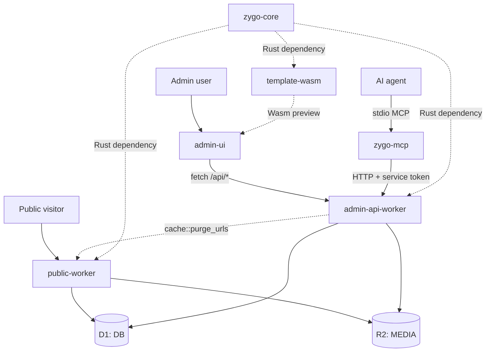

# Zygo CMS Architecture

Zygo CMS is an edge-first CMS built on Cloudflare Workers, D1 (SQLite), R2 object storage, and Rust/Wasm. A deployment consists of three Workers plus a shared Rust library; hostnames, database and bucket names are configured per deployment in each package's `wrangler.toml`.

## Packages

| Package | Role | Bindings (see its `wrangler.toml`) |
| :--- | :--- | :--- |
| `public-worker` | Public server-side rendered site (Rust, MiniJinja) | D1 `DB`, R2 `MEDIA`, static assets from `public/` |
| `admin-api-worker` | Authenticated REST API under `/api/*` | D1 `DB`, R2 `MEDIA` |
| `admin-ui` | Admin SPA (React, Vite, Radix Themes) | Static assets from `dist/` |
| `core` (`zygo-core`) | Shared Rust models, validation, queries | Library, no bindings |
| `template-wasm` | Section template rendering compiled to Wasm for live preview | Library |
| `zygo-mcp` | Node.js MCP server bridging external agents to the admin API | None |
| `create-zygo-app` | CLI scaffolder for new projects | None |

D1 migrations live in `migrations/`.

## Request Flow

1. **Public**: request reaches `public-worker`, which checks the edge cache, reads D1 and R2, and returns rendered HTML.
2. **Admin UI**: the SPA calls `admin-api-worker` through `apiFetch`. The API authenticates the request with Cloudflare Access, writes to D1/R2, then purges affected public URLs from the edge cache.
3. **Agents**: external agents talk to `zygo-mcp` over stdio, which calls the admin API with Cloudflare Access service-token headers. In-browser agents use WebMCP in `admin-ui`.

## Build Pipeline

- Workers: `worker-build --release` compiles each Rust worker to Wasm.
- Admin UI: Vite bundles the SPA into `packages/admin-ui/dist`.
- Root `pnpm run build` runs the API, public worker, and UI builds. See the root `package.json` for exact scripts.
