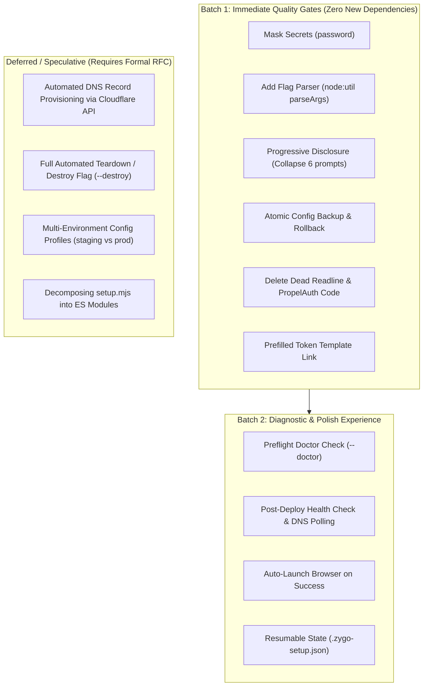

# 4. Setup Script: Architecture, Competitor Analysis, and Opportunities

## Executive Summary

`scripts/setup.mjs` is Zygo CMS's automated provisioning wizard. It bridges local project configuration with Cloudflare's ecosystem: provisioning Cloudflare D1 databases and R2 buckets via Wrangler CLI, generating custom domain routes across three separate `wrangler.toml` files, applying remote SQLite migrations, automating Cloudflare Zero Trust (Access) applications and policies via REST API, configuring Edge WAF/Bot Fight/AI Crawl rules, and triggering end-to-end production builds and deployments.

While the script successfully automates complex Cloudflare REST API operations, this audit reveals critical usability and architectural gaps: an exhaustive ~15-prompt interactive interrogation with zero CLI flag support, unmasked plaintext secrets, lack of preflight validation before mutating files, absence of rollback on failure, vestigial dead code, and an abrupt exit without deployment verification or browser handoff.

By incorporating battle-tested onboarding patterns from modern CLIs (Cloudflare C3, Astro, Ghost CLI, Sanity, Strapi, and Payload), Zygo's onboarding flow can be transformed into an enterprise-grade, resilient CLI experience.

---

## 1. Deep Codebase Audit of `scripts/setup.mjs`

### 1.1 Helper Function Inventory & Capabilities

`scripts/setup.mjs` spans 1,338 lines and is structured into specialized functional areas:

| Helper Function | Lines | Purpose & Mechanism | Limitations & Edge Cases |
| :--- | :--- | :--- | :--- |
| `extractJson(raw)` | 10–42 | Parses JSON from CLI command stdout. Tries raw `JSON.parse`, finds outermost array brackets `[...]`, outermost object braces `{...}`, and parses line-by-line backwards. | Fragile against multi-line mixed stdout/stderr streams from Wrangler; throws generic error without raw text when all heuristics fail. |
| `validateDomain(domain)` | 44–50 | Cleans protocols (`https?://`) and trailing paths; validates format against `/^[a-z0-9]([a-z0-9-]*[a-z0-9])?(\.[a-z0-9]([a-z0-9-]*[a-z0-9])?)+$/`. | Does not check TLD validity or verify whether the domain exists as a Cloudflare zone. |
| `deriveDefaultTeamSlug(domain)` | 52–60 | Extracts apex domain prefix, sanitizes non-alphanumeric characters to hyphens, defaults to `'zygo-cms'`. | Can produce invalid slugs if domain begins with numbers or symbols. |
| `validateEmail(email)` | 62–67 | Regex validation `/^[^\s@]+@[^\s@]+\.[^\s@]+$/`. | Basic format check only. |
| `detectAccountId()` | 69–84 | Executes `npx wrangler whoami --json`, falls back to plaintext regex parsing for a 32-char hex string (`/[│\|]\s*([a-f0-9]{32})\s*[│\|]/i`). | Fails silently and returns `null` if the user is unauthenticated or running in an environment without browser access. |
| `replaceOrInsertRoutes(content, routesStr)` | 88–101 | Replaces `routes = [...]` or legacy `custom_domains = [...]` blocks in TOML; otherwise injects after `compatibility_date`. | Regex-based string replacement instead of a formal TOML parser; vulnerable to commented-out TOML blocks. |
| `ensureWorkersDevFalse(content)` | 103–111 | Enforces `workers_dev = false` in `wrangler.toml` files. | Simple regex match/replace. |
| `updatePublicWrangler(...)` | 113–142 | Injects D1 `database_id` and custom domain routes (`domain` and `${sub}.${domain}`). Strips vestigial `PROPELAUTH_AUTH_URL`. | Hardcodes route structure; mutates file in-place without backup. |
| `updateAdminApiWrangler(...)` | 144–176 | Injects D1 `database_id`, API route (`${sub}.${domain}`), `PUBLIC_SUBDOMAIN`, and strips `PROPELAUTH_AUTH_URL`. | Mutates file in-place without backup. |
| `updateAdminApiAccessVars(aud, teamDomain)` | 178–213 | Injects `CF_ACCESS_AUD` and `CF_ACCESS_TEAM_DOMAIN` under `[vars]` in `packages/admin-api-worker/wrangler.toml`. | Logs warning if team domain changed, but does not validate existing active cookies or sessions. |
| `updateAdminUiWrangler(...)` | 215–229 | Sets `routes = [{ pattern = "admin.<domain>", custom_domain = true }]` in `packages/admin-ui/wrangler.toml`. | Mutates file in-place without backup. |
| `updateAdminUiEnv(domain, apiSub)` | 231–287 | Creates or updates `packages/admin-ui/.env.production` with `VITE_API_BASE_URL=https://<apiSub>.<domain>`. | Parses key-value pairs line by line; creates file if missing. |
| `provisionD1Database()` | 290–327 | Runs `npx wrangler d1 list --json`. If `zygo-cms-db` exists, reuses its UUID. If not, runs `npx wrangler d1 create zygo-cms-db --json` (with regex UUID fallback). | Assumes default database name `zygo-cms-db`. Does not handle multiple accounts with the same DB name. |
| `provisionR2Bucket()` | 329–342 | Runs `npx wrangler r2 bucket create zygo-cms-media`. Catches `already exists` / error `10004` gracefully. | Hardcoded bucket name `zygo-cms-media`. |
| `applyRemoteMigrations()` | 344–357 | Executes `npx wrangler d1 migrations apply zygo-cms-db --remote` with `CI: 'true'`. | Catches failure and warns, but does not halt setup; user may deploy an unmigrated DB. |
| `printManualAccessInstructions(...)` | 359–383 | Formats manual step-by-step instructions for Zero Trust dashboard if automated API calls fail. | Static terminal printout. |
| `createAccessAppAndPolicy(...)` | 385–507 | REST POST to `/accounts/${id}/access/apps`. If CORS headers fail (e.g. error 12130), automatically retries without `cors_headers`. Detects existing apps; detects `not_enabled` and `auth.forbidden` (Error 1010). Creates/reuses `Admin Access Policy`. | Complex error handling; returns `false` or object `{ success, appId, aud }`. |
| `getZeroTrustOrgDomain(...)` | 509–527 | REST GET to `/accounts/${id}/access/organizations`. Returns `auth_domain`. | Swallows network errors silently. |
| `ensureZeroTrustOrganization(...)` | 529–578 | Checks existing organization domain; if none, creates one via POST `/access/organizations`. | Cloudflare accounts frequently block org creation via API if billing or Zero Trust terms are not accepted. |
| `ensureOneTimePinProvider(...)` | 580–627 | Checks identity providers for `type === 'onetimepin'`; if missing, creates it. | High value: eliminates external IdP requirements for new users. |
| `configureGoogleProvider(...)` | 629–675 | Checks and creates Google OAuth IdP via REST API. | Requires pre-created GCP credentials; secrets entered in plaintext. |
| `configureCloudflareAccess(...)` | 677–716 | Orchestrates UI and API Access apps, sets policies, updates `wrangler.toml` vars. | Relies on REST token having high-privilege Access scopes. |
| `getZoneId(...)` | 719–728 | REST GET to `/zones?name=${domain}&account.id=${accountId}`. | Called very late in the wizard; if missing, previous provisioning steps are already committed. |
| `applyZoneSettings(...)` | 730–740 | PATCHes `/zones/${zoneId}/settings` for security level and performance settings. | Swallows errors with console warning. |
| `applyBotFightMode(...)` | 742–752 | PUTs `/zones/${zoneId}/bot_management` with `fight_mode: on/off`. | Free plans support basic Bot Fight Mode; enterprise features fail silently. |
| `applyAiCrawlSettings(...)` | 754–772 | PUTs `/zones/${zoneId}/bot_management` with AI crawl rules (`ai_bots_protection`, `ai_search`, `ai_training`, `ai_user`). | Cutting-edge Cloudflare API; may reject payloads on unsupported plan tiers. |
| `updateAdminApiZoneVar(...)` | 774–788 | Injects `CF_ZONE_ID` into `packages/admin-api-worker/wrangler.toml` under `[vars]`. | Mutates file in-place. |
| `applyCloudflareRedirect(...)` | 790–870 | Queries dynamic redirect ruleset entrypoint; creates or updates 301 redirect rule (e.g. apex -> `www` or `www` -> apex). | Robust Cloudflare Ruleset Engine implementation. |
| `promptInput(...)` & `promptYesNo(...)` | 872–910 | Readline-based input prompts with TTY checks. | **Dead code**. The script migrated to `@clack/prompts` (`text`, `select`, `confirm`), leaving these unused. References non-existent global `input.isTTY`. |
| `main()` | 912–1307 | Clack-driven UI flow; collects ~15 inputs; runs sequential spinner tasks; builds and deploys. | Massive monolithic function; no flag parsing; plaintext secrets; abrupt exit without verification. |

---

### 1.2 Core Deficiencies in the Current Implementation

1. **Interactive Prompt Overload (~15 Prompts, Zero Flags):**
   Every run forces the user through 15 sequential questions: apex domain, public subdomain, apex redirect behavior, admin UI subdomain, admin API subdomain, account ID, API token, admin email, Zero Trust team subdomain, Google OAuth confirmation (and client ID + secret if yes), Bot Fight Mode, AI Crawl policy (and up to 3 sub-questions if custom), WAF security level, Performance & Network multiselect, proceed confirmation, and deployment confirmation. There are no flags (`--yes`, `--domain`, etc.) to bypass this for CI or repeated runs.

2. **No Preflight Verification (`--doctor`):**
   The script does not verify the user's environment before mutating configuration files. It does not check:
   - Toolchain binaries: Node 22, pnpm 11, Rust target `wasm32-unknown-unknown`, `worker-build`.
   - Token scopes: Whether the token actually has `D1:Edit`, `R2:Edit`, `Access:Apps:Edit`, `Zone:Settings:Edit`, `Zone:Cache Purge:Purge`.
   - Cloudflare Zone: Whether the specified apex domain actually exists as an active zone on the specified Cloudflare account (`getZoneId` is only invoked in Step 5 after D1, R2, and Access have already been provisioned).

3. **Plaintext Secret Exposure:**
   Both the Cloudflare API Token and the Google Client Secret are collected using `@clack/prompts` `text()`, which echoes secret credentials directly to the terminal stdout in clear text.

4. **Destructive Partial Failures (No Backup / Atomic Rollback):**
   Files (`packages/*/wrangler.toml`, `packages/admin-ui/.env.production`) are edited in-place with regexes. If `provisionD1Database()`, `configureCloudflareAccess()`, or `applyRemoteMigrations()` fails halfway through, the script calls `process.exit(1)`, leaving corrupted or partially modified configuration files on disk with no undo or cleanup mechanism.

5. **Post-Setup Silence & Manual DNS / Health Checking:**
   After building and deploying three Workers, the script prints static text URLs and exits. It does not verify that DNS resolves, does not test HTTP status codes (200 for public, 302 for admin), and does not offer to open the browser for initial admin login.

6. **Dead Code and Outdated References:**
   - Lines 872–910 contain dead `readline` functions (`promptInput`, `promptYesNo`) that reference an undeclared `input` variable.
   - Lines 139 and 164 contain regex replacements stripping `PROPELAUTH_AUTH_URL`, an obsolete auth provider completely removed from the project.

---

## 2. Competitive Landscape & Framework Benchmarking

### 2.1 Competitor Benchmarking Matrix

| Feature / Capability | Zygo CMS (`setup.mjs`) | Cloudflare C3 (`create-cloudflare`) | Astro (`create-astro`) | Strapi (`create-strapi-app`) | Ghost CLI (`ghost setup`) | Sanity (`sanity init`) | Payload (`create-payload-app`) |
| :--- | :--- | :--- | :--- | :--- | :--- | :--- | :--- |
| **Non-Interactive Bypass** | ❌ None | ✅ `--type`, `--framework`, `--ts` | ✅ `--yes` / `-y` | ✅ `--quickstart`, `--dbclient` | ✅ `--no-prompt` | ✅ `-y` | ✅ `-n`, `-t`, `--db` |
| **Preflight / Doctor Check** | ❌ None | ⚠️ Basic whoami | ⚠️ Node engine check | ⚠️ Node engine check | ✅ `ghost doctor` (ports, memory, stack) | ⚠️ Token check | ⚠️ DB connection check |
| **Secret Masking** | ❌ Plaintext | ⚠️ Browser OAuth | N/A (no secrets) | ⚠️ Plaintext or env | ✅ Masked password prompt | ✅ Browser OAuth handoff | ⚠️ Env file setup |
| **Scoped / Prefilled Auth** | ❌ Manual token creation | ✅ Browser OAuth (`wrangler login`) | N/A | N/A | N/A | ✅ Browser login + callback | N/A |
| **Separated Deploy Step** | ⚠️ Prompted at end | ✅ `--deploy` / `--no-deploy` | N/A | N/A | ⚠️ Subcommand based | N/A | N/A |
| **Failure Rollback** | ❌ None (`process.exit(1)`) | ✅ Cleans scaffold directory | ✅ Cleans directory | ✅ Cleans directory | ✅ Systemd/SSL rollback | ✅ Clean exit | ✅ Cleans directory |
| **Post-Setup Health Check** | ❌ None (prints text) | ⚠️ Prints live worker URL | ✅ Prints dev command | ✅ Auto-opens browser | ✅ Systemd & curl status check | ✅ Auto-opens studio | ✅ Prints dev command |
| **Progressive Disclosure** | ❌ Interrogates all 15 settings | ✅ Smart defaults, minimal prompts | ✅ 3 core questions only | ✅ Single `--quickstart` question | ✅ Subcommand targets | ✅ Default project templates | ✅ Default SQLite option |

---

### 2.2 Best-in-Class Patterns to Adopt

#### 1. Ghost CLI (`ghost doctor` & Stage Targeting)
- **Pattern:** `ghost doctor` inspects Node version, file permissions, port availability, MySQL connectivity, and process manager before executing any mutation. Additionally, `ghost setup` allows targeting or skipping specific stages (e.g. `ghost setup --no-setup-ssl` or `ghost setup nginx`).
- **Zygo Adoption:** Implement a standalone `--doctor` flag and preflight check that runs prior to any D1/R2/TOML provisioning. Allow targeted setup execution (e.g. `pnpm run setup --skip-access` or `--only-dns`).

#### 2. Astro CLI (`create-astro` Simplicity & `--yes` Mode)
- **Pattern:** Astro limits interactive onboarding to 3 core choices: directory, template, and TypeScript. All questions can be bypassed using `--yes` (`-y`) to accept defaults, and `--dry-run` allows inspecting generated actions without disk writes.
- **Zygo Adoption:** Move secondary zone settings (Bot Fight Mode, AI Crawl policies, WAF level, Performance optimizations) behind a single prompt: `"Configure advanced Cloudflare Edge & AI crawl settings? (y/N)"`. Provide `--yes` to accept recommended defaults immediately.

#### 3. Cloudflare C3 (`create-cloudflare` Deployment Control)
- **Pattern:** C3 explicitly decouples project configuration from deployment using `--deploy` and `--no-deploy`. It leverages Wrangler's browser-based OAuth (`wrangler login`) to avoid forcing users to manually generate complex API tokens with 8 distinct scopes.
- **Zygo Adoption:** Support `--no-deploy` for users who only want to configure local settings or run in CI/CD. When API tokens are missing, provide a single-click URL with prefilled permission templates.

#### 4. Sanity Studio (`sanity init` Browser Authentication & Callback)
- **Pattern:** When unauthenticated, Sanity opens the browser to authenticate with Google/GitHub/SSO, captures the token via a temporary localhost callback listener, and securely stores it without terminal exposure.
- **Zygo Adoption:** Use `@clack/prompts` `password()` for tokens and Google secrets to prevent plaintext terminal leakage.

---

## 3. Ranked Opportunities Matrix (Value vs. Effort)

| Rank | Opportunity | Value | Effort | Target Helper / Area in `scripts/setup.mjs` |
| :--- | :--- | :--- | :--- | :--- |
| **1** | **Read-Only Preflight (`--doctor`)** | **High** | **Low** | New helper `runPreflightChecks()`; run at top of `main()` |
| **2** | **CLI Flag Support & Non-Interactive Mode** | **High** | **Low** | Parse `process.argv` with `node:util` `parseArgs` (`--yes`, `--domain`, etc.) |
| **3** | **Progressive Disclosure for Edge/WAF Settings** | **High** | **Low** | `main()` lines 1074–1184: collapse into one "Advanced settings?" confirm |
| **4** | **Mask Sensitive Secret Inputs** | **High** | **Low** | Replace `text()` with `password()` from `@clack/prompts` |
| **5** | **Post-Setup Health Check & Edge Diagnostics** | **High** | **Low** | New helper `verifyDeployment()`; poll endpoints after deploy |
| **6** | **Prefilled Cloudflare Token Template URL** | **Med** | **Low** | In `main()` when token prompt appears, print prefilled Cloudflare URL |
| **7** | **Configuration Snapshots & Atomic Rollback** | **Med** | **Low** | Helper `backupConfigs()` and `rollbackConfigs()` around provisioning block |
| **8** | **Auto-Launch Browser on Setup Complete** | **Med** | **Low** | Cross-platform browser opener (`open`, `xdg-open`, `start`) |
| **9** | **Dead Code & Legacy Sanitization Removal** | **Low** | **Low** | Delete lines 872–910 (`promptInput`, `promptYesNo`) and `PROPELAUTH` regexes |
| **10** | **Resumable State via `.zygo-setup.json`** | **Med** | **Med** | Persist step progress to gitignored state file |

---

## 4. Helper-Level Implementation Recipes

### 4.1 Opportunity 1: Preflight Diagnostic Engine (`runPreflightChecks`)
- **Problem:** Users run `setup.mjs` with missing CLI tools, wrong Node versions, or invalid Cloudflare API tokens. The script fails halfway through, leaving dirty state.
- **Implementation:**
  ```javascript
  async function runPreflightChecks(config, { isDoctorMode = false } = {}) {
    const checks = [];
    
    // 1. Toolchain verification
    const nodeMajor = parseInt(process.versions.node.split('.')[0], 10);
    checks.push({ name: 'Node.js LTS (v22+)', ok: nodeMajor >= 22, detail: `Found v${process.version}` });

    try {
      execSync('worker-build --version', { stdio: 'ignore' });
      checks.push({ name: 'worker-build installed', ok: true });
    } catch {
      checks.push({ name: 'worker-build installed', ok: false, fix: 'cargo install worker-build' });
    }

    try {
      const targets = execSync('rustup target list --installed').toString();
      const hasWasm = targets.includes('wasm32-unknown-unknown');
      checks.push({ name: 'Rust wasm32 target', ok: hasWasm, fix: 'rustup target add wasm32-unknown-unknown' });
    } catch {
      checks.push({ name: 'Rust toolchain', ok: false, fix: 'Install rustup' });
    }

    // 2. Cloudflare Zone & Token verification
    if (config.apiToken && config.domain) {
      const zoneId = await getZoneId(config.accountId, config.apiToken, config.domain);
      checks.push({ 
        name: `Cloudflare Zone (${config.domain})`, 
        ok: Boolean(zoneId), 
        detail: zoneId ? `Zone ID: ${zoneId}` : 'Zone not found in account' 
      });
    }

    return checks;
  }
  ```

---

### 4.2 Opportunity 2: Non-Interactive CLI Flag Parsing
- **Problem:** CI/CD pipelines and automated deployments cannot run `pnpm run setup`.
- **Implementation:**
  Use Node's built-in `node:util` `parseArgs` (zero dependencies):
  ```javascript
  import { parseArgs } from 'node:util';

  const { values: flags } = parseArgs({
    options: {
      yes: { type: 'boolean', short: 'y', default: false },
      domain: { type: 'string' },
      email: { type: 'string' },
      'account-id': { type: 'string' },
      token: { type: 'string' },
      'no-deploy': { type: 'boolean', default: false },
      'dry-run': { type: 'boolean', default: false },
      doctor: { type: 'boolean', default: false }
    },
    strict: false
  });
  ```
  If `flags.yes` is provided with `flags.domain` and `flags.email`, populate `config` with recommended defaults, skip all interactive prompts, and proceed straight to execution.

---

### 4.3 Opportunity 3: Progressive Disclosure for Edge/WAF Prompts
- **Problem:** Lines 1074–1184 force users to configure Bot Fight Mode, 4 different AI Crawl policies, 5 WAF security levels, and 6 network performance options.
- **Implementation:**
  Replace the 6 sequential prompts with sensible defaults and a single opt-in prompt:
  ```javascript
  // Default values
  config.botFightMode = true;
  config.securityLevel = 'medium';
  config.cfSettings = ['always_use_https', 'http3', 'ipv6', 'tiered_cache', 'brotli', 'early_hints'];
  config.aiCrawlSettings = { aiBotsProtection: 'block', aiSearch: 'block', aiTraining: 'block', aiUser: 'block' };

  if (!flags.yes) {
    const customizeEdge = await confirm({
      message: 'Configure advanced Cloudflare Edge & AI Crawl settings? (Recommended defaults are already selected)',
      initialValue: false
    });
    if (customizeEdge) {
      // Show Bot Fight, AI Crawl, WAF, and Perf options here...
    }
  }
  ```

---

### 4.4 Opportunity 4: Secret Masking for Tokens & Passwords
- **Problem:** `text()` in lines 1010 and 1067 displays the Cloudflare API Token and Google Client Secret on screen in clear text.
- **Implementation:**
  Import `password` from `@clack/prompts`:
  ```javascript
  import { password } from '@clack/prompts';

  const tokenAns = await password({
    message: 'Cloudflare API Token',
    mask: '•',
    validate(value) {
      if (!value || !value.trim()) return 'API Token is required';
    }
  });
  ```

---

### 4.5 Opportunity 5: Prefilled Cloudflare Token Template URL
- **Problem:** Users must manually select 8 different permissions in the Cloudflare dashboard. If one is missing (like `Access: Apps: Edit`), setup fails with Error 1010.
- **Implementation:**
  Print a direct link that opens Cloudflare's token creation interface with required scopes pre-highlighted:
  ```javascript
  const TOKEN_URL = 'https://dash.cloudflare.com/profile/api-tokens?permissionGroupKeys=' +
    encodeURIComponent(JSON.stringify([
      'd1_edit', 'r2_edit', 'access_edit', 'zone_settings_edit', 'dns_edit', 'cache_purge'
    ]));
  console.log(pc.cyan(`\n🔑 Need an API token? Create one with the required permissions here:\n${TOKEN_URL}\n`));
  ```

---

### 4.6 Opportunity 6: Post-Setup Health Check & Edge Diagnostics
- **Problem:** After deploy, `setup.mjs` exits immediately. If DNS is not pointed or SSL is pending, the user encounters a broken site with no explanation.
- **Implementation:**
  Add a post-deployment verification helper:
  ```javascript
  async function verifyDeployment(config) {
    const urls = [
      { name: 'Public Site', url: `https://${config.domain}`, expectedStatus: [200, 301] },
      { name: 'Admin UI', url: `https://${config.adminUiSubdomain}.${config.domain}`, expectedStatus: [302, 200] },
      { name: 'Admin API', url: `https://${config.adminApiSubdomain}.${config.domain}/api/me`, expectedStatus: [302, 401, 200] }
    ];

    console.log(pc.cyan('\n🔍 Verifying deployment and edge routes...'));
    for (const target of urls) {
      try {
        const res = await fetch(target.url, { method: 'HEAD', redirect: 'manual' });
        if (target.expectedStatus.includes(res.status)) {
          console.log(pc.green(`  ✓ ${target.name} (${target.url}) responded with ${res.status}`));
        } else {
          console.warn(pc.yellow(`  ⚠️ ${target.name} (${target.url}) returned unexpected status ${res.status}`));
        }
      } catch (err) {
        console.warn(pc.yellow(`  ⚠️ ${target.name} (${target.url}) could not be reached (DNS propagation may take 1-2 minutes)`));
      }
    }
  }
  ```

---

### 4.7 Opportunity 7: Configuration Snapshots & Atomic Rollback
- **Problem:** If provisioning crashes midway, `wrangler.toml` files are left half-edited with broken route patterns.
- **Implementation:**
  ```javascript
  function backupConfigs() {
    const files = [
      'packages/public-worker/wrangler.toml',
      'packages/admin-api-worker/wrangler.toml',
      'packages/admin-ui/wrangler.toml',
      'packages/admin-ui/.env.production'
    ];
    const backups = new Map();
    for (const rel of files) {
      const full = path.resolve(ROOT_DIR, rel);
      if (fs.existsSync(full)) {
        backups.set(full, fs.readFileSync(full, 'utf8'));
      }
    }
    return {
      rollback() {
        for (const [filePath, content] of backups) {
          fs.writeFileSync(filePath, content, 'utf8');
        }
        console.log(pc.yellow('✓ Restored configuration files to original state.'));
      }
    };
  }
  ```

---

### 4.8 Opportunity 8: Cross-Platform Browser Launch
- **Problem:** The user has to manually copy and paste the Admin UI URL into their browser.
- **Implementation:**
  ```javascript
  function openBrowser(url) {
    try {
      const start = process.platform === 'darwin' ? 'open' :
                    process.platform === 'win32' ? 'start' : 'xdg-open';
      execSync(`${start} "${url}"`, { stdio: 'ignore' });
    } catch (_) { }
  }
  ```

---

### 4.9 Opportunity 9: Dead Code & Legacy Sanitization Removal
- **Problem:**
  - Lines 872–910 contain unused `readline` prompts (`promptInput` and `promptYesNo`) that crash if ever called due to undeclared `input` variables.
  - Lines 139 and 164 contain `content.replace(/^[ \t]*PROPELAUTH_AUTH_URL[ \t]*=.*\r?\n?/gm, '')`, which is obsolete since PropelAuth was removed in favor of Cloudflare Access.
- **Action:** Delete `promptInput`, `promptYesNo`, and `PROPELAUTH_AUTH_URL` regex cleanups.

---

## 5. Execution Phasing & Scoping



### Initial Fix Batch (Recommended for immediate implementation)
1. **Mask secrets:** Switch token and Google secret prompts to `@clack/prompts` `password()`.
2. **Add CLI flag support:** Support `--yes`, `--domain`, `--email`, `--no-deploy`, `--dry-run` via `node:util` `parseArgs`.
3. **Progressive disclosure:** Group Bot Fight Mode, AI Crawl Control, WAF Level, and Performance optimizations under a single opt-in prompt with production defaults.
4. **Config backup & rollback:** Snapshot `wrangler.toml` files in memory before mutation; restore if provisioning throws an unhandled error.
5. **Delete dead code:** Clean up `promptInput`, `promptYesNo`, and `PROPELAUTH` artifacts.
6. **Prefilled token link:** Output direct dashboard URL with required scopes pre-selected.

### Secondary Polish Batch
1. **Preflight doctor (`--doctor`):** Verify Node 22, pnpm 11, `worker-build`, `wasm32` target, and Cloudflare zone presence before execution.
2. **Post-setup verification:** Head-check the 3 URLs and report exact HTTP status codes.
3. **Auto-open browser:** Launch default browser directly to the Admin UI login page upon successful deploy.
4. **Resumable state:** Write non-secret state to `.zygo-setup.json` so interrupted setups resume where they left off.

### Speculative Features (Explicitly Deferred)
- **Automated DNS record creation:** Auto-creating apex/subdomain DNS records via Cloudflare API can overwrite existing user configurations or break active email/web services on the zone. Must remain manual or require explicit opt-in.
- **Teardown / `--destroy` command:** Destructive resource deletion (dropping D1 databases, deleting R2 buckets with data) presents high catastrophic risk; requires dedicated confirmation barriers and separate review.
- **Multi-environment profiles / Terraform:** Out of scope for new-user onboarding; addresses advanced DevOps rather than zero-to-one setup.
- **Modular script split:** Refactoring `scripts/setup.mjs` into multiple files is an internal architectural cleanup that provides zero user-facing value and risks breaking package scripts unless thoroughly tested.
