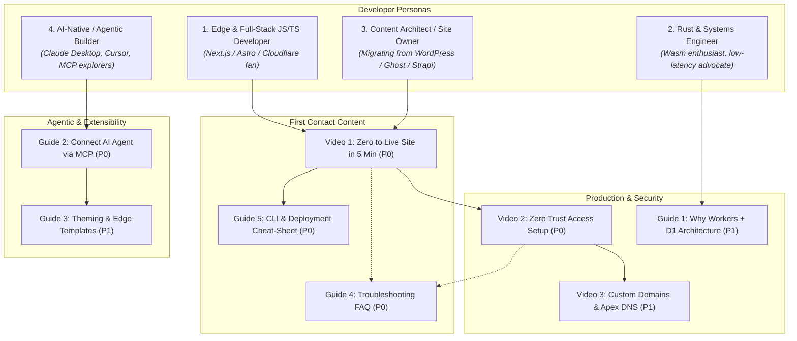
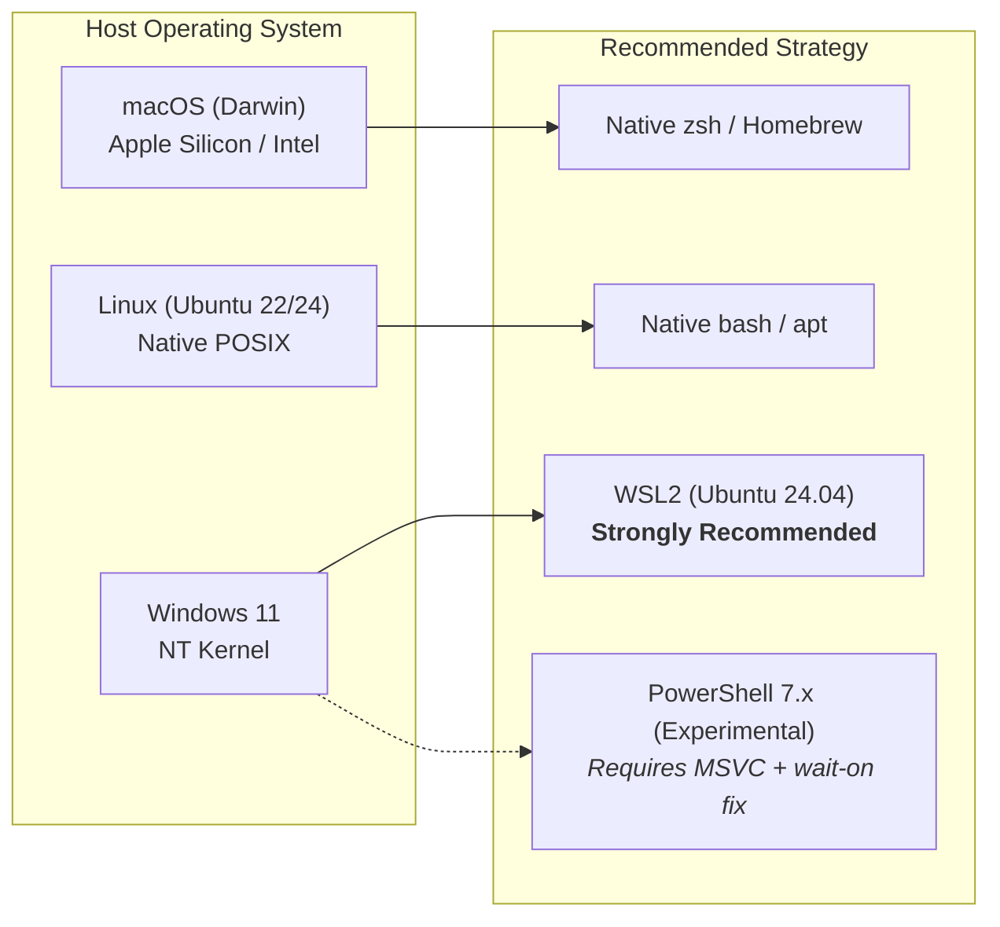

# 5. New-User Onboarding & Content Strategy Plan

## Executive Summary

Zygo CMS sits at an ambitious intersection: high-performance **Rust + Wasm SSR**, distributed edge database storage (**Cloudflare D1**), blob storage (**R2**), and modern Zero Trust authentication (**Cloudflare Access**), coupled with a **React 19 Admin UI** and deep **Model Context Protocol (MCP)** agentic integration. 

However, as uncovered in the setup audit series ([1-docs.md](1-docs.md), [2-script-ux.md](2-script-ux.md), [3-script-accuracy.md](3-script-accuracy.md), and [4-opportunities.md](4-opportunities.md)), new users encounter steep friction immediately upon arrival:
- **Mental Model Mismatch:** Quickstarts describe a mythical email/password signup screen that does not exist; local dev relies on an undocumented `ENVIRONMENT=dev` mock bypass on `:5173` (not `:8788`).
- **Toolchain Shock:** Users unfamiliar with Rust Wasm compilation are blindsided by multi-minute initial builds requiring `worker-build`, `wasm32-unknown-unknown`, and platform C-linkers.
- **Cloudflare Zero Trust Jargon:** New developers stumble over terminology (AUD tags, Team Domains, IdPs, Service Tokens, Zone vs Account scopes) and assume Zero Trust requires expensive enterprise contracts when it is free for 50 seats.
- **Cross-Platform Gotchas:** Windows 11 users hitting POSIX shell scripts (`sleep 3 && ...`) and path resolution bugs face immediate silent crashes unless guided into WSL2.

This document establishes a **content and education plan** to bridge these gaps. It defines a strategic library of **high-leverage video tutorials**, **in-depth architectural and procedural written guides**, a **cross-platform OS operational matrix**, and **complete scene-by-scene production scripts** for the two most critical onboarding videos.

---

## 1. Content Strategy & Audience Personas

To maximize conversion from "curious GitHub stargazer" to "production deployment with active AI content workflows," all onboarding content is targeted across four core developer personas:



### 1.1 Target Personas

1. **The Edge & Full-Stack Developer:** Familiar with Vite, React, npm/pnpm, and Wrangler. Wants a modern headless/coupled CMS without managing Docker containers, VPCs, or database connection pooling. Prioritizes instant setup, clean APIs, and rapid live deployment.
2. **The Rust & Systems Engineer:** Drawn by Zygo's memory safety, Minijinja SSR rendering, zero cold starts, and deterministic performance on V8 isolates. Cares about compilation targets, worker bundle sizes, test harnesses, and SQLite D1 query efficiency.
3. **The Content Architect / Technical Publisher:** Seeking an alternative to heavyweight WordPress, Ghost, or costly SaaS headless platforms (Sanity, Contentful). Needs custom domains, clean SEO markup, responsive themes, media uploads to R2, and zero monthly server maintenance.
4. **The AI-Native Developer & Agentic Workflow Builder:** Wants to edit blog posts, generate section templates, and manage content programmatically via Anthropic Claude Desktop, Cursor, or ChatGPT using the Model Context Protocol (MCP).

---

## 2. Core Content Portfolio & Prioritization Matrix

The table below outlines the 8 proposed core content assets, detailing target audience, format, estimated word count or video runtime, key talking points, specific audit issues addressed, priority level, and OS platform scope.

| Item | Title | Format | Length | Target Persona | Friction / Bug Addressed (Cross-Ref) | Priority | Platform Variants |
| :--- | :--- | :--- | :--- | :--- | :--- | :--- | :--- |
| **V1** | **Zero to Live Site in 5 Minutes** | Video (Loom/YouTube) | 5:00 min | All personas | 1-docs #1, #2, #3, #10; 2-script #1, #5; 3-script B1, B2 | **P0** | macOS / Ubuntu / Windows (WSL2) |
| **V2** | **Cloudflare Access & Zero Trust Setup (Free Tier)** | Video (Loom/YouTube) | 5:30 min | Edge Devs, Site Owners | 1-docs #6, #7, #15; 2-script #4, #10; 3-script B3, B4; §4 scopes | **P0** | Universal Web Dashboard |
| **V3** | **Custom Domain, Apex Routing, & Cloudflare DNS** | Video (Loom/YouTube) | 4:30 min | Site Owners, DevOps | 1-docs #4, #5, #20, #23; 2-script #10, #14; 3-script B8 | **P1** | macOS / Linux / Win (`dig` vs `Resolve-DnsName`) |
| **G1** | **Why Cloudflare Workers + D1: The Architecture Behind Zygo** | Deep-Dive Blog Post | ~1,800 w | Systems Eng, Edge Devs | 1-docs #8, #9, #16, #27, #31, #34; Architecture clarity | **P1** | Platform Agnostic |
| **G2** | **Connect an AI Agent via MCP: Editing with Claude & Cursor** | Hands-On Tutorial | ~2,200 w | AI Builders, Developers | 1-docs #30; WebMCP vs CLI MCP bridge; Service Tokens | **P0** | macOS, Linux, Windows |
| **G3** | **Theming & Custom Templates: From HTML to Live Edge Rendering** | Technical Guide | ~2,000 w | Designers, Frontend Devs | 1-docs #28, #29, #32, #33, #35; Minijinja vs Askama | **P1** | Platform Agnostic |
| **G4** | **New-User Troubleshooting FAQ (Error Codes, JWT Loops, D1)** | Living Reference Guide | ~3,200 w | All personas | 1-docs #18; 2-script #8; 3-script B1–B13; Common edge failures | **P0** | macOS, Ubuntu, Windows 11 |
| **G5** | **Zygo CMS CLI & Deployment Cheat-Sheet** | Quick-Reference Card / Gist | ~1,500 w | Developers, Operators | 1-docs #6, #11, #13, #17, #26; 2-script #1; 4-opps flags | **P0** | Shell commands across Bash/Zsh/PowerShell |

---

## 3. High-Leverage Video Proposals

### Video 1: "Zero to Live Site in 5 Minutes"
- **Target Audience:** All new users, evaluation engineers, and prospective site owners.
- **Format:** High-energy, crisp technical screencast with split-screen webcam, clear keystroke visualization, and terminal zoom-ins.
- **Length:** 5 minutes (strict ceiling).
- **Core Talking Points:**
  1. Prerequisites check (Node 22, pnpm 11, Rust target, `worker-build`).
  2. Quick local development demo (`pnpm run dev`) explaining local mock auth (`admin@localhost`) on `:5173`.
  3. Running `pnpm run setup` with Cloudflare credentials.
  4. Automatic provisioning of D1 database, R2 bucket, and remote migrations.
  5. One-click deploy of the 3 workers (public SSR, admin REST API, admin React SPA).
  6. First live visit to the public edge site and admin login via Cloudflare Access One-Time PIN.
- **Friction Addressed:**
  - 1-docs #1 (clarifies no password signup; explains local mock auth vs production Access).
  - 1-docs #2 (uses correct migration flags with `.wrangler/state`).
  - 1-docs #3 (sets expectations on initial Rust build duration).
  - 2-script #1 (stresses `pnpm run setup`, avoiding `pnpm setup` collision).
  - 3-script B1 (ensures migrations target the user's D1 UUID).
- **Priority:** **P0** (The primary conversion asset).

---

### Video 2: "Cloudflare Access & Zero Trust Setup: Zero to Secure Admin in 5 Minutes"
- **Target Audience:** Site owners, security engineers, developers deploying to custom domains.
- **Format:** Step-by-step browser walkthrough of the Cloudflare Zero Trust dashboard synchronized with `setup.mjs`.
- **Length:** 5:30 minutes.
- **Core Talking Points:**
  1. Demystifying Zero Trust: 50 seats free forever, zero passwords to leak or hash.
  2. Navigating Cloudflare Zero Trust: Account setup, adding a team name (`<team>.cloudflareaccess.com`).
  3. Configuring Identity Providers: One-Time PIN (OTP) (zero external configuration) and Google OAuth (Client ID + Secret + authorized callback URI).
  4. Creating Access Applications for `admin.<domain>` and `api.<domain>`.
  5. Understanding the `CF_ACCESS_AUD` (Audience Tag) and `CF_ACCESS_TEAM_DOMAIN` variables.
  6. Service Tokens: How to mint client ID/secret pairs for headless APIs and automated CI/MCP agents.
  7. Verification: Testing the login flow, inspecting the `Cf-Access-Jwt-Assertion` header, and avoiding redirect loops.
- **Friction Addressed:**
  - 1-docs #6, #7, #15 (resolves token scope confusion, demystifies AUD tag, explains Zero Trust free billing setup).
  - 2-script #4, #10 (addresses secret entry and Google OAuth callback URI registration).
  - 3-script B3, B4 (explains why an empty `CF_ACCESS_AUD` is a severe security hole and how to verify it is populated).
- **Priority:** **P0** (Eliminates the #1 roadblock preventing users from completing production deployment).

---

### Video 3: "Custom Domain, Apex Routing, & Cloudflare DNS"
- **Target Audience:** Production deployers, domain administrators.
- **Format:** Visual DNS architecture diagrams combined with Cloudflare DNS management console and terminal verification.
- **Length:** 4:30 minutes.
- **Core Talking Points:**
  1. Zygo's Three-Worker Architecture: Public Worker (`example.com`), Admin UI (`admin.example.com`), Admin API (`api.example.com`).
  2. Apex vs. `www`: Configuring Dynamic Redirect Rulesets (301 redirecting `www.example.com` to `example.com` or vice-versa).
  3. Custom Domain Routes in Workers: How Cloudflare Workers routes bind directly to DNS zones without origin servers.
  4. Avoiding DNS Conflict Errors: Dealing with existing A/AAAA/CNAME records on apex or subdomains.
  5. Cross-platform DNS and SSL verification: Using `dig`, `Resolve-DnsName`, and checking Cloudflare SSL/TLS edge certificate issuance.
  6. CORS across subdomains: Explaining how `ADMIN_SUBDOMAIN` and `PUBLIC_SUBDOMAIN` interact.
- **Friction Addressed:**
  - 1-docs #5, #20, #23 (resolves conflict between manual DNS edits and setup script; adds Windows DNS verification).
  - 3-script B8 (explains custom subdomain CORS constraints).
- **Priority:** **P1**.

---

## 4. Written Guides & Blog Posts Proposals

### Guide 1: "Why Cloudflare Workers + D1: The Architecture Behind Zygo CMS"
- **Target Audience:** Systems architects, Rust developers, tech leads evaluating CMS infrastructure.
- **Format:** In-depth technical blog post with high-resolution Mermaid architecture diagrams, benchmarks, and code snippets.
- **Word Count:** ~1,800 words.
- **Outline & Key Sections:**
  1. **The Modern CMS Dilemma:** Why traditional WordPress/Node.js CMS stacks suffer from container cold starts, database connection exhaustion, memory bloat, and server patching overhead.
  2. **The 3-Worker Topology:**
     - `public-worker`: Rust + Minijinja edge SSR with Cloudflare D1 local read cache, generating HTML in under 15ms globally.
     - `admin-api-worker`: Rust REST API validating Cloudflare Access JWTs, querying D1 SQLite, and streaming media directly to/from R2.
     - `admin-ui`: Static React 19 SPA served via Cloudflare Workers assets.
  3. **Data Layer at the Edge:** Cloudflare D1 (distributed serverless SQLite) and Cloudflare R2 (S3-compatible zero-egress blob storage).
  4. **Cost Analysis Breakdown:** Concrete monthly cost modeling (Workers Free vs Workers Paid \$5/mo for Rust Wasm bundle limits; D1/R2 free tier thresholds).
  5. **Security Without Passwords:** Delegating identity entirely to Cloudflare Access at the edge network layer.
- **Friction Addressed:**
  - 1-docs #8, #9, #16, #27, #31, #34 (corrects 2-worker vs 3-worker misconceptions, Askama vs Minijinja, schema diagrams, and realistic cost modeling).
- **Priority:** **P1**.

---

### Guide 2: "Connect an AI Agent via MCP: Editing Content with Claude, Cursor, and ChatGPT"
- **Target Audience:** AI enthusiasts, content operations teams, modern developers using agentic tools.
- **Format:** Practical hands-on tutorial with interactive configuration blocks for Claude Desktop and Cursor.
- **Word Count:** ~2,200 words.
- **Outline & Key Sections:**
  1. **What is Model Context Protocol (MCP) in Zygo?** Explaining how AI agents can read, create, update, and publish CMS content natively without scraping or fragile web automations.
  2. **Dual-Bridge Architecture:**
     - **In-Browser WebMCP (`window.webmcp`):** Real-time agent assistance while editing directly inside the Admin UI.
     - **CLI MCP Bridge (`packages/zygo-mcp/index.mjs`):** Standalone stdio MCP server for Claude Desktop, Cursor, or CLI scripts.
  3. **Configuring Claude Desktop:** Step-by-step setup of `claude_desktop_config.json`:
     - Local dev connection.
     - Production connection via Cloudflare Access Service Tokens (`CF-Access-Client-Id` and `CF-Access-Client-Secret`).
  4. **Configuring Cursor (`.cursor/mcp.json`):** Enabling in-editor content drafting and documentation updates.
  5. **Real-World Agentic Workflows:**
     - Prompt: *"Audit all published posts and generate a draft summary post for Q3."*
     - Prompt: *"Create a new Section Template for a 3-tier pricing card with customizable CTA buttons."*
  6. **Security & Rate-Limiting:** Protecting D1 database writes against runaway agent loops.
- **Friction Addressed:**
  - 1-docs #30 (documents proper headless API authentication using Service Tokens instead of broken unauthenticated endpoints).
  - AGENTS.md §4 (satisfies the mandatory MCP Parity Gate requirement).
- **Priority:** **P0** (A major competitive differentiator for Zygo CMS).

---

### Guide 3: "Theming & Custom Templates: From HTML to Live Edge Rendering"
- **Target Audience:** Web designers, frontend developers, agencies building custom sites.
- **Format:** Step-by-step tutorial with code sandboxes, CSS token tables, and live editor walkthroughs.
- **Word Count:** ~2,000 words.
- **Outline & Key Sections:**
  1. **How Zygo Renders the Web:** Edge SSR using Minijinja templates with dynamic live overrides stored in D1.
  2. **The Theme Editor (`/theme`):**
     - Global CSS Design Tokens: Primary/accent palettes, typography presets, border radii.
     - Dark mode and `color-mix()` adaptability.
  3. **Section Templates (`/templates`):**
     - Creating modular block components (Hero, Feature Grid, Testimonials, FAQ accordion).
     - Defining the `schema_json` for dynamic admin inputs (text, richtext, image URL, select).
     - Writing Minijinja `template_html` and scoped `template_css`.
  4. **Layout Templates:** Header, Footer, and Global Wrapper customization.
  5. **Live Preview & Cache Invalidation:** How the Public Worker clears the edge cache instantly when templates are updated.
- **Friction Addressed:**
  - 1-docs #28, #29, #32, #33, #35 (replaces the erroneous "edit `src/views.rs` and recompile Rust" instructions with real Admin UI `/theme` and `/templates` workflows; removes Askama references).
- **Priority:** **P1**.

---

### Guide 4: "New-User Troubleshooting FAQ (Error Codes, JWT Loops, D1 Issues)"
- **Target Audience:** All users experiencing onboarding or operational errors.
- **Format:** Searchable problem-solution reference guide indexed by exact error messages and symptoms.
- **Word Count:** ~3,200 words.
- **Key Error Categories & Solutions:**
  1. **Local Development Issues:**
     - Symptom: *"Database error: no such table: entries"*. Fix: Run `pnpm run db:migrate:local` (ensures `--persist-to=./.wrangler/state`).
     - Symptom: *"Login button redirects to 404 or asks for password"*. Fix: Access `:5173`, verify `ENVIRONMENT=dev` in `.dev.vars`.
     - Symptom: *"Port 8787 or 5173 already in use"*. Fix: `lsof -ti:8787 | xargs kill -9` (or Windows `netstat -ano`).
  2. **Wrangler & Toolchain Compilation:**
     - Symptom: `error: linker 'cc' not found` (Linux) or `link.exe not found` (Windows). Fix: Install `build-essential` or MSVC Build Tools.
     - Symptom: `target 'wasm32-unknown-unknown' not found`. Fix: `rustup target add wasm32-unknown-unknown`.
     - Symptom: `command not found: worker-build`. Fix: `cargo install worker-build` and add `~/.cargo/bin` to PATH.
  3. **Setup Wizard & API Failures:**
     - Symptom: `Cloudflare API Error 1010 (Forbidden)`. Fix: API token lacks required Access or Zone scopes; provide explicit permissions table.
     - Symptom: `Silent exit on Windows` (`pnpm run setup`). Fix: Bug B2 path handling or switch to WSL2.
     - Symptom: `Command failed: npx wrangler d1 migrations apply zygo-cms-db --remote`. Fix: Root `wrangler.toml` author UUID conflict (Bug B1); pass explicit config flag `-c packages/admin-api-worker/wrangler.toml`.
  4. **Cloudflare Access & Authentication:**
     - Symptom: Infinite redirect loop between `admin.<domain>` and `<team>.cloudflareaccess.com`. Fix: Check `CF_ACCESS_TEAM_DOMAIN` match in `wrangler.toml`.
     - Symptom: HTTP 401 Unauthorized on `/api/me`. Fix: Missing `CF_ACCESS_AUD` or mismatched Access Application audience tag.
     - Symptom: Admin UI fails with CORS error when calling API. Fix: Custom API subdomain not matched in `lib.rs` / `ADMIN_SUBDOMAIN`.
- **Friction Addressed:**
  - 1-docs #2, #18; 2-script #8; 3-script B1, B2, B3, B4, B8.
- **Priority:** **P0** (Essential self-service rescue document).

---

### Guide 5: "Zygo CMS CLI & Deployment Cheat-Sheet"
- **Target Audience:** Developers, sysadmins, DevOps engineers.
- **Format:** Compact, printable Markdown reference card and GitHub Gist.
- **Word Count:** ~1,500 words.
- **Core Content Sections:**
  1. **Essential Scripts Reference:** `pnpm run dev`, `pnpm run setup`, `pnpm run build`, `pnpm run deploy`, `pnpm run db:migrate:local`, `pnpm run db:migrate:remote`.
  2. **Configuration Variables Matrix:** Exhaustive reference of every variable in `.dev.vars`, `packages/*/wrangler.toml`, and Worker Secrets:
     - `ENVIRONMENT` (`dev` vs `production`)
     - `CF_ACCESS_AUD`
     - `CF_ACCESS_TEAM_DOMAIN`
     - `CF_ZONE_ID`
     - `CF_API_TOKEN` (Worker secret for cache purge)
     - `SITE_URL` / `CANONICAL_ORIGIN`
     - `VITE_API_BASE_URL`
  3. **Wrangler Direct Operations:**
     - Inspecting remote SQLite tables: `npx wrangler d1 execute zygo-cms-db --remote -c packages/admin-api-worker/wrangler.toml --command "SELECT * FROM entries LIMIT 5"`
     - Database backups: `npx wrangler d1 export zygo-cms-db --remote -c packages/admin-api-worker/wrangler.toml --output=backup.sql`
     - Tailing edge logs: `npx wrangler tail -c packages/public-worker/wrangler.toml`
  4. **Complete Teardown & Uninstall Commands:** Exact step-by-step commands to delete all 3 workers, D1 database, R2 bucket, and Access applications to avoid orphaned resources.
- **Friction Addressed:**
  - 1-docs #6, #11, #13, #17, #21, #26; 2-script #1.
- **Priority:** **P0**.

---

## 5. Full Production Script: Video 1 ("Zero to Live Site in 5 Minutes")

### Metadata & Production Specifications
- **Title:** Zero to Live Site in 5 Minutes | Zygo CMS Quickstart
- **Target Runtime:** 05:00
- **Resolution:** 4K 60fps (3840x2160), 16:9
- **On-Screen Presenter:** Pip (bottom-right corner) during intro/outro; full-screen screencast with cursor smoothing during terminal and browser scenes.
- **Audio:** High-fidelity voiceover (warm, energetic, precise) with subtle low-volume electronic lo-fi background music (ducked -24dB under voice).
- **Prerequisites Callout Banner:** Displayed on-screen at 00:20 (Node.js 22+, pnpm 11+, Rust stable with `wasm32-unknown-unknown`, `worker-build`).

---

### Beat-by-Beat Timestamped Scene Breakdown

| Timestamp | Visual & On-Screen Direction | Voiceover / Spoken Narration | Commands / Code Displayed | Callout / Warning Banner |
| :--- | :--- | :--- | :--- | :--- |
| **00:00 - 00:25** (25s) | **Scene 1: Hook & Value Prop.**<br>Full-screen presenter cuts to a quick 3-second demo: clicking "Publish" on a modern admin UI, then instantly refreshing a public site hosted at `https://zygodactyl.dev` with 12ms edge response time in DevTools network tab. | "Deploying a full CMS used to mean provisioning Linux VMs, configuring PostgreSQL pools, setting up Docker, and worrying about memory leaks.<br><br>In this video, we're going from absolute zero to a globally distributed, edge-rendered CMS powered by Cloudflare Workers, D1 SQLite, and Rust—live on your own domain in under five minutes. Let's build with Zygo CMS." | None | None |
| **00:25 - 01:10** (45s) | **Scene 2: Prerequisites & Scaffolding.**<br>Split screen: Terminal on left, prerequisite checklist graphic on right. Zoom into terminal as the scaffold command runs. Cut forward through the initial Rust compile bar with a 4x fast-forward timer graphic. | "Before we scaffold, ensure you have Node 22, pnpm 11, and the Rust toolchain installed with the `wasm32-unknown-unknown` target.<br><br>Let's run `npm create zygo-app@latest my-site`.<br><br>This creates our project workspace, installs dependencies, and prepares our local edge environment. Because Zygo's public rendering worker compiles down to WebAssembly for sub-15ms edge performance, the first compile takes about 60 to 90 seconds. Grab a coffee while the compiler links our edge binary." | `npm create zygo-app@latest my-site`<br>`cd my-site` | **PRO-TIP (Onscreen):**<br>*Windows users: We strongly recommend running inside WSL2 Ubuntu for seamless POSIX script and linker support.* |
| **01:10 - 01:50** (40s) | **Scene 3: Local Dev & The Dev Auth Clarification.**<br>Terminal runs `pnpm run dev`. Vite and Wrangler banners boot. Browser automatically opens to `http://localhost:5173`.<br>Zoom into the Admin Dashboard showing immediate logged-in status as `admin@localhost`. | "Once built, test locally with `pnpm run dev`.<br><br>Notice the architecture: Wrangler starts local D1 SQLite emulators on ports 8787 and 8788, while Vite serves our React 19 Admin UI on port 5173.<br><br>Notice you didn't have to create a password. In local development, Zygo automatically mocks an authenticated admin user so you can test editors, templates, and media immediately without third-party auth dependencies." | `pnpm run dev` | **HEADS UP (Onscreen):**<br>*Zygo has NO local password database! Local dev auto-authenticates via `ENVIRONMENT=dev`.* |
| **01:50 - 03:00** (70s) | **Scene 4: The Automated Cloudflare Setup Wizard.**<br>Terminal clears. Presenter runs `pnpm run setup`.<br>Clack CLI wizard banner appears. Show keystrokes entering domain `mysite.com`.<br>Show token prompt (masked).<br>Show spinner steps animating: D1 created, R2 created, migrations applied, Zero Trust configured. | "Now let's take this to production. Run `pnpm run setup`—make sure to include `run` so pnpm doesn't call its internal command.<br><br>The wizard asks for our apex domain—we'll type `mysite.com`. It will automatically route our public site to the apex, our Admin UI to `admin.mysite.com`, and our REST API to `api.mysite.com`.<br><br>Next, enter your Cloudflare API token. The script verifies permissions, provisions a serverless D1 database called `zygo-cms-db`, creates an R2 bucket for zero-egress media storage, runs our 13 database migrations, and configures Cloudflare Access Zero Trust security." | `pnpm run setup` | **SECURITY NOTE (Onscreen):**<br>*Your API token needs Account D1, R2, Workers, Access, and Zone DNS permissions.* |
| **03:00 - 03:45** (45s) | **Scene 5: Deploying to the Edge.**<br>Wizard reaches the "Deploy to Cloudflare now?" prompt. Select "Yes".<br>Wrangler deployment output streams for all three workers: `zygo-public-worker`, `zygo-admin-api-worker`, and `zygo-admin-ui`. Show green checkmarks. | "When prompted to deploy, hit enter.<br><br>Wrangler bundles the Rust SSR worker into Wasm, compiles the Admin REST API, builds the React 19 UI, and deploys all three Workers directly to Cloudflare's global edge network across 300+ cities.<br><br>Within seconds, our custom domain routes and edge bindings are live." | `Select: [Yes] Deploy now` | None |
| **03:45 - 04:35** (50s) | **Scene 6: First Production Login via Zero Trust.**<br>Browser transitions to `https://admin.mysite.com`.<br>Cloudflare Access login screen appears asking for email.<br>Type `founder@mysite.com`. Show email client receiving 6-digit One-Time PIN.<br>Enter PIN in browser. Instant redirect into the live Zygo Admin UI. Create a post titled "Hello Edge World" and hit Publish. | "Let's visit `admin.mysite.com`. Because Zygo uses Cloudflare Access Zero Trust, our admin portal has no passwords to steal or brute-force.<br><br>Enter the admin email you specified in the setup script. Cloudflare sends a secure One-Time PIN to your inbox. Paste the code, and boom—you are authenticated at the edge.<br><br>Let's write a quick post, add a section block, and hit Publish." | Browser: `https://admin.mysite.com` | **ZERO TRUST FREE TIER:**<br>*Cloudflare Zero Trust is 100% free for your first 50 team members.* |
| **04:35 - 05:00** (25s) | **Scene 7: Live Edge Site & Outro.**<br>Open new tab to `https://mysite.com`. The post is rendered beautifully with full typography and instant load time.<br>Presenter full-screen with links on screen. | "Refresh your apex domain, and your post is live, rendered at the edge with Minijinja in sub-15 milliseconds.<br><br>You now have a production-grade, globally distributed, zero-maintenance CMS running on Cloudflare's serverless tier.<br><br>Check out our next video on configuring Google OAuth and connecting AI agents via MCP. All documentation links are in the description. Happy building!" | Browser: `https://mysite.com` | Links on screen: Docs, Discord, GitHub repo. |

---

## 6. Full Production Script: Video 2 ("Cloudflare Access & Zero Trust Setup")

### Metadata & Production Specifications
- **Title:** Cloudflare Access & Zero Trust Setup: Zero to Secure Admin in 5 Minutes
- **Target Runtime:** 05:30
- **Resolution:** 4K 60fps (3840x2160), 16:9
- **On-Screen Presenter:** Pip in bottom-right corner during dashboard navigation; full-screen browser capture with callout circles highlighting dashboard controls.
- **Goal:** Demystify Cloudflare Zero Trust, eliminate authentication redirect loops, explain audience tags (`CF_ACCESS_AUD`), and demonstrate Service Tokens for AI agents and headless APIs.

---

### Beat-by-Beat Timestamped Scene Breakdown

| Timestamp | Visual & On-Screen Direction | Voiceover / Spoken Narration | Cloudflare Dashboard & Code Elements | Pitfall / Alert Callout |
| :--- | :--- | :--- | :--- | :--- |
| **00:00 - 00:35** (35s) | **Scene 1: Why Zero Trust?**<br>Presenter to camera. Graphic overlay showing traditional CMS attacks (brute-force `/wp-login.php`, SQL injections on user tables) crossed out with a green shield. | "Traditional CMS authentication is broken. You store password hashes in a database, maintain session tables, configure rate limiters, and hope your login endpoints don't get brute-forced.<br><br>Zygo CMS eliminates this entirely by offloading authentication to Cloudflare Access at the edge.<br><br>In this video, we'll walk through setting up Cloudflare Zero Trust on the 100% free tier, configuring One-Time PINs and Google OAuth, and securing both your Admin UI and REST API without a single line of auth boilerplate." | Graphic: Cloudflare Edge Firewall -> Zero Trust Filter -> Workers | None |
| **00:35 - 01:25** (50s) | **Scene 2: Zero Trust Plan & Team Domain.**<br>Screen share: Cloudflare Dashboard (`dash.cloudflare.com`). Navigate to left sidebar -> "Zero Trust".<br>Show team domain registration screen (`<myteam>.cloudflareaccess.com`). Select the Free Plan (\$0/mo for 50 users). | "First, log into your Cloudflare dashboard and click 'Zero Trust' in the sidebar.<br><br>If this is your first time, you'll be prompted to choose a team name—this becomes your login domain, like `myteam.cloudflareaccess.com`.<br><br>Select the Free tier. Note that Cloudflare asks for a payment card on file to verify identity, but you will not be charged—the free plan covers up to 50 active team members forever." | Cloudflare Dashboard:<br>Zero Trust -> Settings -> Custom Pages / Team Domain | **IMPORTANT (Onscreen):**<br>*A payment card is required by Cloudflare to activate Zero Trust, but the Free Plan is \$0/month for up to 50 users.* |
| **01:25 - 02:20** (55s) | **Scene 3: Configuring Identity Providers (OTP & Google).**<br>Navigate to: Zero Trust -> Settings -> Authentication -> Login methods.<br>Show "One-Time PIN" enabled by default.<br>Click "Add new", select Google.<br>Switch tab to Google Cloud Console: Show OAuth consent screen and Authorized Redirect URI. Copy Client ID and Secret into Cloudflare. | "Under Settings and Authentication, you'll find login methods.<br><br>One-Time PIN is enabled by default—this sends an email code to any allowed address with zero extra configuration.<br><br>If your team uses Google Workspace or Gmail, click 'Add new' and select Google.<br><br>In your Google Cloud Console, register your OAuth credentials and ensure your Authorized Redirect URI is set to `https://<myteam>.cloudflareaccess.com/cdn-cgi/access/callback`. Paste your Client ID and Secret back into Cloudflare, hit Save, and your IdP is live." | Redirect URI:<br>`https://<myteam>.cloudflareaccess.com/cdn-cgi/access/callback` | **COMMON PITFALL (Onscreen):**<br>*Make sure the Google OAuth Redirect URI exactly matches your Zero Trust team slug!* |
| **02:20 - 03:30** (70s) | **Scene 4: Creating the Access Applications & Finding AUD.**<br>Navigate to: Access -> Applications.<br>Show the two applications created by `setup.mjs` (or created manually):<br>1. `Zygo Admin UI` (`admin.mysite.com`)<br>2. `Zygo Admin API` (`api.mysite.com`).<br>Open the Admin API app settings, scroll to "Overview", highlight the **AUD tag** (Audience Tag string). | "Now look under Applications. Zygo requires two Access applications: one protecting our web interface at `admin.mysite.com`, and one protecting our REST API at `api.mysite.com`.<br><br>The policy is simple: Allow emails ending with `@yourcompany.com` or specific administrator email addresses.<br><br>Here is the critical step that trips up developers: click 'Edit' on the API application, scroll to 'Overview', and find the Application Audience Tag, or AUD.<br><br>This 64-character string is the cryptographic identity of your app. Copy this value." | `packages/admin-api-worker/wrangler.toml`:<br>`[vars]`<br>`CF_ACCESS_AUD = "9a8b7c6d..."`<br>`CF_ACCESS_TEAM_DOMAIN = "myteam.cloudflareaccess.com"` | **CRITICAL SECURITY GATE:**<br>*Never deploy with an empty `CF_ACCESS_AUD`. An empty AUD disables cryptographic token verification on the API!* |
| **03:30 - 04:20** (50s) | **Scene 5: Wiring the Secrets into Workers.**<br>Switch to VS Code. Open `packages/admin-api-worker/wrangler.toml`.<br>Paste `CF_ACCESS_AUD` and `CF_ACCESS_TEAM_DOMAIN`.<br>Run `npx wrangler secret put CF_API_TOKEN` to add the cache-purge token. | "Our setup script configures these automatically, but if you're configuring manually or rotating keys, open `packages/admin-api-worker/wrangler.toml`.<br><br>Verify that `CF_ACCESS_AUD` contains your exact audience tag, and `CF_ACCESS_TEAM_DOMAIN` contains your team domain.<br><br>When a request hits your API, the Rust worker verifies the signed `Cf-Access-Jwt-Assertion` header against Cloudflare's public keys. If the token is invalid or the AUD doesn't match, access is immediately denied." | Terminal:<br>`npx wrangler secret put CF_API_TOKEN -c packages/admin-api-worker/wrangler.toml` | **TOKEN SCOPES:**<br>*The runtime `CF_API_TOKEN` only requires `Zone > Cache Purge > Purge`.* |
| **04:20 - 05:00** (40s) | **Scene 6: Service Tokens for Headless Apps & AI Agents.**<br>Navigate to: Access -> Service Auth -> Service Tokens.<br>Click "Create Service Token". Name it "Zygo AI Agent MCP".<br>Show Client ID and Client Secret generated. Show how to add the token to the Access Application policy. | "What if you want to use the Admin API programmatically, or connect an AI agent using the Model Context Protocol?<br><br>AI agents can't solve email One-Time PINs. Instead, go to Service Auth, click 'Create Service Token', and name it 'Zygo AI Agent'.<br><br>Cloudflare generates a Client ID and Client Secret.<br><br>Add a 'Service Token' rule to your API Access policy. Now, any client passing the `CF-Access-Client-Id` and `CF-Access-Client-Secret` headers can interact with your API securely." | Headers:<br>`CF-Access-Client-Id: <id>`<br>`CF-Access-Client-Secret: <secret>` | **PROTECT SECRETS:**<br>*The Service Token Client Secret is displayed only once upon creation.* |
| **05:00 - 05:30** (30s) | **Scene 7: Testing & Verification.**<br>Open incognito window. Visit `https://admin.mysite.com`. Log in via Google OAuth. Show successful dashboard load.<br>Terminal: Send unauthenticated curl request to API (returns 302/403). Send authenticated curl with service headers (returns 200 OK). Outro. | "Let's test it: an incognito browser visiting `admin.mysite.com` prompts for Google login and lands directly into the dashboard.<br><br>In the terminal, a raw curl to our API is rejected by Cloudflare at the edge. But when we pass our Service Token headers, our API responds with status 200.<br><br>Zero passwords, enterprise-grade edge security, 100% free. In our next tutorial, we'll connect this Service Token to Claude Desktop using MCP. See you there!" | Terminal:<br>`curl -I https://api.mysite.com/api/me` (302)<br>`curl -H "CF-Access-Client-Id: ..." -H "CF-Access-Client-Secret: ..." https://api.mysite.com/api/me` (200) | Outro links: Setup Guide, Troubleshooting FAQ. |

---

## 7. Cross-Platform OS Variant Matrix & Operational Guidelines

A frequent root cause of onboarding abandonment is instructions written implicitly for macOS zsh that fail silently or catastrophically on Linux or Windows. The table below details operational platform differences across the entire Zygo CMS workflow.



### 7.1 Cross-Platform Command & Diagnostic Lookup

| Task / Operation | macOS (Zsh / Terminal) | Linux (Ubuntu / Bash) | Windows 11 (WSL2 Ubuntu) | Windows 11 (Native PowerShell) |
| :--- | :--- | :--- | :--- | :--- |
| **Compiler / Toolchain** | `xcode-select --install` | `sudo apt install build-essential pkg-config libssl-dev` | Same as Linux (`build-essential`) | Visual Studio Build Tools (C++ Workload) via `winget` |
| **Node.js LTS** | `brew install node@22` | NodeSource repo (`setup_22.x`) | NodeSource repo (`setup_22.x`) | `winget install OpenJS.NodeJS.LTS` |
| **Package Manager** | `brew install pnpm` | `corepack enable && corepack prepare pnpm@11 --activate` | `corepack enable && corepack prepare pnpm@11 --activate` | `corepack enable; corepack prepare pnpm@11 --activate` |
| **Rust & Wasm Target** | `rustup target add wasm32-unknown-unknown` | `rustup target add wasm32-unknown-unknown` | `rustup target add wasm32-unknown-unknown` | `rustup target add wasm32-unknown-unknown` |
| **Worker Builder** | `cargo install worker-build` | `cargo install worker-build` | `cargo install worker-build` | `cargo install worker-build` |
| **DNS Resolution Check** | `dig +short example.com` | `dig +short example.com` | `dig +short example.com` | `Resolve-DnsName example.com` |
| **HTTP Response Check** | `curl -I https://example.com` | `curl -I https://example.com` | `curl -I https://example.com` | `curl.exe -I https://example.com` |
| **Port Conflict Check** | `lsof -i :8787` | `ss -tulpn \| grep :8787` | `ss -tulpn \| grep :8787` | `netstat -ano \| findstr 8787` |
| **Killing Stuck Process** | `kill -9 <PID>` | `kill -9 <PID>` | `kill -9 <PID>` | `Stop-Process -Id <PID> -Force` |
| **Wrangler Headless Login** | Browser opens auto | Browser opens auto | Open browser in Windows or `--browser=false` | `npx wrangler login` |

### 7.2 OS-Specific Gotchas & Recommendations

#### 1. macOS (Apple Silicon / Intel)
- **C Linker:** macOS requires Xcode Command Line Tools (`xcode-select --install`). If missing, `cargo install worker-build` fails with linker errors.
- **Homebrew Paths:** Ensure `/opt/homebrew/bin` (Apple Silicon) or `/usr/local/bin` (Intel) is exported in `~/.zshrc`.
- **Port 5000 / 7000 Conflicts:** macOS AirPlay Receiver occupies port 5000 and 7000; does not collide with Zygo defaults (`8787`, `8788`, `5173`).

#### 2. Linux (Ubuntu 22.04 / 24.04 LTS)
- **Mandatory Packages:** Standard minimal VPS installations lack essential build tools. Always run:
  ```bash
  sudo apt update && sudo apt install -y build-essential curl git pkg-config libssl-dev
  ```
- **File Limits:** Inotify file watcher limits can be exceeded by Vite and Cargo watchers in large monorepos. If watching fails, run:
  ```bash
  echo fs.inotify.max_user_watches=524288 | sudo tee -a /etc/sysctl.conf && sudo sysctl -p
  ```

#### 3. Windows 11 (WSL2 vs Native)
- **The WSL2 Strong Recommendation:** Native Windows development faces two major hurdles:
  1. `package.json` contains POSIX shell script chains like `sleep 3 && ...` which fail on cmd.exe and PowerShell (1-docs §OS coverage).
  2. `scripts/setup.mjs` path math uses `new URL(import.meta.url).pathname`, which produces `/C:/Users/...`, causing silent setup aborts (3-script B2).
- **WSL2 Best Practice:** Install Ubuntu 24.04 under WSL2 (`wsl --install -d Ubuntu-24.04`). **Always clone the repository into the Linux root filesystem** (`~/code/zygo-cms`), never into the Windows mount (`/mnt/c/...`). Accessing files across the Windows 9P filesystem bridge slows down Rust compilation by 800% and breaks Vite's inotify file watching.

---

## 8. Content Production & Phasing Roadmap

To ensure high-impact delivery synchronized with setup script improvements, content creation is structured into three phased waves:

```mermaid
gantt
    title Onboarding Content Production Roadmap
    dateFormat  YYYY-MM-DD
    section Wave A (P0 Essentials)
    Video 1: Zero to Live Site in 5 Min       :active, a1, 2026-10-25, 5d
    Video 2: Cloudflare Access Setup          :active, a2, 2026-10-27, 5d
    Guide 5: CLI & Deployment Cheat-Sheet     :active, a3, 2026-10-25, 3d
    Guide 4: Troubleshooting FAQ              :active, a4, 2026-10-28, 4d
    section Wave B (P1 Production & Agentic)
    Guide 2: Connect AI Agent via MCP         :b1, 2026-11-01, 5d
    Video 3: Custom Domains & Apex DNS        :b2, 2026-11-03, 4d
    Guide 1: Why Workers + D1 Architecture    :b3, 2026-11-05, 4d
    section Wave C (P1/P2 Extensibility)
    Guide 3: Theming & Edge Templates         :c1, 2026-11-09, 5d
    Documentation Audit & Video Embeds Sync   :c2, 2026-11-14, 3d
```

### Wave A: Critical P0 Conversion Assets (Week 1)
- **Deliverables:** Video 1, Video 2, Guide 5 (Cheat-Sheet), Guide 4 (Troubleshooting FAQ).
- **Objective:** Rescue active users dropping off during onboarding; eliminate setup script confusion and authentication loops; provide an immediate visual happy-path.
- **Key Channels:** Pinned in GitHub README, linked directly from `quickstart.md` and `deployment.md`, embedded in the CLI setup outro.

### Wave B: Agentic Workflows & Production Scaling (Week 2)
- **Deliverables:** Guide 2 (MCP Tutorial), Video 3 (DNS & Custom Domains), Guide 1 (Architecture Deep-Dive).
- **Objective:** Position Zygo CMS as the premier agentic CMS for Claude Desktop and Cursor; resolve production custom domain DNS issues.
- **Key Channels:** Hacker News, X/Twitter developer threads, Anthropic developer community, Cloudflare community forums.

### Wave C: Extensibility & Ecosystem (Week 3)
- **Deliverables:** Guide 3 (Theming & Section Templates), complete docs synchronization, and interactive documentation widgets.
- **Objective:** Empower agencies, designers, and frontend developers to create custom themes and sell Zygo-backed solutions.

---

## 9. Content Maintenance & Continuous Verification

Onboarding documentation and video tutorials deteriorate quickly when upstream dependencies evolve. To ensure content longevity:
1. **Cloudflare Dashboard Drift Audits:** Every quarter, review Video 2 and Guide 4 against Cloudflare Zero Trust UI updates to ensure menu labels and permission keys match current production.
2. **CI Headless Setup Verification:** Incorporate a headless run of `setup.mjs` with `--doctor` and `--yes` into GitHub Actions to alert maintainers if CLI prompts or Wrangler outputs drift.
3. **Automated Dead-Link and Port Verification:** Enforce linting on all documentation to guarantee port consistency (`:5173` for Admin UI, `:8787` for Public Worker, `:8788` for Admin API) and ensure all referenced endpoints exist in the Rust router.
