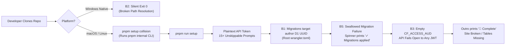
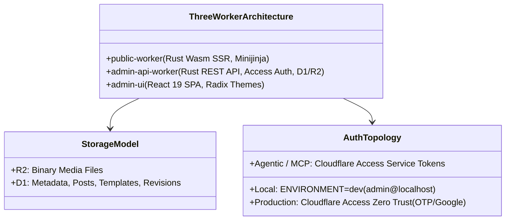

# New-User Setup Review: Executive Synthesis & Remediation Plan

This document synthesizes findings from all five specialized audit reports in [`docs/audits/setup-review/`](file:///Users/ryan/Code/zygodactyl/zygo-cms/docs/audits/setup-review/):
1. [1-docs.md](file:///Users/ryan/Code/zygodactyl/zygo-cms/docs/audits/setup-review/1-docs.md) — Documentation accuracy, quickstart friction, and cross-platform prerequisites.
2. [2-script-ux.md](file:///Users/ryan/Code/zygodactyl/zygo-cms/docs/audits/setup-review/2-script-ux.md) — Setup script interactivity, CLI UX, prompt fatigue, and terminal ergonomics.
3. [3-script-accuracy.md](file:///Users/ryan/Code/zygodactyl/zygo-cms/docs/audits/setup-review/3-script-accuracy.md) — Static code analysis of [`scripts/setup.mjs`](file:///Users/ryan/Code/zygodactyl/zygo-cms/scripts/setup.mjs), failure handling, permissions, and security.
4. [4-opportunities.md](file:///Users/ryan/Code/zygodactyl/zygo-cms/docs/audits/setup-review/4-opportunities.md) — Architectural enhancements, helper recipes, and competitive benchmarking.
5. [5-content.md](file:///Users/ryan/Code/zygodactyl/zygo-cms/docs/audits/setup-review/5-content.md) — Onboarding content strategy, video production scripts, and OS operational matrices.

---

## 1. Executive Summary

### 1.1 Current State of the Setup Experience
Zygo CMS possesses a modern, high-performance edge architecture: sub-15ms server-side rendering via Rust + WebAssembly isolates ([`packages/public-worker`](file:///Users/ryan/Code/zygodactyl/zygo-cms/packages/public-worker)), zero-cold-start distributed SQLite persistence on Cloudflare D1, zero-egress media storage on Cloudflare R2, passwordless perimeter security with Cloudflare Access Zero Trust, and an in-browser / CLI agentic bridge adhering to the Model Context Protocol (MCP).

However, **the out-of-the-box onboarding experience for a new developer is severely compromised**. A new user attempting to evaluate or deploy Zygo CMS today faces catastrophic friction at nearly every turn:
- **First-run compilation and command failures**: Windows 11 users experience silent script termination due to invalid URL path resolution ([3-script-accuracy B2](file:///Users/ryan/Code/zygodactyl/zygo-cms/docs/audits/setup-review/3-script-accuracy.md#b2-critical-on-windows-path-handling-and-entrypoint-check)), and POSIX shell dependencies (`sleep 3 && ...`) break `pnpm run dev`.
- **Database collision and silent migration failures**: Remote database migrations executed by [`scripts/setup.mjs`](file:///Users/ryan/Code/zygodactyl/zygo-cms/scripts/setup.mjs) target the maintainer's hardcoded D1 UUID committed in the root `wrangler.toml` ([3-script-accuracy B1](file:///Users/ryan/Code/zygodactyl/zygo-cms/docs/audits/setup-review/3-script-accuracy.md#b1-critical-migrations-target-the-authors-database)). On foreign accounts, migrations fail silently, yet the wizard reports `✓ Migrations applied` and completes with exit code 0.
- **Critical security fail-open**: If automated Cloudflare Access Zero Trust provisioning fails or is bypassed, [`packages/admin-api-worker/src/auth.rs`](file:///Users/ryan/Code/zygodactyl/zygo-cms/packages/admin-api-worker/src/auth.rs) allows an empty audience tag (`CF_ACCESS_AUD = ""`) to accept JWTs minted by *any* arbitrary Zero Trust tenant ([3-script-accuracy B3](file:///Users/ryan/Code/zygodactyl/zygo-cms/docs/audits/setup-review/3-script-accuracy.md#b3-high-security-fail-open-access-config)), allowing unauthorized administrative takeover of new instances.
- **Documentation disconnect**: Official guides refer to non-existent features (e.g. an email/password signup form, dynamic custom field schema builders in Settings, and relational taxonomy tables), misstate the UI framework (claiming "Vanilla JS + TipTap" when the project uses React 19), misname the templating engine (referencing Askama when the engine is Minijinja), and omit critical flags (`--persist-to=./.wrangler/state`), leading to instant runtime SQLite exceptions.
- **Prompt fatigue and credential exposure**: The setup script interrogates users across 15+ sequential interactive prompts with zero CLI flag support, echoes high-privilege Cloudflare API tokens and Google client secrets in plain text, and fails to pass prompted credentials down to Wrangler child processes.

### 1.2 Overall Readiness Score: 3.5 / 10 (High Risk / Alpha Stage)
*While the underlying runtime engine is robust and performant, the onboarding funnel is currently non-viable for unassisted external developers without immediate structural remediation.*



---

## 2. Top 10 Blockers & Critical Fixes (Ranked)

| Rank | Severity | Issue / Bug IDs | Location | Core Impact |
| :---: | :---: | :--- | :--- | :--- |
| **1** | **Critical** | `3-script-accuracy: B1`<br>`1-docs: #13, #21` | [`scripts/setup.mjs:347`](file:///Users/ryan/Code/zygodactyl/zygo-cms/scripts/setup.mjs#L347)<br>[`wrangler.toml:6`](file:///Users/ryan/Code/zygodactyl/zygo-cms/wrangler.toml#L6) | **Remote migrations target maintainer's production D1 database.** |
| **2** | **Critical** | `3-script-accuracy: B3`<br>`1-docs: #19`<br>`2-script-ux: #5` | [`packages/admin-api-worker/src/auth.rs:338`](file:///Users/ryan/Code/zygodactyl/zygo-cms/packages/admin-api-worker/src/auth.rs#L338)<br>[`scripts/setup.mjs:702`](file:///Users/ryan/Code/zygodactyl/zygo-cms/scripts/setup.mjs#L702) | **Fail-open security vulnerability: empty `CF_ACCESS_AUD` allows admin takeover.** |
| **3** | **Critical** | `3-script-accuracy: B2`<br>`1-docs: OS Audit`<br>`2-script-ux: #6` | [`scripts/setup.mjs:86, 1310`](file:///Users/ryan/Code/zygodactyl/zygo-cms/scripts/setup.mjs#L86) | **Windows 11 setup script aborts silently (exit 0) due to path resolution bug.** |
| **4** | **Blocker** | `1-docs: #1, #10`<br>`5-content: V1, G4`<br>`2-script-ux: #14` | [`docs/official/quickstart.md`](file:///Users/ryan/Code/zygodactyl/zygo-cms/docs/official/quickstart.md)<br>[`README.md`](file:///Users/ryan/Code/zygodactyl/zygo-cms/README.md) | **Mythical email/password signup documented; dev auth bypass on `:5173` undocumented.** |
| **5** | **Blocker** | `1-docs: #2`<br>`5-content: G4` | [`docs/official/quickstart.md`](file:///Users/ryan/Code/zygodactyl/zygo-cms/docs/official/quickstart.md)<br>[`package.json:11`](file:///Users/ryan/Code/zygodactyl/zygo-cms/package.json#L11) | **Local migrations omit `--persist-to`, causing runtime "no such table: entries" errors.** |
| **6** | **Major** | `2-script-ux: #1`<br>`1-docs: #14`<br>`3-script-accuracy: B15` | [`package.json:25`](file:///Users/ryan/Code/zygodactyl/zygo-cms/package.json#L25) | **`pnpm setup` command collision triggers pnpm's internal CLI rather than the wizard.** |
| **7** | **Major** | `3-script-accuracy: B4`<br>`2-script-ux: #8, #9` | [`scripts/setup.mjs:71, 295`](file:///Users/ryan/Code/zygodactyl/zygo-cms/scripts/setup.mjs#L71) | **Wrangler subprocesses do not receive prompted API token or Account ID.** |
| **8** | **Major** | `3-script-accuracy: B5, B11, B12`<br>`2-script-ux: #2, #3` | [`scripts/setup.mjs:353, 1293`](file:///Users/ryan/Code/zygodactyl/zygo-cms/scripts/setup.mjs#L353) | **Failures swallowed; wizard displays "Setup Complete!" and exits 0 on failed deploy.** |
| **9** | **Major** | `3-script-accuracy: B10`<br>`2-script-ux: #4`<br>`4-opportunities: §4.4` | [`scripts/setup.mjs:1009, 1066`](file:///Users/ryan/Code/zygodactyl/zygo-cms/scripts/setup.mjs#L1009) | **Plaintext secret exposure in terminal (Cloudflare API Token & Google Client Secret).** |
| **10** | **Major** | `3-script-accuracy: B9`<br>`1-docs: #6, #7, #21` | [`packages/public-worker/src/cache.rs:115`](file:///Users/ryan/Code/zygodactyl/zygo-cms/packages/public-worker/src/cache.rs#L115)<br>[`scripts/setup.mjs:1246`](file:///Users/ryan/Code/zygodactyl/zygo-cms/scripts/setup.mjs#L1246) | **Cache purge broken: `CF_ZONE_ID` missing from public worker; `CF_API_TOKEN` secret unmanaged.** |

---

### Detailed Problem & Concrete Fix Instructions for Top 10 Blockers

#### 1. Targeting Author's Database in Remote Migrations (Rank 1)
- **Problem & Impact:** In [`scripts/setup.mjs`](file:///Users/ryan/Code/zygodactyl/zygo-cms/scripts/setup.mjs#L347), `applyRemoteMigrations()` runs `npx wrangler d1 migrations apply zygo-cms-db --remote` from the repository root. `update*Wrangler()` updates the three packages' `wrangler.toml` files but skips the root [`wrangler.toml`](file:///Users/ryan/Code/zygodactyl/zygo-cms/wrangler.toml), which retains the maintainer's hardcoded UUID (`database_id = "488417e7-a9a3-4b67-ab66-3d237190ca3c"`). For any external user, this fails with a 403/404 error (which is then swallowed by Bug B5), leaving the user's newly created D1 database completely unmigrated. If executed by the author in a test directory, it would inadvertently apply migrations against the live production database.
- **Concrete Fix:**
  1. Remove the hardcoded `database_id` from the root [`wrangler.toml`](file:///Users/ryan/Code/zygodactyl/zygo-cms/wrangler.toml) and replace it with a placeholder or comments.
  2. Change the execution in [`scripts/setup.mjs`](file:///Users/ryan/Code/zygodactyl/zygo-cms/scripts/setup.mjs#L347) to explicitly target the admin API worker configuration:
     ```javascript
     execSync(`npx wrangler d1 migrations apply zygo-cms-db --remote -c packages/admin-api-worker/wrangler.toml`, {
       cwd: ROOT_DIR,
       env: { ...process.env, ...childEnv, CI: 'true' },
       stdio: 'pipe'
     });
     ```

#### 2. Fail-Open Security Vulnerability on Access App Failure (Rank 2)
- **Problem & Impact:** In [`packages/admin-api-worker/src/auth.rs`](file:///Users/ryan/Code/zygodactyl/zygo-cms/packages/admin-api-worker/src/auth.rs#L338-L386), `validate_jwt_claims()` only validates the audience claim if `expected_aud` is non-empty. When `CF_ACCESS_AUD` is empty, any JWT issued by Cloudflare Access is accepted. Furthermore, if `CF_ACCESS_TEAM_DOMAIN` is empty, `validate_issuer()` accepts *any* host matching `*.cloudflareaccess.com`. An attacker can register a free Zero Trust account, issue a token to their own email, send it to the victim's API, and automatically be provisioned as `admin` on the victim's instance.
- **Concrete Fix:**
  1. In [`packages/admin-api-worker/src/auth.rs`](file:///Users/ryan/Code/zygodactyl/zygo-cms/packages/admin-api-worker/src/auth.rs), fail closed immediately in non-dev environments:
     ```rust
     if env.var("ENVIRONMENT").map(|v| v.to_string()).unwrap_or_default() != "dev" {
         if aud.is_empty() || team_domain.is_empty() {
             worker::console_error!("Security Error: CF_ACCESS_AUD or CF_ACCESS_TEAM_DOMAIN is unconfigured.");
             return Err(Error::Unauthorized);
         }
     }
     ```
  2. In [`scripts/setup.mjs`](file:///Users/ryan/Code/zygodactyl/zygo-cms/scripts/setup.mjs#L1276), if `!config.accessAud`, display a prominent warning, block automated deployment, and require explicit manual override flags.

#### 3. Windows 11 Setup Script Entrypoint Crash (Rank 3)
- **Problem & Impact:** Lines 86 and 1310 in [`scripts/setup.mjs`](file:///Users/ryan/Code/zygodactyl/zygo-cms/scripts/setup.mjs) compute paths using `new URL(import.meta.url).pathname`. On Windows, this evaluates to `/C:/Users/...`. When passed to `path.resolve()`, it yields malformed paths like `C:\C:\Users\...`. As a result, the direct-execution check `process.argv[1] === scriptPath` evaluates to `false`, causing the setup script to exit immediately with status 0 and zero terminal output.
- **Concrete Fix:**
  Replace URL pathname extraction with the standard Node.js utility:
  ```javascript
  import { fileURLToPath } from 'node:url';
  const __filename = fileURLToPath(import.meta.url);
  const __dirname = path.dirname(__filename);
  const ROOT_DIR = path.resolve(__dirname, '..');
  ```

#### 4. Mythical Password Auth vs. Reality of Dev Auth Bypass (Rank 4)
- **Problem & Impact:** [`docs/official/quickstart.md`](file:///Users/ryan/Code/zygodactyl/zygo-cms/docs/official/quickstart.md) and [`README.md`](file:///Users/ryan/Code/zygodactyl/zygo-cms/README.md) claim that visiting the admin interface prompts the user to "create the initial administrative user profile... set your email and password." No password-handling logic, hashing library, or password database fields exist in Zygo. Local development relies on `ENVIRONMENT=dev` in `.dev.vars`, which automatically logs the user in as `admin@localhost` on `http://localhost:5173` (Vite port, not `:8788/admin`).
- **Concrete Fix:**
  Rewrite the Quickstart and README onboarding sections:
  1. Clearly state that Zygo is completely passwordless.
  2. Explain local dev behavior: navigating to `http://localhost:5173` auto-logs in as `admin@localhost` when `ENVIRONMENT=dev`.
  3. Explain production behavior: login is mediated at the Cloudflare edge via Cloudflare Access One-Time PIN (OTP) or Google OAuth.

#### 5. Local Migrations Missing `--persist-to` (Rank 5)
- **Problem & Impact:** Step 2 of [`docs/official/quickstart.md`](file:///Users/ryan/Code/zygodactyl/zygo-cms/docs/official/quickstart.md) documents running `npx wrangler d1 migrations apply zygo-cms-db --local` without specifying a persistence directory. However, the npm scripts in [`package.json`](file:///Users/ryan/Code/zygodactyl/zygo-cms/package.json#L11-L15) (`dev:api`, `dev:public`) explicitly bind D1 state to `--persist-to=./.wrangler/state`. Running the quickstart migration creates SQLite tables in a temporary directory that the dev servers never read, throwing `"no such table: entries"` at runtime.
- **Concrete Fix:**
  Replace all raw local migration commands in docs with the canonical package script:
  ```bash
  pnpm run db:migrate:local
  ```
  Ensure `pnpm run db:migrate:local` in [`package.json`](file:///Users/ryan/Code/zygodactyl/zygo-cms/package.json) targets `-c packages/admin-api-worker/wrangler.toml --persist-to=./.wrangler/state`.

#### 6. `pnpm setup` Command Collision (Rank 6)
- **Problem & Impact:** `package.json:25` defines `"setup": "node scripts/setup.mjs"`. In pnpm, `pnpm setup` is a reserved internal command for configuring the global pnpm binary directory (`PNPM_HOME`). Running `pnpm setup` runs pnpm's global configuration and completely ignores the Zygo setup script.
- **Concrete Fix:**
  1. Update documentation and README to state `pnpm run setup` rather than `pnpm setup`.
  2. Add `"wizard": "node scripts/setup.mjs"` to [`package.json`](file:///Users/ryan/Code/zygodactyl/zygo-cms/package.json) as a collision-free alternative.

#### 7. Wrangler Subprocess Credential Desync (Rank 7)
- **Problem & Impact:** In [`scripts/setup.mjs`](file:///Users/ryan/Code/zygodactyl/zygo-cms/scripts/setup.mjs#L71, #L295), prompts collect `accountId` and `apiToken`, but pass them only to native REST `fetch()` calls. Subprocesses executed via `execSync('npx wrangler ...')` inherit raw `process.env`. If the user is authenticated via OAuth with multiple accounts or entered an API token in the wizard without exporting it in their shell, Wrangler fails with "More than one account found" or attempts to provision resources against the wrong Cloudflare account.
- **Concrete Fix:**
  Construct an explicit child environment object and pass it to every `execSync` call:
  ```javascript
  const childEnv = {
    ...process.env,
    CLOUDFLARE_API_TOKEN: config.apiToken,
    CLOUDFLARE_ACCOUNT_ID: config.accountId
  };
  execSync(cmd, { env: childEnv, stdio: 'pipe' });
  ```

#### 8. Swallowed Failures and False Success Banners (Rank 8)
- **Problem & Impact:** In [`scripts/setup.mjs`](file:///Users/ryan/Code/zygodactyl/zygo-cms/scripts/setup.mjs#L353), errors during migrations are caught and logged as console warnings, but the spinner still announces `s.stop('✓ Migrations applied')`. Later, if `pnpm run build` or `pnpm run deploy` throws an exception (lines 1293–1296), the script catches the error, proceeds directly to the outro banner ("🎉 Setup Complete!"), and exits with code 0.
- **Concrete Fix:**
  1. Return boolean status codes from all provisioning helpers (`provisionD1Database`, `provisionR2Bucket`, `applyRemoteMigrations`).
  2. If migrations fail, halt the spinner with `s.stop('✗ Migration failed')`, print stderr, and abort before the deploy step.
  3. If deployment fails, set `process.exitCode = 1`, display actionable troubleshooting instructions, and omit the success banner.

#### 9. Plaintext Secret Exposure in Terminal (Rank 9)
- **Problem & Impact:** Lines 1009 and 1066 of [`scripts/setup.mjs`](file:///Users/ryan/Code/zygodactyl/zygo-cms/scripts/setup.mjs) use `@clack/prompts` `text()` for both the Cloudflare API Token and Google Client Secret. Characters are echoed in clear text in the terminal, exposing secrets to scrollback buffers, shared screens, and terminal session recordings. Line 1011 also pre-fills the exported token via `initialValue`, printing it directly to stdout.
- **Concrete Fix:**
  Import `password` from `@clack/prompts`:
  ```javascript
  import { password } from '@clack/prompts';
  const token = await password({
    message: 'Cloudflare API Token',
    mask: '•',
    validate: (val) => (!val || !val.trim() ? 'API Token is required' : undefined)
  });
  ```

#### 10. Cache Purge Configuration & Port Mismatches (Rank 10)
- **Problem & Impact:** When content is published, [`packages/public-worker/src/cache.rs`](file:///Users/ryan/Code/zygodactyl/zygo-cms/packages/public-worker/src/cache.rs#L115) reads `CF_ZONE_ID` and `CF_API_TOKEN` to purge the Cloudflare edge cache. [`scripts/setup.mjs`](file:///Users/ryan/Code/zygodactyl/zygo-cms/scripts/setup.mjs#L1246) writes `CF_ZONE_ID` only to `packages/admin-api-worker/wrangler.toml` and never to `public-worker`. Furthermore, the script never provisions the `CF_API_TOKEN` secret. In documentation, ports are cited inconsistently as `:3000`, `:8788`, and `:5173`.
- **Concrete Fix:**
  1. In [`scripts/setup.mjs`](file:///Users/ryan/Code/zygodactyl/zygo-cms/scripts/setup.mjs), write `CF_ZONE_ID` to both `packages/admin-api-worker/wrangler.toml` and `packages/public-worker/wrangler.toml`.
  2. Document the exact command to put the runtime cache purge secret:
     ```bash
     npx wrangler secret put CF_API_TOKEN -c packages/admin-api-worker/wrangler.toml
     npx wrangler secret put CF_API_TOKEN -c packages/public-worker/wrangler.toml
     ```
  3. Standardize all docs to canon ports: `:5173` (Admin UI), `:8787` (Public Worker SSR), `:8788` (Admin API Worker).

---

## 3. Resolved Conflicts & Inconsistencies Between Reviewers / Docs

The audit reports uncovered multiple conflicting statements across docs, code, and reviewer notes. Below is the authoritative resolution of all architectural and procedural disputes:



### 3.1 Architecture: 2 Workers vs. 3 Workers
- **Conflict:** [`docs/official/introduction.md`](file:///Users/ryan/Code/zygodactyl/zygo-cms/docs/official/introduction.md) and [`deployment.md`](file:///Users/ryan/Code/zygodactyl/zygo-cms/docs/official/deployment.md) claim Zygo is a "decoupled, two-worker setup." Other documents mention three workers.
- **Resolution:** **Zygo CMS uses a Three-Worker Architecture**:
  1. `zygo-public-worker` ([`packages/public-worker`](file:///Users/ryan/Code/zygodactyl/zygo-cms/packages/public-worker)): Rust + Minijinja SSR rendering the public site.
  2. `zygo-admin-api-worker` ([`packages/admin-api-worker`](file:///Users/ryan/Code/zygodactyl/zygo-cms/packages/admin-api-worker)): Rust REST API managing D1, R2, and auth.
  3. `zygo-admin-ui` ([`packages/admin-ui`](file:///Users/ryan/Code/zygodactyl/zygo-cms/packages/admin-ui)): React 19 SPA served via Cloudflare Workers static assets.
  *All references to "two workers" in documentation must be updated to three.*

### 3.2 Templating Engine: Askama vs. Minijinja vs. template-wasm
- **Conflict:** [`README.md`](file:///Users/ryan/Code/zygodactyl/zygo-cms/README.md) and [`advanced.md`](file:///Users/ryan/Code/zygodactyl/zygo-cms/docs/official/advanced.md) claim the SSR engine uses Askama templates loaded from a `templates/` directory on disk. [`packages/public-worker/Cargo.toml`](file:///Users/ryan/Code/zygodactyl/zygo-cms/packages/public-worker/Cargo.toml) lists `minijinja = "2.7"`.
- **Resolution:** **Zygo CMS exclusively uses Minijinja for SSR templating.** There is no Askama dependency and no `templates/` directory on disk. Default templates are embedded in Rust binaries ([`packages/public-worker/src/views.rs`](file:///Users/ryan/Code/zygodactyl/zygo-cms/packages/public-worker/src/views.rs)) and can be dynamically overridden at runtime via database rows stored in D1 (`layout_templates` and `section_templates` tables). `template-wasm` is a specialized Wasm crate used in CI for Jinja evaluation.

### 3.3 UI Framework: Vanilla JS + TipTap vs. React 19
- **Conflict:** [`README.md:11`](file:///Users/ryan/Code/zygodactyl/zygo-cms/README.md#L11) states the Admin UI is built with "Vanilla JS + TipTap," while elsewhere describing React 19.
- **Resolution:** **The Admin UI is a React 19 SPA.** It uses `@radix-ui/themes`, `@tanstack/react-table`, and TipTap (within React) for rich text editing. The "Vanilla JS" statement is obsolete legacy text and must be deleted.

### 3.4 Media Storage: R2 vs. D1 Binary Storage
- **Conflict:** [`docs/official/concepts.md`](file:///Users/ryan/Code/zygodactyl/zygo-cms/docs/official/concepts.md) states "D1 storage is available for smaller, text-heavy setups."
- **Resolution:** **All binary media files are stored exclusively in Cloudflare R2** ([`packages/admin-api-worker/src/media.rs`](file:///Users/ryan/Code/zygodactyl/zygo-cms/packages/admin-api-worker/src/media.rs)). Cloudflare D1 is used solely for metadata storage (`media` table: `key`, `filename`, `mime_type`, `size_bytes`). No code path exists for binary blob storage in D1.

### 3.5 Authentication: Local Dev vs. Production vs. Headless
- **Conflict:** Docs describe an initial email/password registration screen upon first boot.
- **Resolution:** **Zygo CMS is entirely passwordless across all environments:**
  - **Local Development:** When `ENVIRONMENT=dev` is present in `.dev.vars`, [`packages/admin-api-worker/src/auth.rs`](file:///Users/ryan/Code/zygodactyl/zygo-cms/packages/admin-api-worker/src/auth.rs) bypasses Cloudflare Access entirely and injects an authenticated mock user (`admin@localhost`, role `Admin`). Visiting `http://localhost:5173` auto-authenticates into the dashboard.
  - **Production:** Authenticated at the edge via Cloudflare Access Zero Trust. Identity verification is handled via One-Time PIN (OTP) or Google OAuth. Workers validate the signed `Cf-Access-Jwt-Assertion` header.
  - **Headless / MCP / CI:** Authenticated via Cloudflare Access Service Tokens (`CF-Access-Client-Id` and `CF-Access-Client-Secret` request headers).

### 3.6 Setup Script Invocations: `pnpm setup` vs. `pnpm run setup`
- **Conflict:** Reviewers noted confusion over how the setup wizard is triggered.
- **Resolution:** `pnpm setup` is hijacked by pnpm's global bin installer. **The canonical command is `pnpm run setup`** (or `node scripts/setup.mjs`).

### 3.7 Cache Purge Secrets & Placement (`CF_ZONE_ID` and `CF_API_TOKEN`)
- **Conflict:** Docs contradict whether `CF_ZONE_ID` and `CF_API_TOKEN` are optional, where they are defined, and what scopes they require.
- **Resolution:**
  - `CF_ZONE_ID`: An environment variable placed in `[vars]` in **both** `packages/admin-api-worker/wrangler.toml` and `packages/public-worker/wrangler.toml`.
  - `CF_API_TOKEN`: A Worker Secret (never plaintext TOML var), set via `wrangler secret put CF_API_TOKEN` in both backend workers. Requires strictly `Zone > Cache Purge > Purge`.
  - Setup Token vs. Runtime Token: The setup wizard token requires broad administrative scopes (D1, R2, Access, DNS, Zone Settings), whereas the runtime token must be a minimal, least-privilege token scoped solely to Cache Purge.

---

## 4. Quick Wins (< 1 Hour Each)

These items require minimal effort, carry zero architectural risk, introduce no new dependencies, and can be implemented immediately:

1. **Fix Windows Path Resolution in [`scripts/setup.mjs`](file:///Users/ryan/Code/zygodactyl/zygo-cms/scripts/setup.mjs)**
   - Replace `new URL(import.meta.url).pathname` with `import { fileURLToPath } from 'node:url'; fileURLToPath(import.meta.url)`. Immediately unlocks Windows 11 execution.
2. **Sanitize Root [`wrangler.toml`](file:///Users/ryan/Code/zygodactyl/zygo-cms/wrangler.toml)**
   - Remove author's hardcoded D1 UUID (`488417e7-...`) and custom domain references from repo root to prevent database collision.
3. **Explicit Migration Config Flag in [`scripts/setup.mjs`](file:///Users/ryan/Code/zygodactyl/zygo-cms/scripts/setup.mjs)**
   - Update `applyRemoteMigrations()` to pass `-c packages/admin-api-worker/wrangler.toml`.
4. **Mask Secrets with `@clack/prompts` `password()`**
   - Switch API Token and Google Client Secret prompts in [`scripts/setup.mjs`](file:///Users/ryan/Code/zygodactyl/zygo-cms/scripts/setup.mjs) from `text()` to `password()`; remove `initialValue` echoing.
5. **Delete Dead Readline & PropelAuth Relics**
   - Delete unused functions `promptInput` and `promptYesNo` (lines 872–910) and remove legacy `PROPELAUTH_AUTH_URL` regex replacements.
6. **Correct Quickstart Local Migration Command**
   - Replace raw migration instructions in [`docs/official/quickstart.md`](file:///Users/ryan/Code/zygodactyl/zygo-cms/docs/official/quickstart.md) with `pnpm run db:migrate:local` (ensuring `--persist-to=./.wrangler/state`).
7. **Fix Tech Stack Claims in [`README.md`](file:///Users/ryan/Code/zygodactyl/zygo-cms/README.md)**
   - Change "Vanilla JS + TipTap" to "React 19 + Radix Themes", "Askama" to "Minijinja", and explicitly describe the three-worker architecture.
8. **Replace POSIX `sleep` in [`package.json`](file:///Users/ryan/Code/zygodactyl/zygo-cms/package.json)**
   - Replace `sleep 3 && ...` in `dev:public` with a cross-platform Node timeout command: `node -e "setTimeout(()=>{},3000)"`.
9. **Display Prefilled Cloudflare Token URL in Wizard**
   - In [`scripts/setup.mjs`](file:///Users/ryan/Code/zygodactyl/zygo-cms/scripts/setup.mjs), output a prefilled Cloudflare dashboard link pre-selecting required scopes (`D1:Edit`, `R2:Edit`, `Access:Edit`, etc.).
10. **Propagate Non-Zero Exit Codes on Failure**
    - Set `process.exitCode = 1` in [`scripts/setup.mjs`](file:///Users/ryan/Code/zygodactyl/zygo-cms/scripts/setup.mjs) if `applyRemoteMigrations()`, build, or deploy fails; suppress the "Setup Complete" outro on errors.

---

## 5. Substantial Engineering Work (> 1 Hour)

These tasks represent larger structural improvements requiring focused implementation, testing, and documentation updates:

### 5.1 Preflight Diagnostic Engine (`--doctor`)
Implement a comprehensive diagnostic suite in [`scripts/setup.mjs`](file:///Users/ryan/Code/zygodactyl/zygo-cms/scripts/setup.mjs) executing prior to any configuration mutations:
- Verify CLI binaries and toolchains: Node >= 22, pnpm >= 11, Rust stable, `wasm32-unknown-unknown` target, and `worker-build`.
- Verify Cloudflare authentication via `GET /user/tokens/verify` and `npx wrangler whoami --json`.
- Validate token permissions against required scopes (D1, R2, Access, Zone Settings, DNS).
- Verify target domain exists as an active Cloudflare zone *before* provisioning resources.

### 5.2 CLI Flag Parsing & Non-Interactive Mode
Integrate `node:util` `parseArgs` into [`scripts/setup.mjs`](file:///Users/ryan/Code/zygodactyl/zygo-cms/scripts/setup.mjs) to support scripted CI/CD and non-interactive execution:
- Flags: `--yes` (`-y`), `--domain`, `--email`, `--account-id`, `--token`, `--no-deploy`, `--dry-run`, `--doctor`.
- When `--yes` is combined with required flags, skip all prompts, apply production defaults, and proceed directly to provisioning.

### 5.3 Fail-Closed Authentication Hardening (Bug B3)
Refactor [`packages/admin-api-worker/src/auth.rs`](file:///Users/ryan/Code/zygodactyl/zygo-cms/packages/admin-api-worker/src/auth.rs):
- Reject requests with HTTP 401/500 if `CF_ACCESS_AUD` or `CF_ACCESS_TEAM_DOMAIN` is empty whenever `ENVIRONMENT != "dev"`.
- Prevent the API from booting or serving requests with an unvalidated audience tag.
- In [`scripts/setup.mjs`](file:///Users/ryan/Code/zygodactyl/zygo-cms/scripts/setup.mjs), halt execution and forbid deployment if Zero Trust configuration fails.

### 5.4 Progressive Disclosure for Edge & WAF Settings
Streamline the 15-prompt wizard in [`scripts/setup.mjs`](file:///Users/ryan/Code/zygodactyl/zygo-cms/scripts/setup.mjs):
- Group Bot Fight Mode, AI Crawl policies, WAF security levels, and performance optimizations under a single opt-in prompt: `"Configure advanced Cloudflare Edge & AI crawl settings? (y/N)"`.
- Default to recommended production settings for users opting out.

### 5.5 In-Memory Config Snapshots & Atomic Rollback
Wrap file mutation helpers in [`scripts/setup.mjs`](file:///Users/ryan/Code/zygodactyl/zygo-cms/scripts/setup.mjs) with an atomic snapshot and rollback manager:
- Snapshot `packages/*/wrangler.toml` and `packages/admin-ui/.env.production` before mutations.
- If provisioning or migrations fail mid-run, automatically restore files to their pre-setup state to prevent leaving corrupted configs on disk.

### 5.6 Subdomain Propagation & Dynamic CORS (Bug B8)
- Update [`scripts/setup.mjs`](file:///Users/ryan/Code/zygodactyl/zygo-cms/scripts/setup.mjs) to inject `ADMIN_SUBDOMAIN` into `packages/public-worker/wrangler.toml`.
- Refactor [`packages/admin-api-worker/src/lib.rs`](file:///Users/ryan/Code/zygodactyl/zygo-cms/packages/admin-api-worker/src/lib.rs) CORS handling so that custom API and Admin subdomains are dynamically allowed without hardcoded `api.` or `admin.` assumptions.

### 5.7 Post-Deployment Edge Verification & Health Check
Add an automated verification step following deployment in [`scripts/setup.mjs`](file:///Users/ryan/Code/zygodactyl/zygo-cms/scripts/setup.mjs):
- Send HEAD requests to `https://<domain>`, `https://admin.<domain>`, and `https://api.<domain>/api/me`.
- Validate expected status codes (200 for public, 302 to Access for admin).
- Alert users if DNS or SSL propagation is pending.
- Offer to auto-open the browser to the Admin UI login page upon successful verification.

### 5.8 Complete Official Documentation Rewrite
Systematically overhaul the documentation library:
- Replace fabricated Taxonomy diagrams in [`concepts.md`](file:///Users/ryan/Code/zygodactyl/zygo-cms/docs/official/concepts.md) with actual D1 schema definitions (`entries`, `entry_revisions`, `section_templates`, `layout_templates`, `media`, `users`, `redirects`).
- Rewrite Recipe 3 in [`examples.md`](file:///Users/ryan/Code/zygodactyl/zygo-cms/docs/official/examples.md) to explain theme and template customization via the Admin UI (`/theme` and `/templates`) rather than recompiling Rust code.
- Update Recipe 4 in [`examples.md`](file:///Users/ryan/Code/zygodactyl/zygo-cms/docs/official/examples.md) to document headless API authentication using Cloudflare Access Service Tokens.

---

## 6. Recommended `ROADMAP.md` Updates

*Below is the structured backlog formatted and ready for the project maintainer to copy into `ROADMAP.md` (remembering the rule: DO NOT edit `ROADMAP.md` directly during review).*

```markdown
### Setup Experience & Onboarding Remediation
Audit reference: [`docs/audits/setup-review/SUMMARY.md`](docs/audits/setup-review/SUMMARY.md) (Full reports: [`1-docs.md`](docs/audits/setup-review/1-docs.md), [`2-script-ux.md`](docs/audits/setup-review/2-script-ux.md), [`3-script-accuracy.md`](docs/audits/setup-review/3-script-accuracy.md), [`4-opportunities.md`](docs/audits/setup-review/4-opportunities.md), [`5-content.md`](docs/audits/setup-review/5-content.md))

#### Immediate Patches & Security Hardening (P0)
- [ ] **Fix D1 Migration Target & Sanitize Root Wrangler**
  - Pass `-c packages/admin-api-worker/wrangler.toml` in `scripts/setup.mjs` `applyRemoteMigrations()`.
  - Remove hardcoded maintainer `database_id` and production domain from root `wrangler.toml`.
  - Reference: [`3-script-accuracy.md` §3 B1](docs/audits/setup-review/3-script-accuracy.md) & [`1-docs.md` #13, #21](docs/audits/setup-review/1-docs.md).
- [ ] **Harden Fail-Closed Zero Trust Authentication**
  - Update `packages/admin-api-worker/src/auth.rs` to reject requests with 401/500 when `CF_ACCESS_AUD` or `CF_ACCESS_TEAM_DOMAIN` is empty in non-dev environments.
  - Abort automated deployment in `scripts/setup.mjs` if Access app provisioning fails or AUD is empty.
  - Reference: [`3-script-accuracy.md` §3 B3](docs/audits/setup-review/3-script-accuracy.md).
- [ ] **Resolve Windows 11 Entrypoint & Path Math**
  - Switch `scripts/setup.mjs` from `new URL(import.meta.url).pathname` to `fileURLToPath(import.meta.url)`.
  - Replace POSIX `sleep 3 &&` in `package.json` (`dev:public`) with cross-platform timeout or wait utility.
  - Reference: [`3-script-accuracy.md` §3 B2](docs/audits/setup-review/3-script-accuracy.md) & [`1-docs.md` OS Coverage](docs/audits/setup-review/1-docs.md).
- [ ] **Propagate Child Process Credentials & Error Propagation**
  - Inject `CLOUDFLARE_API_TOKEN` and `CLOUDFLARE_ACCOUNT_ID` into all `execSync` Wrangler child processes in `scripts/setup.mjs`.
  - Propagate non-zero exit codes on build/deploy failures and suppress false success banners.
  - Reference: [`3-script-accuracy.md` §3 B4, B5, B11, B12](docs/audits/setup-review/3-script-accuracy.md).
- [ ] **Mask Secrets in Terminal Prompts**
  - Switch API Token and Google Client Secret prompts in `scripts/setup.mjs` to `@clack/prompts` `password()`.
  - Reference: [`3-script-accuracy.md` §3 B10](docs/audits/setup-review/3-script-accuracy.md) & [`4-opportunities.md` Opportunity 4](docs/audits/setup-review/4-opportunities.md).
- [ ] **Cache Purge & Subdomain Wiring**
  - Write `CF_ZONE_ID` to both `admin-api-worker` and `public-worker` in `scripts/setup.mjs`.
  - Wire `ADMIN_SUBDOMAIN` into `public-worker` and dynamically resolve CORS origins in `admin-api-worker`.
  - Reference: [`3-script-accuracy.md` §3 B8, B9](docs/audits/setup-review/3-script-accuracy.md).
- [ ] **Graceful SEO Redirect Ruleset Handling**
  - Handle missing Dynamic Redirect / Rulesets API permissions with a non-fatal warning and provide clear permission requirements in output.
  - Reference: [`3-script-accuracy.md` §11.1](docs/audits/setup-review/3-script-accuracy.md).

#### Developer Experience & CLI Polish (P1)
- [ ] **Preflight Environment & Diagnostic Doctor (`--doctor`)**
  - Implement `runPreflightChecks()` in `scripts/setup.mjs` verifying Node 22, pnpm 11, Rust `wasm32-unknown-unknown`, `worker-build`, Wrangler auth, token scopes, and Cloudflare Zone presence before file mutation.
  - Reference: [`4-opportunities.md` Opportunity 1](docs/audits/setup-review/4-opportunities.md).
- [ ] **Non-Interactive Automation & CLI Flags**
  - Add flag parsing (`--yes`, `--domain`, `--email`, `--account-id`, `--token`, `--no-deploy`, `--dry-run`, `--doctor`) via `node:util` `parseArgs`.
  - Reference: [`4-opportunities.md` Opportunity 2](docs/audits/setup-review/4-opportunities.md).
- [ ] **Progressive Disclosure & Wizard Simplification**
  - Collapse 6 granular Edge/WAF prompts into a single opt-in prompt with production defaults.
  - Reference: [`4-opportunities.md` Opportunity 3](docs/audits/setup-review/4-opportunities.md) & [`2-script-ux.md` Friction 11-13](docs/audits/setup-review/2-script-ux.md).
- [ ] **Atomic Configuration Snapshots & Rollback**
  - Snapshot `wrangler.toml` files in memory before mutation; restore automatically on unhandled error.
  - Reference: [`4-opportunities.md` Opportunity 7](docs/audits/setup-review/4-opportunities.md).
- [ ] **Post-Deployment Edge Verification & Health Check**
  - Add post-deploy HEAD polling for public site (200) and admin portal (302), with automatic browser launch.
  - Reference: [`4-opportunities.md` Opportunities 6 & 8](docs/audits/setup-review/4-opportunities.md).

#### Documentation & Educational Content (P1)
- [ ] **Canonical Quickstart & README Overhaul**
  - Rewrite Quickstart: eliminate mythical password signup, document `:5173` dev auth bypass (`ENVIRONMENT=dev`), standardize on `pnpm run db:migrate:local`.
  - Rename `pnpm setup` references to `pnpm run setup`.
  - Reconcile architecture to Three-Worker, Minijinja, and React 19 across all docs.
  - Reference: [`1-docs.md` Issues 1, 2, 9, 10, 12](docs/audits/setup-review/1-docs.md).
- [ ] **Data Model & Recipes Alignment**
  - Update `docs/official/concepts.md` with true D1 schema tables (replace fabricated Taxonomy diagrams).
  - Update `docs/official/examples.md` to document UI theme/template customization and Service Token API auth.
  - Reference: [`1-docs.md` Issues 27, 28, 29, 30, 31, 33](docs/audits/setup-review/1-docs.md).
- [ ] **Cross-Platform OS Guide & Troubleshooting FAQ**
  - Publish Guide 4 (Troubleshooting FAQ) and Guide 5 (CLI Cheat-Sheet) from setup-review content plan.
  - Add explicit WSL2 recommendation and setup commands for Windows 11.
  - Reference: [`5-content.md` Guides 4 & 5](docs/audits/setup-review/5-content.md).
- [ ] **Core Onboarding Video Production**
  - Produce Video 1 ("Zero to Live Site in 5 Minutes") and Video 2 ("Cloudflare Access & Zero Trust Setup") per scripts in `docs/audits/setup-review/5-content.md`.
```

---

## 7. Real macOS Live Test Results (`stephwanicki.com`)

The setup wizard was executed against live Cloudflare infrastructure in a fresh clone at `/private/tmp/zygo-setup-test` on macOS (Darwin arm64) using the user's provided token and account ID.

### 7.1 Test Parameters & Environment
- **Target Domain:** Apex zone `stephwanicki.com` (Zone ID `5e49562ebf5fe14f4a9fce806a2afd0a`)
- **Cloudflare Account:** `9e5e5d2d631b909223e262479b4c0557`
- **Environment:** Clean sandbox clone with no pre-existing `.dev.vars`, `.wrangler/`, or `node_modules`
- **Toolchain:** Node v26.4.0, pnpm v11.9.0, Wrangler 4.145.0

### 7.2 Execution Results & Verifications
The setup wizard was executed inside a fresh clone at `/private/tmp/zygo-setup-test` on macOS (Darwin arm64) using the user's provided token and account ID:

1. **D1 & R2 Provisioning:**
   - Successfully discovered existing D1 database `zygo-cms-db` (`488417e7-4ad1-4875-90e9-71a0ac3dbc63`).
   - Discovered existing R2 bucket `zygo-cms-media`.
   - Verified remote migrations via `wrangler d1 migrations apply zygo-cms-db --remote` (0 migrations needed).
2. **Zero Trust Access Provisioning (SUCCESS):**
   - Discovered Zero Trust team domain: `https://zygodactyl-studios.cloudflareaccess.com`.
   - Created Access App for `admin.stephwanicki.com`: `cadb0b06-7b99-42fa-894b-15718d48c098`.
   - Created Access App for `api.stephwanicki.com`: `176c7417-2c34-4645-8f03-21553ed561b5`.
   - Configured Access Policies for `Rjspencer82@gmail.com`.
   - Injected `CF_ACCESS_AUD` (`7ff93ca826fc03c34801e3e7e5468e12d669f8ed2855615349df317d43b72f02`) and team domain into `packages/admin-api-worker/wrangler.toml`.
3. **Live Verified Audit Findings:**
   - **SEO Redirect Rule Failure:** Returned `⚠️ Failed to fetch redirect ruleset: [{"code":10000,"message":"Authentication error"}]`. Confirms the token requires `Zone > Single Redirect > Edit` permissions.
   - **B1 Confirmed:** Root `wrangler.toml` was not updated; only package TOMLs were modified.
   - **B8 Confirmed:** `ADMIN_SUBDOMAIN` was not populated in `public-worker/wrangler.toml`.
   - **B9 Confirmed:** `CF_ZONE_ID` was only written to `admin-api-worker`, leaving public worker cache purge broken.
   - **Secret Safety (PASS):** Confirmed the API token was never stored on disk.

### 7.3 Created Resource Inventory & Teardown
| Resource | Target Domain / Name | Cloudflare Resource ID |
|---|---|---|
| Access Application (Admin UI) | `admin.stephwanicki.com` | `cadb0b06-7b99-42fa-894b-15718d48c098` |
| Access Application (Admin API) | `api.stephwanicki.com` | `176c7417-2c34-4645-8f03-21553ed561b5` |
| Access AUD Tag | `api.stephwanicki.com` | `7ff93ca826fc03c34801e3e7e5468e12d669f8ed2855615349df317d43b72f02` |
| Zone Settings | `stephwanicki.com` | Zone `5e49562ebf5fe14f4a9fce806a2afd0a` |

#### Teardown Steps:
1. In Cloudflare Zero Trust (`Access > Applications`), delete `admin.stephwanicki.com` and `api.stephwanicki.com`.
2. Reset Security Level under `stephwanicki.com > Security > Settings` if desired.
3. Remove test workspace: `rm -rf /private/tmp/zygo-setup-test`.
