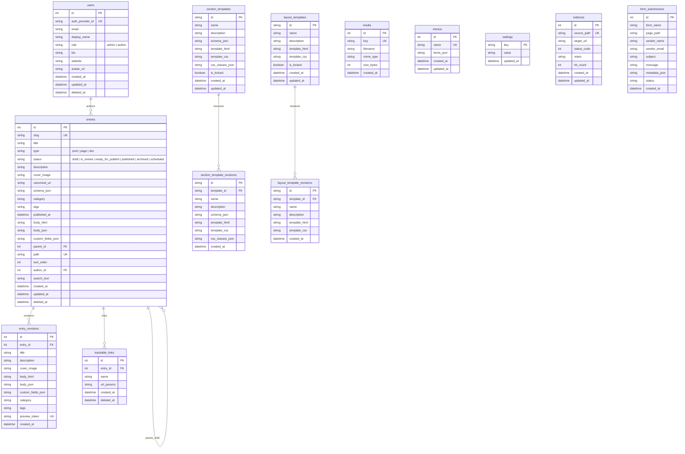

# Core Concepts

Understanding how Zygo CMS structures data and renders content is key to building fast, scalable edge-native websites.

## Data Model Overview

Zygo CMS runs entirely on Cloudflare edge primitives, storing all relational data in Cloudflare D1 (edge SQLite). Below is the complete relational entity-relationship schema reflecting the actual D1 tables and columns:



In addition to standard relational tables, Cloudflare D1 maintains an SQLite FTS5 virtual table (`search_index`) automatically synchronized via SQLite triggers on `entries` (for insert, update, and delete events). This powers instantaneous, edge-evaluated full-text search at `/search` with title, description, and content matching without requiring third-party search indexes.

## Content Types: Posts, Pages, and Docs

All content entries live in the unified `entries` table, categorized by the `type` column:

### Posts (`post`)
- **Use Case:** Blog articles, announcements, news, and chronological publications.
- **Editor:** Rich-text editor powered by TipTap / ProseMirror, tailored for long-form editorial writing. On save, `body_html` stores the server-sanitized HTML (sanitized via the `ammonia` crate in Rust), and `body_json` defaults to `'{}'`.
- **Routing & SEO:** Prefixed with `/post/:slug` (e.g., `/post/hello-world`). Canonical URLs strictly omit trailing slashes.
- **Taxonomy & Metadata:** Supports categories, comma-separated tags, author attribution, custom cover images, and publication scheduling.

### Pages (`page`)
- **Use Case:** Landing pages, company overview, pricing, contact pages, and evergreen site architecture.
- **Editor:** Modular **Section Templates** block builder where editors stack, rearrange, and configure structured sections. On save, `body_json` stores the JSON array of section instances using `type_id`: `[{"type_id": "hero", "data": {...}}, ...]`, while `body_html` is left empty (`""`).
- **Routing & Hierarchy:** Routed directly at root paths (e.g., `/about`, `/pricing`). Supports parent-child hierarchies via `parent_id` (e.g., `/company/careers`) and automatic breadcrumb resolution. Canonical URLs omit trailing slashes except for the homepage root (`/`).

### Docs (`doc`)
- **Use Case:** Product guides, technical documentation, API manuals, and knowledge bases.
- **Editor:** Rich-text TipTap / ProseMirror editor paired with tree navigation. On save, `body_html` stores server-sanitized HTML (sanitized via the `ammonia` crate in Rust), and `body_json` defaults to `'{}'`.
- **Hierarchy:** Deep multi-level hierarchy supported through `parent_id`, `path`, and `sort_order`, powering multi-tier sidebar navigation trees and automatic table-of-contents generation.

## Dual Content Model (`body_html` and `body_json`)

Zygo CMS implements a tailored dual content architecture across all entries to achieve sub-millisecond edge delivery while preserving full dynamic flexibility:

1. **Posts (`post`) & Docs (`doc`):**
   - **Editing:** Authored in the TipTap / ProseMirror rich-text editor in the Admin UI.
   - **Persistence:** On save, the client sends the serialized HTML. The Admin API worker passes this through the Rust `ammonia` HTML sanitization crate, storing the clean HTML in `body_html` and setting `body_json` to `'{}'`.
   - **Edge SSR Delivery:** At SSR time, `public-worker` injects `body_html` directly into the post or doc layout with zero runtime parsing or AST traversals, achieving lightning-fast edge delivery.

2. **Pages (`page`):**
   - **Editing:** Constructed using the modular Section Templates block builder in the Page Editor.
   - **Persistence:** On save, `body_json` stores the JSON array of section instances referencing template identifiers via `type_id` (NOT `template_slug`): `[{"type_id": "hero", "data": {...}}, ...]`. `body_html` is stored as an empty string (`""`).
   - **Edge SSR Delivery & Dynamic Re-rendering:** At SSR time, `public-worker` dynamically evaluates each section instance's `type_id` against the current MiniJinja `section_templates` retrieved from D1 and caches the rendered HTML at the Cloudflare Edge. This architectural separation ensures that editing or polishing a Section Template in `/templates` immediately updates all pages utilizing that template across the entire site without needing to touch or re-save each individual page.

Whenever an entry is saved in the Admin UI or via API, an automatic snapshot is recorded in `entry_revisions`, supporting revision comparison, preview tokens, and instant rollbacks.

## Editorial Workflows & RBAC

Zygo CMS features a multi-stage editorial workflow with role-based access control (RBAC):

- **Workflow Statuses:**
  - `draft`: Work-in-progress content visible only in the Admin panel.
  - `in_review`: Content submitted by authors for editorial inspection and review.
  - `ready_for_publish`: Content reviewed and approved by editors, ready for publication or scheduling.
  - `published`: Content live and publicly accessible via edge SSR routes.
  - `archived`: Decommissioned or withdrawn content, retained in the CMS for audit and historical records.
  - `scheduled`: Content scheduled for automated publishing at a designated future timestamp.
- **Role Permissions:**
  - **Authors:** Can create and edit their own entries. Authors are restricted to transitioning between `draft` and `in_review` ("Submit for Review"). Authors cannot publish, archive, or set status to `ready_for_publish`.
  - **Editors & Admins:** Have full editorial authority across all entries, allowing them to review, approve ("Mark Ready"), publish, or archive content.
- **Status Filtering:** Posts, Pages, and Docs listing views provide dedicated status tabs (`All`, `Published`, `In Review`, `Ready for Publish`, `Draft`, `Archived`) with direct URL synchronization.

## Bulk Content Operations & Trash/Restore

Zygo CMS provides atomic batch operations across content entries via `/api/entries/bulk` and the Admin UI `BulkActionBar`:

- **Batch Actions:** Select multiple entries across Posts, Pages, or Docs to execute batch actions in a single atomic request:
  - `publish`: Sets status to `published` and updates published timestamps.
  - `unpublish`: Reverts published entries back to `draft` status.
  - `trash`: Soft-deletes entries by stamping `deleted_at = CURRENT_TIMESTAMP`, instantly removing them from public SSR routes while preserving their data.
  - `restore`: Recovers soft-deleted entries from the Trash bin by clearing `deleted_at`.
  - `add_tags` & `remove_tags`: Batch modifies comma-separated tags across selected entries without overwriting existing unrelated tags.
- **System Page Protection:** Built-in safeguards strictly prevent accidental deletion or trashing of core system routes, specifically the Home page (`/`) and Docs Home (`/docs`).
- **Hierarchy Guards:** When batch-deleting or trashing pages, the backend verifies parent-child relationships. A page with active children cannot be trashed unless its child pages are also included in the deletion batch or reassigned, preventing orphaned routing trees.

## Section Templates & Layout Templates

Instead of rigid page schemas or fragile CMS plugins, Zygo CMS uses **Section Templates** and **Layout Templates** compiled and evaluated with MiniJinja:

- **Section Templates (`/templates`):** Reusable UI blocks with a defined JSON schema (`schema_json`), MiniJinja HTML (`template_html`), scoped CSS (`template_css`), and CSS class presets (`css_classes_json`). Every save creates a revision snapshot in `section_template_revisions`.
- **Layout Templates (`/templates`):** Global structural layouts for `post`, `page`, and `doc` rendering. Each modification is versioned in `layout_template_revisions`.
- **Client-Side Live Preview:** The Admin UI integrates the `template-wasm` package, executing a compiled WebAssembly build of the Rust MiniJinja rendering engine in the browser to give designers instant zero-latency preview feedback as they edit templates.
- **Zero-Downtime Customization:** Designers can update templates in production without rebuilding or redeploying Cloudflare Worker binaries.

## Media Library & 3-Tier WebP Pipeline

All uploaded assets are managed through the Media Library (`/media`) backed by Cloudflare R2 object storage:

- **Browser-Side Image Optimization (`imageOptimization.ts`):** When uploading raster images (JPEG, PNG, WebP, AVIF), the browser automatically converts the source into 3 WebP dimension tiers:
  - `thumb` (400w): For list views, thumbnails, and compact cards.
  - `md` (1024w): For in-article content and standard layouts.
  - `lg` (2048w): For full-bleed hero banners and high-DPI displays.
- **Atomic Multi-Object R2 Storage:** The upload pipeline atomically saves the tiers to R2 (`<key>__thumb.webp`, `<key>__md.webp`, and the full-resolution file) while writing a single canonical metadata row in the D1 `media` table. A scheduled weekly cron reconciles D1 records with R2 bucket contents to clean up orphaned assets.
- **Edge Variant Resolution:** Public and Admin Worker media endpoints resolve `?size=thumb` and `?size=md` with automatic fallback to the master image if a tier is omitted.
- **TipTap & MiniJinja Integration:** The rich-text editor automatically inserts `?size=md` with explicit sizing attributes (`width="1024" style="max-width: 100%"`). In MiniJinja templates, the `{{ image|media_srcset|safe }}` filter automatically expands media URLs into full responsive `srcset` markup.

## Site Branding & Strict Dual-Mode Logo Synchronization

Global site presentation and identity are managed via the `settings` key-value store and the `themes` table (see [Themes & Dual-Mode Styling](themes.md)):

- **Branding Assets:** Configure `site_logo`, `site_logo_dark`, `site_favicon`, `default_og_image`, `footer_text`, and optional `site_tagline`.
- **Strict Theme-Synchronized Logo Display:** When both light and dark logos are configured, the public SSR worker renders dual logo markup:
  ```html
  
  
  
  
  ```
  Edge CSS rules switch logo visibility based on the active theme mode and visitor toggle overrides (`data-theme="dark"` / `data-theme="light"`), ensuring that logos strictly match the active color scheme without color inversion or mismatch. When no dark theme is active, `.site-logo-dark` remains hidden.

## Redirects & Trackable Links (with QR Codes)

Zygo CMS provides built-in edge routing and campaign tracking utilities:

- **Redirects (`/redirects`):**
  - Configure custom `301 Moved Permanently` and `302 Found` redirects stored in the `redirects` table.
  - Resolved directly at the Cloudflare edge prior to evaluating 404 handlers.
  - Features real-time hit tracking (`hit_count`), redirect loop detection, and aggressive edge caching for 301 rules.
  - Generates downloadable vector/raster QR codes for any redirect rule directly from the Admin UI.
- **Trackable Links:**
  - Authors can configure per-entry UTM and campaign query parameters in the Editor's **Links** tab.
  - Stored in `trackable_links` linked directly to entry records.
  - Built-in QR code generator enables instant creation of scannable print and social media distribution links.

## Menus & Navigation

Zygo CMS provides a built-in menu navigation manager:
- Define distinct menus (e.g., `header`, `footer`) in the `menus` table with structured JSON item hierarchies.
- Supports internal links (Pages, Posts, Docs) as well as external URLs.
- The Public Worker automatically resolves internal links to canonical paths, keeping navigation in sync when entry slugs change.
- Publishing menu modifications automatically invalidates edge HTML caches.

## Native Forms & Submissions Inbox

Lead capture, newsletter registrations, and contact inquiries are handled natively with zero third-party dependencies:
- **Preset Form Templates:** Built-in `contact-form` and `newsletter` Section Templates can be placed onto any Page.
- **Edge Zero-Write Spam Filtering:** The Public Worker enforces strict request size limits (max 64 KB), per-IP rate limiting via Cloudflare Cache API, invisible honeypot verification, and Cloudflare Turnstile token validation before persisting submissions to D1.
- **Submissions Inbox:** Inquiries are stored in the `form_submissions` table and managed directly from the Admin UI at `/submissions` with CSV export, search, and status tracking.

## Cloudflare AI Crawl Control

Zygo CMS includes native integration with Cloudflare Bot Management AI crawl controls, configurable during the Setup Wizard and via Admin UI Settings (`/api/cloudflare/ai-crawl`):

- **Preset Policies:** One-click presets allow site owners to choose their AI scraping posture:
  - `Block All`: Prohibits all automated AI scrapers and crawlers.
  - `Allow AI Search`: Permits citation and search-indexing bots (e.g., Perplexity, OpenAI SearchBot) while disallowing bulk training crawlers.
  - `Allow All`: Unrestricted crawling for all documented AI bots.
- **Granular Rules:** Fine-tune specific protections across `ai_bots_protection`, `ai_search`, `ai_training`, and `ai_user` rules directly from the CMS without having to log into the Cloudflare dashboard.

## AI Agent Parity (WebMCP & `zygo-mcp`)

Zygo CMS is built from the ground up for agentic AI collaboration. Every administrative capability has complete 1:1 parity between human users and autonomous agents:

- **In-Browser WebMCP:**
  - Exposes tools to browser extensions and web models via `window.webmcp` and the emerging W3C `navigator.modelContext` standard.
  - Includes an embedded in-app Assistant Drawer and an interactive RPC Console for inspecting and invoking tools live in the Admin UI.
  - Tools operate within the active browser session, inheriting user authentication, form state, and draft buffers.
- **Standalone CLI MCP Bridge (`packages/zygo-mcp`):**
  - A production-grade MCP server implemented in `packages/zygo-mcp/index.mjs` exposing 37 comprehensive tools.
  - Allows external coding assistants (Claude Desktop, Cursor, Gemini CLI, Antigravity) to manage entries, media, templates, menus, redirects, submissions, and Cloudflare AI settings over standard JSON-RPC.
  - Every tool has strict JSON schema validation, detailed tool metadata, and automated end-to-end Vitest coverage matching the WebMCP implementation.
