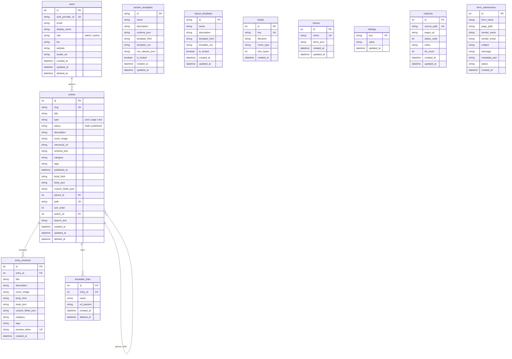

# Core Concepts

Understanding how Zygo CMS structures data and renders content is key to building fast, scalable edge-native websites.

## Data Model Overview

Zygo CMS runs entirely on Cloudflare edge primitives, storing all relational data in Cloudflare D1 (edge SQLite). Below is the complete relational entity-relationship schema reflecting the actual D1 tables and columns:

## Content Types: Posts, Pages, and Docs

All content entries live in the unified `entries` table, categorized by the `type` column:

### Posts (`post`)
- **Use Case:** Blog articles, announcements, news, and chronological publications.
- **Editor:** Rich-text editor powered by TipTap / ProseMirror, tailored for long-form editorial writing. Stores the document AST in `body_json` and pre-rendered sanitized HTML in `body_html`.
- **Routing & SEO:** Prefixed with `/post/:slug` (e.g., `/post/hello-world`). Canonical URLs strictly omit trailing slashes.
- **Taxonomy & Metadata:** Supports categories, comma-separated tags, author attribution, custom cover images, and publication scheduling.

### Pages (`page`)
- **Use Case:** Landing pages, company overview, pricing, contact pages, and evergreen site architecture.
- **Editor:** Modular **Section Templates** block builder where editors stack, rearrange, and configure structured sections. Stores the array of section blocks in `body_json` and compiled HTML in `body_html`.
- **Routing & Hierarchy:** Routed directly at root paths (e.g., `/about`, `/pricing`). Supports parent-child hierarchies via `parent_id` (e.g., `/company/careers`) and automatic breadcrumb resolution. Canonical URLs omit trailing slashes except for the homepage root (`/`).

### Docs (`doc`)
- **Use Case:** Product guides, technical documentation, API manuals, and knowledge bases.
- **Editor:** Rich-text TipTap / ProseMirror editor paired with tree navigation. Stores the document AST in `body_json` and pre-rendered sanitized HTML in `body_html`.
- **Hierarchy:** Deep multi-level hierarchy supported through `parent_id`, `path`, and `sort_order`, powering multi-tier sidebar navigation trees.

## Dual Content Model (`body_html` and `body_json`)

Zygo CMS implements a dual content architecture across all entries to deliver instant edge delivery alongside lossless editor fidelity:

1. **`body_html` (Edge SSR Delivery):**
   - Contains the pre-rendered, server-sanitized HTML ready for direct injection into layouts at edge SSR time.
   - Compiled directly from `body_json` whenever an entry is saved (by evaluating section templates via MiniJinja for Pages, or converting the TipTap / ProseMirror AST to clean, sanitized HTML for Posts and Docs).
   - When visitors navigate to a page, post, or doc, the Public Worker serves `body_html` instantly with zero runtime JSON parsing or AST traversals, achieving sub-millisecond rendering latencies at Cloudflare edge locations worldwide.

2. **`body_json` (Editing & Headless State):**
   - Preserves the lossless, structured data representation tailored to the entry's format:
     - **Pages (`type: "page"`):** A JSON array of Section blocks (`[{"template_slug": "hero", "data": {...}}, ...]`), matching the section template's `schema_json`.
     - **Posts (`type: "post"`) & Docs (`type: "doc"`):** Serialized TipTap / ProseMirror AST JSON (retaining marks, nodes, attributes, and cursor history).
   - Enables headless applications to consume raw structured data and render custom React, Vue, or native mobile components.

When authors save content in the Admin UI or via API, the Admin API worker compiles `body_json` into `body_html` (rendering section templates via MiniJinja or converting TipTap AST to clean HTML), validates and sanitizes the output, and writes both columns atomically to D1 alongside an automatic revision snapshot in `entry_revisions`.

## Section Templates

Instead of fixed page schemas or inflexible CMS plugins, Zygo CMS uses **Section Templates** to build rich, dynamic Pages:

- **Schema Definition:** Each section template defines a JSON schema (`schema_json`) containing typed field specifications (such as `text`, `textarea`, `richtext`, `url`, `image`, `video`, `select`, or `boolean`).
- **MiniJinja Templating:** Paired with each schema is a MiniJinja HTML template (`template_html`) and optional scoped styles (`template_css`).
- **Dynamic Block Assembly:** Authors construct Pages by stacking section blocks in the Page Editor. The editor dynamically generates input forms matching each section's schema.
- **Zero-Downtime Customization:** Section templates are managed directly inside the Admin UI at `/templates`. Developers and designers can create new templates, modify existing MiniJinja HTML markup, update field schemas, and test changes in real time without running database migrations or redeploying worker binaries.

## Menus & Navigation

Zygo CMS provides a built-in menu navigation manager:
- Define distinct menus (e.g., `header`, `footer`) in the `menus` table with structured JSON item hierarchies.
- Supports internal links (Pages, Posts, Docs) as well as external URLs.
- The Public Worker automatically resolves internal links to canonical paths, keeping navigation in sync when entry slugs change.
- Publishing menu modifications automatically invalidates edge HTML caches.

## Media Library

All uploaded assets (images, documents, video clips) are indexed in the `media` table:
- Stored and distributed via Cloudflare R2 object storage with global edge CDN caching.
- Media inserts generate responsive markup (`<picture>` and `<source>` elements with `srcset` and modern formats) for fast mobile rendering.

## Native Forms & Submissions Inbox

Lead capture, newsletter registrations, and contact inquiries are handled natively with zero third-party dependencies:
- **Preset Form Templates:** Built-in `contact-form` and `newsletter` Section Templates can be placed onto any Page.
- **Edge Zero-Write Spam Filtering:** The Public Worker enforces strict request size limits (max 64 KB), per-IP rate limiting via Cloudflare Cache API, invisible honeypot verification, and Cloudflare Turnstile token validation before persisting submissions to D1.
- **Submissions Inbox:** Inquiries are stored in the `form_submissions` table and managed directly from the Admin UI at `/submissions` with CSV export, search, and status tracking.
