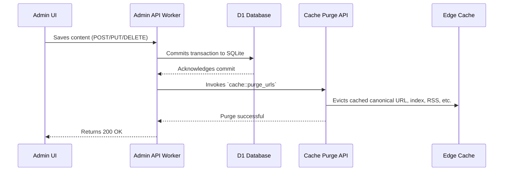

# Deployment Guide

Zygo CMS is designed to be deployed exclusively to Cloudflare's global edge network, leveraging Workers, D1 (SQLite), and aggressive edge caching.

## 1. Before You Begin

Before provisioning resources or deploying, you need to authenticate your local environment and gather a few specific keys from the Cloudflare Dashboard:

1. **Authenticate Wrangler CLI:** Run `npx wrangler login` to authorize your terminal.
2. **Zone ID:** Find the `Zone ID` for your domain on the overview page of your Cloudflare dashboard.
3. **API Token:** Create a Custom API Token.
   - **Worker Runtime Cache Purge:** At runtime, workers only require **Zone:Cache Purge:Edit** permissions to broadcast cache invalidation signals.
   - **Automated Setup Wizard (`pnpm run setup`):** If you plan to use the automated setup wizard to provision DNS records, Zero Trust applications, and worker routes automatically, generate an API token with the following scopes:
     - `Account:Workers Scripts:Edit`
     - `Account:Access: Apps and Policies:Edit`
     - `Account:Access: Organizations, Identity Providers, and Groups:Edit`
     - `Zone:Workers Routes:Edit`
     - `Zone:DNS:Edit`
     - `Zone:Zone:Read`
     - `Zone:Cache Purge:Edit`

Zygo's global caching architecture and dual analytics dashboard require the Zone ID, Account ID, and API Token to broadcast instant cache invalidation signals and query edge/RUM metrics. Add these keys to your `.dev.vars` (for local testing) and your Cloudflare Worker secrets (for production):
- `CF_ZONE_ID`: Cloudflare Zone ID for your domain (powers Edge HTTP request analytics and edge cache purging).
- `CF_ACCOUNT_ID`: Cloudflare Account ID (powers Cloudflare Web Analytics / RUM pageload telemetry via the Cloudflare GraphQL API).
- `CF_API_TOKEN`: Cloudflare API Token with read access for Analytics (`Analytics:Read`) and edit access for cache purging (`Zone:Cache Purge:Edit`).

## 2. Production Provisioning

We provide an interactive setup wizard to automatically provision the required production resources. The Zygo CMS architecture is deployed across a decoupled three-worker system:
1. `packages/public-worker`: Public-facing website (Rust + Minijinja SSR)
2. `packages/admin-api-worker`: Authenticated REST API (Rust + Cloudflare Access + D1 + R2)
3. `packages/admin-ui`: Modern administrative dashboard (React 19 + Radix Themes SPA)

Run the interactive wizard:

```bash
pnpm run setup
# or:
pnpm run wizard
```

During this interactive process, the script will:
- **Provision D1 Databases:** Create the primary SQLite database on Cloudflare's edge (`zygo-cms-db`).
- **Configure R2 Storage:** Set up the `zygo-cms-media` bucket for media assets.
- **Environment Bindings:** Automatically inject the generated `database_id` and configuration into your `wrangler.toml` files across all packages.
- **Custom Domains:** Prompt you to assign custom domains for public routing (e.g., `example.com`), the admin dashboard (e.g., `admin.example.com`), and the API (e.g., `api.example.com`).
- **Zero Trust Integration:** Detect or provision your Cloudflare Zero Trust organization, Access applications, and admin user policies.

### Setup Wizard Capabilities (`scripts/setup.mjs`)

The setup wizard includes robust automation, diagnostic, and rollback features:

- **Preflight Doctor (`--doctor`)**: Run `node scripts/setup.mjs --doctor` to verify Node.js (>= 22), pnpm (>= 11), Rust Wasm target (if applicable), Cloudflare Account ID, and active Zone before modifying files.
- **Automated DNS Conflict Detection**: Automatically checks target hostnames (`public`, `admin`, `api`, and apex) for conflicting `A`, `AAAA`, or `CNAME` records and offers to clean them up while strictly preserving `MX` and `TXT` records (such as email authentication SPF/DKIM/DMARC).
- **Cloudflare Zero Trust & AI Crawl Control**: Automatically detects or provisions your Zero Trust organization (`<team>.cloudflareaccess.com`), enforces `workers_dev = false` across all workers to prevent bypassing edge routing, configures RS256 JWT signature verification (`CF_ACCESS_AUD` and `CF_ACCESS_TEAM_DOMAIN`), and configures Cloudflare AI Crawl Control policies (`block_all`, `allow_search_only`, `custom`, or `disabled`).
- **Non-Interactive & Dry-Run Modes**: Supports `--dry-run` to print the 10-step execution plan without mutating files or remote resources, `--yes` (`-y`) for automated CI/headless provisioning (using `--domain <domain>`, `--email <email>`, etc.), and `--no-deploy` to provision Cloudflare infrastructure without executing an immediate deployment.
- **Atomic Config Rollback & Health Checks**: Snapshots all `wrangler.toml` files and `.env.production` in memory and automatically rolls back on error; verifies live edge endpoints (`HEAD` checks on Public Site, Admin UI, and Admin API `/api/me`) after deployment.

## 3. Database Migrations

Before deploying your workers to production, you must initialize the production database schema. Zygo CMS uses Wrangler's D1 migration system to handle schema changes.

- **Local Development:** Run migrations against the local SQLite state:
  ```bash
  pnpm run db:migrate:local
  ```
- **Production (Remote):** Apply migrations to the remote Cloudflare D1 database:
  ```bash
  pnpm run db:migrate
  ```
  *(or directly: `npx wrangler d1 migrations apply zygo-cms-db --remote -c packages/admin-api-worker/wrangler.toml`)*

**Important Migration Guidelines:**
- **Zero Downtime:** Always design migrations to be backward-compatible (e.g., list explicit column names, never use `SELECT *`).
- **SQLite Limitations:** Cloudflare D1 strictly disallows non-constant defaults in `ALTER TABLE ... ADD COLUMN`. Add columns as nullable first, then backfill data using an `UPDATE` query.

### Seeding Production Content

After applying database migrations, you can optionally seed initial content into your remote Cloudflare D1 database:

- **Official Documentation**: Seed the complete documentation library into the `entries` table:
  ```bash
  pnpm run seed:docs:official -- --remote
  ```
- **Theme Preview Showcase**: Seed default themes, section templates, and the `/theme-preview` demonstration page into the remote `section_templates` and `entries` tables:
  ```bash
  pnpm run seed:theme-preview -- --remote
  ```

## 4. Building and Deploying

Compile the Rust workers to WebAssembly and build the React 19 Admin UI:

```bash
# Verify all tests pass
pnpm run test:all
cargo test

# Build all 3 packages (Rust to Wasm, Vite to static assets)
pnpm run build

# Deploy all 3 workers to Cloudflare
pnpm run deploy
```

You can also deploy individual workers:
```bash
pnpm run deploy:public   # packages/public-worker
pnpm run deploy:api      # packages/admin-api-worker
pnpm run deploy:ui       # packages/admin-ui
```

## Cache Invalidation Architecture

Zygo CMS leverages aggressive edge caching. When you edit content in the Admin UI, the `admin-api-worker` automatically issues internal purge requests to Cloudflare's Cache API. This ensures your users always see the fastest possible response times without viewing stale content. Whenever content is created, updated, or deleted, `cache::purge_urls` is invoked to clear the affected canonical URL, the homepage, RSS feed, and Sitemap.

Key cache invalidation features include:
- **Dual-Host Purging**: Purge requests automatically cover both `www` and apex hosts, guaranteeing that visitors hitting either domain see fresh content.
- **Automated Theme & Template Revalidation**: Updating themes or layout templates automatically recomputes `styles_hash` and purges the entire host so cached pages pick up stylesheet updates immediately without manual intervention.
- **Manual Cache Purge**: Admins can also trigger a full manual cache purge and `styles_hash` rotation anytime via the **Clear Cache** card in **Settings** (`POST /api/cache/clear` or MCP tool `zygo_clear_cache`).


