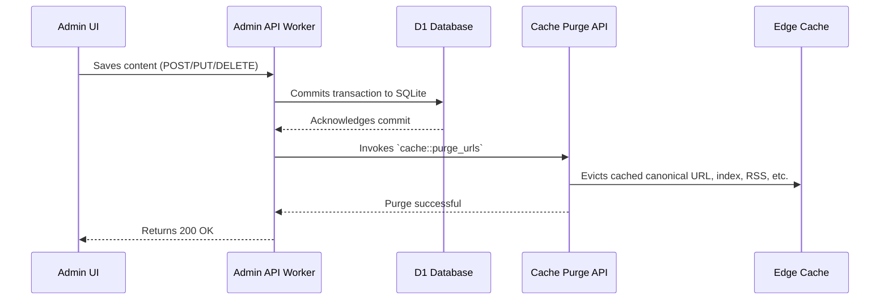

# Deployment Guide

Zygo CMS is designed to be deployed exclusively to Cloudflare's global edge network, leveraging Workers, D1 (SQLite), and aggressive edge caching.

## 1. Before You Begin

Before provisioning resources or deploying, you need to authenticate your local environment and gather a few specific keys from the Cloudflare Dashboard:

1. **Authenticate Wrangler CLI:** Run `npx wrangler login` to authorize your terminal.
2. **Zone ID:** Find the `Zone ID` for your domain on the overview page of your Cloudflare dashboard.
3. **API Token:** Create a Custom API Token with **Zone:Cache Purge:Edit** permissions.

Zygo's global caching architecture requires the Zone ID and API Token to broadcast instant cache invalidation signals to all 300+ data centers whenever you publish or update an article. Add these keys to your `.dev.vars` (for local testing) and your Cloudflare Worker secrets (for production):
- `CF_ZONE_ID`
- `CF_API_TOKEN`

## 2. Production Provisioning

We provide an interactive setup wizard to automatically provision the required production resources. The Zygo CMS architecture is deployed across a decoupled three-worker system:
1. `packages/public-worker`: Public-facing website (Rust + Minijinja SSR)
2. `packages/admin-api-worker`: Authenticated REST API (Rust + Cloudflare Access + D1 + R2)
3. `packages/admin-ui`: Modern administrative dashboard (React 19 + Radix Themes SPA)

Run the interactive wizard:

```bash
pnpm run setup
# or:
pnpm run wizard
```

During this interactive process, the script will:
- **Provision D1 Databases:** Create the primary SQLite database on Cloudflare's edge (`zygo-cms-db`).
- **Configure R2 Storage:** Set up the `zygo-cms-media` bucket for media assets.
- **Environment Bindings:** Automatically inject the generated `database_id` and configuration into your `wrangler.toml` files across all packages.
- **Custom Domains:** Prompt you to assign custom domains for public routing (e.g., `example.com`), the admin dashboard (e.g., `admin.example.com`), and the API (e.g., `api.example.com`).
- **Zero Trust Integration:** Detect or provision your Cloudflare Zero Trust organization, Access applications, and admin user policies.

## 3. Database Migrations

Before deploying your workers to production, you must initialize the production database schema. Zygo CMS uses Wrangler's D1 migration system to handle schema changes.

- **Local Development:** Run migrations against the local SQLite state:
  ```bash
  pnpm run db:migrate:local
  ```
- **Production (Remote):** Apply migrations to the remote Cloudflare D1 database:
  ```bash
  pnpm run db:migrate
  ```
  *(or directly: `npx wrangler d1 migrations apply zygo-cms-db --remote -c packages/admin-api-worker/wrangler.toml`)*

**Important Migration Guidelines:**
- **Zero Downtime:** Always design migrations to be backward-compatible (e.g., list explicit column names, never use `SELECT *`).
- **SQLite Limitations:** Cloudflare D1 strictly disallows non-constant defaults in `ALTER TABLE ... ADD COLUMN`. Add columns as nullable first, then backfill data using an `UPDATE` query.

## 4. Building and Deploying

Compile the Rust workers to WebAssembly and build the React 19 Admin UI:

```bash
# Verify all tests pass
pnpm run test:all
cargo test

# Build all 3 packages (Rust to Wasm, Vite to static assets)
pnpm run build

# Deploy all 3 workers to Cloudflare
pnpm run deploy
```

You can also deploy individual workers:
```bash
pnpm run deploy:public   # packages/public-worker
pnpm run deploy:api      # packages/admin-api-worker
pnpm run deploy:ui       # packages/admin-ui
```

## Cache Invalidation Architecture

Zygo CMS leverages aggressive edge caching. When you edit content in the Admin UI, the `admin-api-worker` automatically issues internal purge requests to Cloudflare's Cache API. This ensures your users always see the fastest possible response times without viewing stale content. Whenever content is created, updated, or deleted, `cache::purge_urls` is invoked to clear the affected canonical URL, the homepage, RSS feed, and Sitemap.


