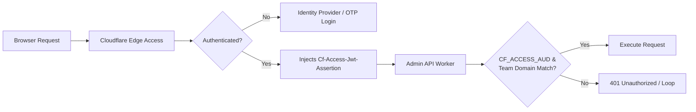

# Troubleshooting FAQ

This guide indexes common errors, environmental pitfalls, and diagnostic procedures encountered when developing and deploying Zygo CMS across macOS, Linux, and Windows.

---

## 1. Database & Persistence Errors

### "Database error: no such table: entries" / SQLite Migration Mismatch

#### Symptom
When accessing `http://localhost:5173` or sending requests to `http://localhost:8787/api/entries`, the worker throws an unhandled SQLite exception:
```text
D1_ERROR: no such table: entries
```
or queries return empty results even after running migrations.

#### Root Cause
Cloudflare Wrangler stores local SQLite state in a persistent directory. By default, running raw Wrangler migration commands without the `--persist-to` flag creates a temporary or disconnected database in `.wrangler/state/v3/d1` that does not align with where `pnpm run dev:api` and `pnpm run dev:public` read state:
```bash
# DO NOT run raw migrations without persist flags:
npx wrangler d1 migrations apply zygo-cms-db --local # ⚠️ Writes to disconnected default state
```

#### Resolution
Always apply local migrations using the root script, which explicitly passes `--persist-to=./.wrangler/state` and binds the admin API worker configuration:

```bash
# Correct: applies all 13+ D1 migrations to the unified local state
pnpm run db:migrate:local
```

Under the hood, this executes:
```bash
wrangler d1 migrations apply zygo-cms-db --local --persist-to=./.wrangler/state -c packages/admin-api-worker/wrangler.toml
```

If your local database state becomes corrupted or out of sync, perform a clean database reset and re-seed:
```bash
# Reset local SQLite tables and reapply migrations from scratch
pnpm run db:reset

# Seed initial official documentation pages into D1
pnpm run seed:docs:official
```

---

## 2. Port Conflicts & Orphaned Processes

Zygo CMS runs a multi-process architecture orchestrated via `pnpm run dev` with `concurrently`:

| Port | Service | Process / Worker | Description |
| :--- | :--- | :--- | :--- |
| **`5173`** | Admin UI | Vite / React 19 SPA | Development server for the CMS administrative dashboard |
| **`8787`** | Admin API Worker | Cloudflare Wrangler / Rust Wasm | Authenticated REST API & media proxy (`packages/admin-api-worker`) |
| **`8788`** | Public Worker | Cloudflare Wrangler / Rust Wasm | Edge SSR site renderer with Minijinja (`packages/public-worker`) |

### Symptom: `EADDRINUSE: address already in use`
When running `pnpm run dev`, one of the services crashes immediately with:
```text
Error: listen EADDRINUSE: address already in use 127.0.0.1:8787
```
or Vite prompts: `Port 5173 is in use, trying another one...` (which breaks CORS and reverse proxy bindings).

#### Resolution: Find and Kill Orphaned Processes

Terminating a `pnpm run dev` session with `Ctrl+C` can occasionally orphan child Wrangler or Vite background processes. Locate and kill the stuck process across your operating system:

#### macOS (Terminal / Zsh)
```bash
# Check what is listening on the port
lsof -i :8787
lsof -i :8788
lsof -i :5173

# Kill a specific stuck process by PID
kill -9 <PID>

# One-liner to kill all Zygo default ports
lsof -ti :8787,8788,5173 | xargs kill -9
```

#### Linux (Ubuntu / Bash)
```bash
# Inspect socket listeners
ss -tulpn | grep -E ':(8787|8788|5173)'

# Or using lsof if installed
lsof -i :8787

# Terminate process
kill -9 <PID>
```

#### Windows 11 (WSL2 Ubuntu)
```bash
# Inside WSL2, ports are shared with the host network
ss -tulpn | grep :8787
kill -9 <PID>
```

#### Windows 11 (Native PowerShell)
```powershell
# Identify the process ID (PID) holding the port
netstat -ano | findstr 8787
netstat -ano | findstr 8788
netstat -ano | findstr 5173

# Force terminate the process using its PID
Stop-Process -Id <PID> -Force
```

---

## 3. Authentication & Access

### Local Development Authentication

#### Symptom: Prompted for password or receiving 401 Unauthorized on localhost
When opening `http://localhost:5173`, the UI shows an unauthorized error or requests login credentials.

#### Explanation
**Zygo CMS has no local password database or username/password table.** In production, identity is delegated to Cloudflare Access at the edge network layer. In local development, the admin API worker inspects the environment variable `ENVIRONMENT`:
- When `ENVIRONMENT=dev`, the authentication middleware (`packages/admin-api-worker/src/auth.rs`) completely bypasses Cloudflare Access JWT validation.
- It automatically mints a mock authenticated session for `admin@localhost` (User ID `admin`, Role `admin`).

#### Resolution
1. Verify that `packages/admin-api-worker/.dev.vars` exists and contains:
   ```ini
   ENVIRONMENT=dev
   ```
2. Restart the development environment:
   ```bash
   pnpm run dev
   ```
3. Open `http://localhost:5173` directly in your browser. You will be authenticated immediately.

---

### Cloudflare Access in Production

In production environments, both `admin.<domain>` and `api.<domain>` are secured behind Cloudflare Access Zero Trust.



#### Symptom 1: Infinite 302 Redirect Loop
When visiting `https://admin.yourdomain.com`, the browser rapidly redirects between `https://admin.yourdomain.com` and `https://<team>.cloudflareaccess.com/cdn-cgi/access/login` until halting with `ERR_TOO_MANY_REDIRECTS`.

- **Cause 1: Mismatched Team Domain.** The `CF_ACCESS_TEAM_DOMAIN` in `packages/admin-api-worker/wrangler.toml` does not match your Zero Trust team name (e.g. `myteam.cloudflareaccess.com` vs `my-team.cloudflareaccess.com`).
- **Cause 2: Access Application Domain Mismatch.** The Access Application is registered for `yourdomain.com/admin` instead of the subdomain `admin.yourdomain.com`.
- **Resolution:**
  1. Go to **Cloudflare One Dashboard** (`one.dash.cloudflare.com`) -> **Settings** -> **Custom Pages / Team Domain** and verify your exact team name.
  2. Ensure `packages/admin-api-worker/wrangler.toml` has:
     ```toml
     [vars]
     CF_ACCESS_TEAM_DOMAIN = "<your-actual-team>.cloudflareaccess.com"
     ```

#### Symptom 2: 401 Unauthorized on `/api/*` (AUD Tag Mismatch)
The Admin UI loads at `https://admin.yourdomain.com`, but all data queries fail with `401 Unauthorized` and the worker console logs:
```text
Security Error: CF_ACCESS_AUD or CF_ACCESS_TEAM_DOMAIN is unconfigured
```
or
```text
JWT validation failed: audience mismatch
```

- **Cause:** Cloudflare Access signs every JWT with an **Application Audience Tag (AUD)** unique to each application. If the API application has AUD `abcdef1234...` but `CF_ACCESS_AUD` in `wrangler.toml` contains an empty string or the AUD of the Admin UI application, the Rust worker rejects the request.
- **Resolution:**
  1. Open Cloudflare Dashboard -> **Zero Trust** -> **Access** -> **Applications**.
  2. Click **Edit** on your **Zygo Admin API** application (`api.yourdomain.com`).
  3. Under **Overview**, copy the 64-character **Application Audience (AUD) Tag**.
  4. Paste it into `packages/admin-api-worker/wrangler.toml`:
     ```toml
     [vars]
     CF_ACCESS_AUD = "your-64-character-aud-string-here"
     ```
  5. Redeploy the API worker:
     ```bash
     pnpm run deploy:api
     ```

---

### Service Tokens for AI Agents & Headless API Access

#### Problem
External AI agents (such as Claude Desktop, Cursor, or automated scripts using the CLI MCP bridge) cannot solve interactive One-Time PIN emails or browser OAuth screens.

#### Resolution
Generate a Cloudflare Access **Service Token** to authenticate headless API clients:

1. **Create the Service Token in Cloudflare Zero Trust:**
   - Navigate to **Access** -> **Service Auth** -> **Service Tokens**.
   - Click **Create Service Token**, name it (e.g., `Zygo-Agent-MCP`), and set a duration.
   - **Save the generated Client ID and Client Secret immediately** (the secret is shown only once).
2. **Authorize the Token on your API Application:**
   - Go to **Access** -> **Applications** -> Edit **Zygo Admin API**.
   - Under **Policies**, add a new policy rule:
     - Action: `Service Auth`
     - Include rule: `Service Token` -> Select `Zygo-Agent-MCP`.
3. **Pass Headers in API / MCP Requests:**
   All automated calls must include:
   ```http
   CF-Access-Client-Id: <your-client-id>
   CF-Access-Client-Secret: <your-client-secret>
   ```
4. **Test the Connection via cURL:**
   ```bash
   curl -I -X GET "https://api.yourdomain.com/api/me" \
     -H "CF-Access-Client-Id: your-client-id.access" \
     -H "CF-Access-Client-Secret: your-client-secret"
   ```
   A properly authenticated request returns HTTP `200 OK`.

---

## 4. Windows 11 & Cross-Platform Considerations

### Strong Recommendation: WSL2 (Windows Subsystem for Linux 2)

If developing on Windows 11, **using WSL2 with Ubuntu 24.04 LTS is strongly recommended** over native Windows NT command line environments.

#### Why WSL2?
1. **Filesystem Performance (The 9P Bridge Penalty):**
   Developing on native Windows with Node.js and Rust compiling through the Windows filesystem (`/mnt/c/Users/...`) incurs an 800%+ compilation time penalty due to 9P filesystem protocol translation between the Linux kernel and the Windows NT kernel.
2. **File Watcher Compatibility:**
   Vite, Cargo, and Wrangler utilize `inotify` for hot-module reloading and file watching. Cross-boundary Windows-to-WSL mounts frequently drop `inotify` events, causing changes not to trigger reloads.
3. **POSIX Script Parity:**
   Monorepo orchestration scripts and CLI utilities operate with native POSIX semantics in WSL2 without requiring Windows batch or PowerShell wrappers.

#### WSL2 Best Practice Setup
```bash
# 1. Install Ubuntu 24.04 in Windows Terminal (PowerShell as Administrator)
wsl --install -d Ubuntu-24.04

# 2. Enter WSL2 and navigate to your Linux user home directory:
cd ~

# 3. Clone the repository INSIDE the Linux root filesystem:
mkdir -p code && cd code
git clone https://github.com/zygodactyl/zygo-cms.git
cd zygo-cms

# 4. Open in VS Code with the WSL extension:
code .
```
> [!IMPORTANT]
> **Always store your repository in the Linux filesystem** (`~/code/zygo-cms` or `/home/<user>/...`), **never** in `/mnt/c/Users/...`.

---

### Native Windows Gotchas (If not using WSL2)

If your organization strictly mandates native Windows development without WSL2:

1. **C-Linker Missing (`link.exe not found`):**
   Compiling Rust WebAssembly crates and native build dependencies requires the MSVC C++ build tools.
   Install via `winget`:
   ```powershell
   winget install Microsoft.VisualStudio.2022.BuildTools --force --override "--passive --add Microsoft.VisualStudio.Workload.VCTools"
   ```
2. **POSIX Shell Script Incompatibilities:**
   Chained commands containing `&&` or `sleep` will fail under CMD. Use PowerShell 7 (`pwsh`), or rely on the cross-platform Node.js runners provided in `package.json` (`node scripts/wait.mjs`).

---

## 5. Rust & WebAssembly (Wasm) Compilation

Zygo CMS compiles its high-performance edge workers (`public-worker` and `admin-api-worker`) from Rust to WebAssembly using Cloudflare's `worker-rs` framework.

### Mandatory Prerequisites
Ensure your Rust toolchain has the Wasm compilation target and build tool installed:

```bash
# Add the WebAssembly compilation target
rustup target add wasm32-unknown-unknown

# Install Cloudflare's worker-build tool
cargo install worker-build
```

### Dealing with `worker-build` Linker Errors

#### On macOS
- **Symptom:** `error: linker 'cc' not found` or compilation fails during native crate dependency resolution.
- **Fix:** Install the Xcode Command Line Tools:
  ```bash
  xcode-select --install
  ```
  If already installed, verify the active developer directory:
  ```bash
  sudo xcode-select --reset
  ```

#### On Linux (Ubuntu / Debian)
- **Symptom:** `error: linker 'cc' not found`, `pkg-config not found`, or OpenSSL linking errors.
- **Fix:** Install the core build tools and development headers:
  ```bash
  sudo apt update && sudo apt install -y build-essential pkg-config libssl-dev
  ```

#### Missing `worker-build` in PATH
- **Symptom:** `sh: worker-build: command not found` during `pnpm run build`.
- **Fix:** Cargo installs binaries to `~/.cargo/bin`. Ensure this directory is in your shell's `PATH`:
  ```bash
  # In ~/.zshrc or ~/.bashrc:
  export PATH="$HOME/.cargo/bin:$PATH"
  ```
  Then reload your shell:
  ```bash
  source ~/.zshrc  # or source ~/.bashrc
  ```

#### Initial Compilation Duration
The first time you run `pnpm run build` or `pnpm run dev`, Rust compiles all crate dependencies (Minijinja, serde, worker-rs) to WebAssembly. This initial build typically takes 60 to 90 seconds. Subsequent compilations utilize target cache artifacts and complete in 2 to 5 seconds.
