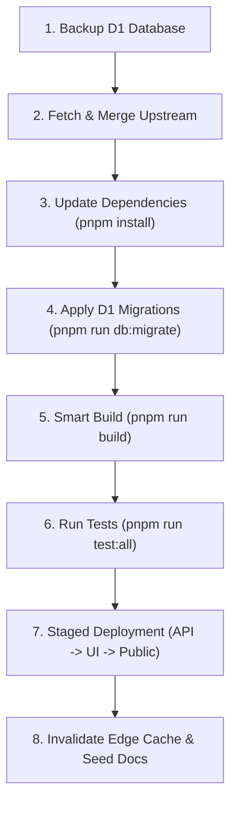
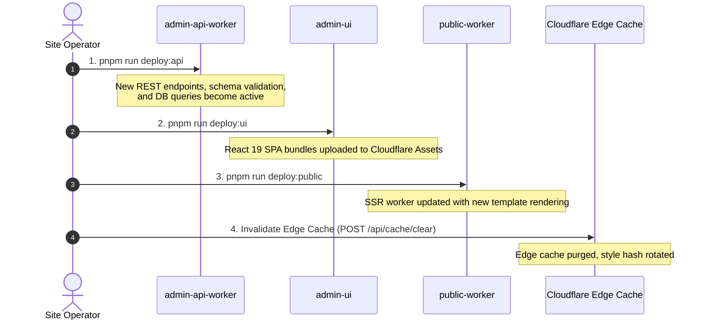
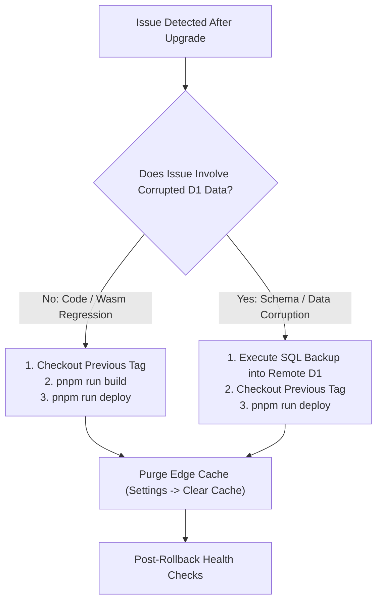

# Upgrade Guide for Self-Hosted Installs

This guide provides a comprehensive, production-grade walkthrough for upgrading self-hosted Zygo CMS installations. Because Zygo CMS runs as a decoupled three-worker system across Cloudflare's edge network with D1 SQLite persistence and R2 media storage, upgrades must be performed methodically to guarantee zero downtime and preserve site configuration.

---

## 1. Overview & Release Model

### Semantic Versioning
Zygo CMS adheres strictly to [Semantic Versioning (SemVer)](https://semver.org/) formatted as `vMAJOR.MINOR.PATCH`:
- **MAJOR (`vX.0.0`)**: Breaking changes across database schemas, REST APIs, or template engine specifications that require careful review of release notes.
- **MINOR (`v0.X.0`)**: Backward-compatible new capabilities, new section templates, additional Admin UI editors, or enhanced WebMCP tools.
- **PATCH (`v0.0.X`)**: Backward-compatible bug fixes, performance optimizations, and security patches.

### Checking Release Notes
Always inspect the release notes before pulling updates:
1. **Repository Changelog**: Review [`CHANGELOG.md`](https://github.com/zygodactylstudios/zygo-cms/blob/main/CHANGELOG.md) for breaking changes, migration highlights, and deprecation notices.
2. **GitHub Releases**: Review tagged GitHub releases for release summaries and compiled artifact checksums.

### Distribution Channels
Zygo CMS supports two distinct distribution models:
- **Zero-Rust Channel (`release` branch)**: Designed for content teams, site owners, and designers. Ships with pre-compiled WebAssembly artifacts for `packages/public-worker`, `packages/admin-api-worker`, and `packages/template-wasm`. Requires only Node.js and pnpm—no Rust toolchain (`cargo`, `wasm-pack`, or `worker-build`) is needed.
- **Source Developer Channel (`main` branch)**: Contains full Rust source code across all worker packages and shared crates (`zygo-core`). Requires an active Rust toolchain (`rustc`, `cargo`, `wasm-pack`, and `worker-build`) for compiling Rust code to WebAssembly target `wasm32-unknown-unknown`.

```mermaid
flowchart TD
    subgraph Upstream["Upstream Repository (zygodactyl/zygo-cms)"]
        M["Branch: main (Rust Source)"]
        R["Branch: release (Pre-compiled Wasm)"]
    end

    subgraph Channels["Distribution Channels"]
        Dev["Source Developer Channel<br/>Compiles Rust to Wasm"]
        Zero["Zero-Rust Channel<br/>Uses Pre-built Wasm"]
    end

    subgraph Production["Self-Hosted Cloudflare Edge"]
        PW["packages/public-worker (SSR)"]
        AW["packages/admin-api-worker (API)"]
        UI["packages/admin-ui (SPA)"]
        D1["Cloudflare D1 (SQLite)"]
    end

    M -->|git fetch & merge main| Dev
    R -->|git fetch & merge release| Zero

    Dev -->|pnpm run build| PW & AW & UI
    Zero -->|pnpm run build (smart runner)| PW & AW & UI

    PW & AW & UI --> Production
    PW & AW --> D1
```

### Pre-Flight Checklist
Before initiating an upgrade, verify your local environment:
- [ ] **Node.js**: Version `>= 24.0.0` (`node --version`)
- [ ] **pnpm**: Version `>= 11.0.0` (`pnpm --version`)
- [ ] **Cloudflare Wrangler CLI**: Authenticated (`npx wrangler whoami`)
- [ ] **Git Working Tree**: Clean working directory with no uncommitted edits (`git status`)
- [ ] **Production Health**: Current site is functioning normally before updating

> [!IMPORTANT]
> Never run an upgrade on a dirty git working tree. Stash or commit local adjustments to ensure merge conflicts can be identified and resolved cleanly.

---

## 2. Pre-Upgrade Preparation & Backups

### Remote D1 Point-in-Time Database Backup
Before modifying any code or applying schema migrations, export a complete snapshot of your production Cloudflare D1 database:

```bash
npx wrangler d1 export zygo-cms-db --remote -c packages/admin-api-worker/wrangler.toml --output backup-$(date +%Y%m%d%H%M%S).sql
```

This generates an atomic SQL dump file containing table definitions and row data. Keep this backup accessible in case an emergency rollback is required.

> [!TIP]
> Verify the integrity of the backup file before proceeding by inspecting the tail of the exported SQL:
> ```bash
> tail -n 20 backup-*.sql
> ```
> Ensure it ends cleanly without truncated statements.

### Preserving Local Worker Configurations
Zygo CMS projects maintain local configuration files containing sensitive bindings unique to your Cloudflare account. **These must not be overwritten or discarded during merges:**

| Configuration File | Critical Local Bindings to Preserve |
| :--- | :--- |
| `packages/admin-api-worker/wrangler.toml` | `database_id`, custom domain `routes`, `CF_ACCESS_AUD`, `CF_ACCESS_TEAM_DOMAIN`, `r2_buckets` name |
| `packages/public-worker/wrangler.toml` | `database_id`, public apex/subdomain `routes`, `r2_buckets` name |
| `packages/admin-ui/wrangler.toml` | Admin dashboard custom domain `routes` |
| `.dev.vars` / Worker Secrets | `CF_ZONE_ID`, `CF_ACCOUNT_ID`, `CF_API_TOKEN`, custom API keys |

> [!WARNING]
> Upstream commits often include placeholder or default values in `wrangler.toml` files. When performing a git merge, inspect diffs for `packages/*/wrangler.toml` to verify your custom domains and `database_id` values remain intact.

---

## 3. Step-by-Step Upgrade Execution

The standard upgrade process consists of eight staged steps:



### Step 1: Fetch and Merge Upstream Updates

Configure your upstream remote if you have not already:
```bash
git remote add upstream https://github.com/zygodactylstudios/zygo-cms.git
```

#### For Zero-Rust Installs (`release` Branch)
Fetch the latest pre-compiled release and merge it into your production deployment branch:
```bash
git fetch upstream release
git merge upstream/release
```

#### For Source Developers (`main` Branch)
Fetch the latest source changes from `main`:
```bash
git fetch upstream main
git merge upstream/main
```

If merge conflicts arise in any `wrangler.toml` file, resolve them by keeping your local `database_id`, Zero Trust application settings, and domain routing blocks intact.

---

### Step 2: Update Package Dependencies
Install updated workspace dependencies and ensure the lockfile is synchronized:

```bash
pnpm install --frozen-lockfile
```

If upstream introduced dependency updates that modified `pnpm-lock.yaml`, run:
```bash
pnpm install
```

---

### Step 3: Apply Remote D1 Database Migrations
Apply pending SQL schema migrations to your production D1 database:

```bash
pnpm run db:migrate
```

Under the hood, this executes:
```bash
wrangler d1 migrations apply zygo-cms-db --remote -c packages/admin-api-worker/wrangler.toml
```

#### Zero-Downtime Expand/Contract Migrations
Cloudflare D1 tracks applied migrations inside an internal metadata table named `d1_migrations`. Zygo CMS follows the **Expand/Contract** database migration pattern:
1. **Expand First**: New columns are added as nullable or with constant defaults, and new tables are created before code deployment.
2. **No `SELECT *`**: All worker queries explicitly enumerate columns (e.g., `SELECT id, title, slug FROM entries`), preventing queries from breaking when schema changes are introduced ahead of worker code rollout.
3. **Safe Forward-Compatibility**: Because existing workers ignore newly expanded columns, running migrations before deploying workers does not cause downtime or runtime errors for concurrent live traffic.

---

### Step 4: Build Packages with the Smart Build Runner
Build all workspace packages using Zygo CMS's smart build runner:

```bash
pnpm run build
```

`scripts/build.mjs` automatically inspects the environment:
- If pre-compiled Wasm artifacts exist in `packages/*/build/` (standard for zero-Rust installs on the `release` branch), it preserves them and compiles the Vite/React Admin UI (`packages/admin-ui/dist`).
- If pre-compiled artifacts are absent and a local Rust toolchain (`cargo`, `worker-build`, `wasm-pack`) is present, it compiles the Rust workers to Wasm automatically.
- Optional explicit flags:
  - `node scripts/build.mjs --skip-rust`: Explicitly bypasses Rust compilation and utilizes pre-compiled bundles.
  - `node scripts/build.mjs --force-rust`: Forces recompilation of all Rust crates regardless of existing pre-built artifacts.

---

### Step 5: Run Verification Tests
Before pushing live changes to Cloudflare's edge network, run the test suite to ensure the build and bindings are healthy:

```bash
pnpm run test:all
```

For source developers with Rust installed, also run native Rust unit and integration tests:
```bash
cargo test
```

---

### Step 6: Staged Zero-Downtime Deployment
Deploy workers in a strictly staged sequence to guarantee high availability and prevent version-skew mismatches between decoupled workers.



Execute the deployments in order:

#### 1. Deploy the Admin API Worker First
Deploy the backend API worker so newly added database queries, REST endpoints, and permissions are live:
```bash
pnpm run deploy:api
```

#### 2. Deploy the Admin UI Next
Upload updated administrative dashboard assets:
```bash
pnpm run deploy:ui
```

#### 3. Deploy the Public Worker Last
Deploy the public SSR worker to begin serving user-facing traffic with the updated templates and engine:
```bash
pnpm run deploy:public
```

> [!TIP]
> If performing an automated or batch deployment where rapid sequential rollout is acceptable, you can deploy all three workers simultaneously using:
> ```bash
> pnpm run deploy
> ```

---

### Step 7: Edge Cache Invalidation & Styles Hash Rotation
Zygo CMS implements aggressive edge caching for public pages and assets. After deploying worker updates, purge stale HTML and rotate the CSS style cache hash so visitors immediately receive the updated stylesheets and templates.

Choose one of the following methods:

#### Method A: Via Admin Dashboard (Recommended)
1. Log in to your Admin UI (`https://admin.<your-domain>`).
2. Navigate to **Settings** in the main sidebar.
3. Click **Clear Cache**.

#### Method B: Via Authenticated REST API
Send an authenticated `POST` request to the cache management endpoint through Cloudflare Access:
```bash
curl -X POST https://api.<your-domain>/api/cache/clear \
  -H "CF-Access-Client-Id: <CLIENT_ID>" \
  -H "CF-Access-Client-Secret: <CLIENT_SECRET>"
```

#### Method C: Via MCP / AI Agent
If managing the CMS through an AI agent connected via Model Context Protocol (`packages/zygo-mcp` or in-browser WebMCP):
- Invoke the `zygo_clear_cache` tool to immediately purge edge caches and rotate the stylesheet hash.

---

### Step 8: Seed Updated Official Documentation into Production D1
Whenever an upgrade introduces new features, CLI commands, or configuration flags, update the database-backed documentation pages served under `/docs`:

```bash
pnpm run seed:docs:official -- --remote
```

This compiles Markdown documentation from `docs/official/` into structured HTML and JSON payloads and inserts them into your production D1 `entries` table.

---

## 4. Post-Upgrade Verification & Health Checks

Verify your deployment across all edge endpoints:

### Automated HTTP Status Checks
Run HTTP head checks against each domain:

```bash
# 1. Verify Public Site SSR (Expect HTTP 200)
curl -I https://<public-domain>

# 2. Verify Admin Dashboard SPA (Expect HTTP 200 or 302 to Cloudflare Access)
curl -I https://<admin-domain>

# 3. Verify Authenticated API Health Endpoint (Expect HTTP 200 or 401/403 without credentials)
curl -I https://<api-domain>/api/me
```

### Live Log Streaming
Stream real-time execution logs from Cloudflare Workers to monitor for unhandled exceptions or database errors during initial traffic:

```bash
npx wrangler tail -c packages/admin-api-worker/wrangler.toml
```

In a second terminal, stream public worker logs:
```bash
npx wrangler tail -c packages/public-worker/wrangler.toml
```

Navigate through your site and admin panel. If any queries fail or tokens are rejected, error logs will appear immediately in the tail output.

---

## 5. Emergency Rollback & Disaster Recovery

If an upgrade causes unanticipated issues or edge errors, execute the following rollback procedures.



### Scenario A: Reverting Worker Code Only
If database schemas remain backward-compatible (thanks to Zygo's expand/contract model), you only need to roll back worker code:

1. **Check out the previous stable release commit or tag:**
   ```bash
   git checkout <previous-stable-tag-or-commit>
   ```

2. **Re-install dependencies and build:**
   ```bash
   pnpm install --frozen-lockfile
   pnpm run build
   ```

3. **Redeploy all workers:**
   ```bash
   pnpm run deploy
   ```

4. **Purge edge cache:**
   Trigger cache clearance via the Admin UI or API to ensure visitors are no longer served cached pages from the rolled-back version.

---

### Scenario B: Restoring Database State (Full Disaster Recovery)
If an upgrade corrupted data or an incompatible schema migration occurred:

1. **Restore D1 database from your pre-upgrade snapshot:**
   ```bash
   npx wrangler d1 execute zygo-cms-db --remote -c packages/admin-api-worker/wrangler.toml --file=backup-<timestamp>.sql
   ```

2. **Check out the previous stable commit:**
   ```bash
   git checkout <previous-stable-tag-or-commit>
   pnpm install
   pnpm run build
   pnpm run deploy
   ```

3. **Re-seed official documentation (if needed):**
   ```bash
   pnpm run seed:docs:official -- --remote
   ```

4. **Purge edge cache:**
   Clear cache through **Settings** -> **Clear Cache** in the Admin UI.

5. **Verify health:**
   Confirm that `curl -I https://<public-domain>` returns HTTP `200` and all site sections load as expected.
