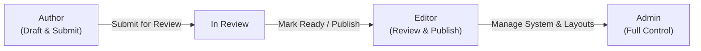
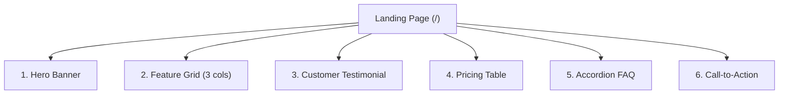
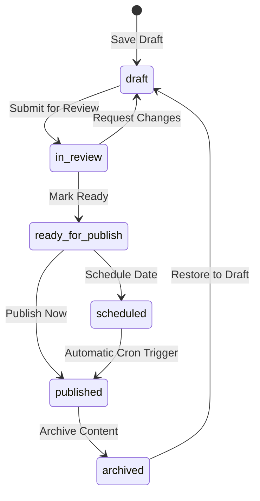
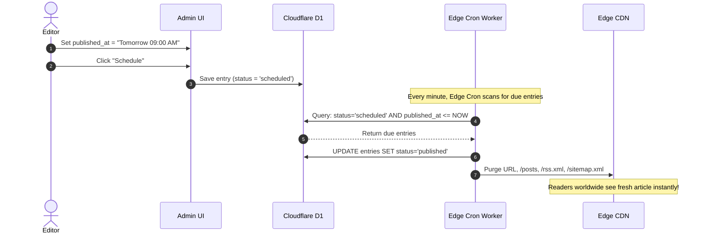

# Author & Editor User Guide

Welcome to the **Zygo CMS Author & Editor User Guide**. This comprehensive guide is designed for writers, editors, content strategists, and marketing teams who create and manage digital experiences on Zygo CMS.

Zygo CMS pairs the speed of modern edge hosting with an intuitive, distraction-free editorial interface. You do not need to write code or understand server administration to craft compelling articles, design modular landing pages, or coordinate complex publication schedules.

---

## Table of Contents

1. [Introduction & Roles Overview](#1-introduction--roles-overview)
2. [Writing Posts and Documentation](#2-writing-posts-and-documentation)
3. [Building Pages with Modular Section Templates](#3-building-pages-with-modular-section-templates)
4. [The Editorial & Review Workflow](#4-the-editorial--review-workflow)
5. [Scheduling Content for Automated Publication](#5-scheduling-content-for-automated-publication)
6. [Media Library & Asset Management](#6-media-library--asset-management)
7. [Helpful Reference & Next Steps](#7-helpful-reference--next-steps)

---

## 1. Introduction & Roles Overview

Zygo CMS uses role-based access control to empower content teams while maintaining editorial standards and brand safety. Every user account belongs to one of three roles: **Author**, **Editor**, or **Admin**.



### Role Responsibilities

| Role | Primary Purpose | What You Can Do | What You Cannot Do |
| :--- | :--- | :--- | :--- |
| **`author`** | Content Creation | Create drafts for posts, docs, and pages; edit own drafts; upload media; submit drafts for review. | Cannot publish directly, cannot mark content ready for publish, cannot archive live content, cannot modify site themes or templates. |
| **`editor`** | Editorial Oversight | Create, edit, and review any content; approve submissions; publish immediately; schedule releases; archive obsolete content. | Cannot alter global system settings, modify locked section templates, or delete admin accounts. |
| **`admin`** | Platform Administration | Full control over all content, users, media, system settings, database backups, themes, and layout templates. | Unrestricted. |

### Permissions Matrix

| Action | Author | Editor | Admin |
| :--- | :---: | :---: | :---: |
| Create new drafts (`post`, `page`, `doc`) | Yes | Yes | Yes |
| Edit own draft entries | Yes | Yes | Yes |
| Edit other users' entries | No | Yes | Yes |
| Save drafts (`Save Draft`) | Yes | Yes | Yes |
| Submit drafts for review (`Submit for Review`) | Yes | Yes | Yes |
| Approve entries (`Mark Ready`) | No | Yes | Yes |
| Publish content immediately (`Publish`) | No | Yes | Yes |
| Schedule publication for a future date | No | Yes | Yes |
| Archive or unpublish live entries (`Archive`) | No | Yes | Yes |
| Upload and manage media assets (`/media`) | Yes | Yes | Yes |
| Configure Themes & Design Tokens (`/theme`) | No | No | Yes |
| Edit Section & Layout Templates (`/templates`) | No | No | Yes |

> [!NOTE]
> If you are logged in as an **Author**, the editor toolbar adapts to your role: buttons for publishing or marking an item ready are hidden, replaced by the amber **Submit for Review** button.

---

## 2. Writing Posts and Documentation

Zygo CMS provides tailored editing experiences depending on whether you are writing dynamic articles or structured documentation.

### Content Types: Posts vs. Docs

- **Posts (`post`)**: Time-sensitive editorial content such as news, thought leadership, product updates, and blog articles.
  - Automatically organized chronologically.
  - Accessible on your live site under the `/post/<slug>` URL prefix.
  - Includes author attribution, publish dates, categories, and tags.
  - Generates entries in public RSS (`/rss.xml`) and Atom feeds.
- **Documentation (`doc`)**: Structured, evergreen guides, user manuals, knowledge base articles, and API references.
  - Organized hierarchically into parent and child documentation trees.
  - Accessible on your live site under the `/docs/<slug>` URL prefix (e.g. [/docs/user-guide](/docs/user-guide)).
  - Supports custom sidebar sort orders for book-style reading navigation.

---

### The TipTap Rich Text Editor

When authoring a **Post** or **Doc**, Zygo CMS loads an ultra-fast, modern TipTap rich-text canvas designed for distraction-free writing.

```
+-----------------------------------------------------------------------------------+
|  [B] [I] [S] [</>] | [H1] [H2] [H3] | [List] [1.] [Quote] | [Link] [Image] | [Undo] [Redo] |
+-----------------------------------------------------------------------------------+
|                                                                                   |
|  Write your narrative here with full typography support...                         |
|                                                                                   |
+-----------------------------------------------------------------------------------+
```

#### Formatting Toolbar Controls

1. **Inline Text Formatting**:
   - **Bold (`B`)**: Emphasize important terms or phrases.
   - **Italic (`I`)**: Add nuance, citations, or titles.
   - **Strikethrough (`S`)**: Mark superseded text or revision ideas.
   - **Inline Code (`</>`)**: Highlight code snippets, keyboard shortcuts, or file names (e.g. `config.json`).
2. **Headings**:
   - **`H1`**: Primary document sections.
   - **`H2`**: Sub-sections and topics.
   - **`H3`**: Sub-topic headings and breakdowns.
3. **Lists and Quotations**:
   - **Bullet List**: Bulleted item lists.
   - **Ordered List (`1.`)**: Sequenced, step-by-step numbered lists.
   - **Blockquote**: Stylized callout quotation blocks with vertical accent borders.
4. **Interactive Media & Navigation**:
   - **Link**: Highlight any text and click the Link button to insert an internal or external URL.
   - **Image**: Open the Media Picker modal to insert optimized assets from your media library.
5. **History**:
   - **Undo / Redo**: Revert or restore recent edits quickly.

#### Markdown Keyboard Shortcuts

You can type naturally without touching the mouse using familiar Markdown shortcuts:

- Type `# ` at the start of a line for a **Heading 1**.
- Type `## ` for a **Heading 2**.
- Type `### ` for a **Heading 3**.
- Type `* ` or `- ` followed by a space to start a **Bullet List**.
- Type `1. ` followed by a space to begin an **Ordered List**.
- Type `> ` followed by a space to start a **Blockquote**.
- Wrap text in backticks (`` `text` ``) to format as **Inline Code**.
- Type `***` or `---` on a blank line to insert a **Horizontal Rule**.

---

### Adding and Managing Metadata

Every post and doc includes a dedicated **Metadata Tab** on the right side of the editor. Metadata governs SEO discoverability, page URLs, search engine indexing, and social media unfurling.

```
+---------------------------------------------------+
| Metadata & SEO Settings                           |
+---------------------------------------------------+
| Status:           [ Draft               v ]       |
| Tags:             [ editorial, product, updates ] |
| Category:         [ Announcements                 ] |
| Cover Image:      [ https://cdn.../hero.webp    ] |
| Meta Description: [ 150-character SEO summary... ] |
| Canonical URL:    [ https://example.com/original ] |
+---------------------------------------------------+
| Search & Social Previews                          |
| - Google Search Snippet Preview                   |
| - Slack Card Unfurl Preview                       |
| - iMessage Rich Card Preview                      |
+---------------------------------------------------+
```

#### Key Metadata Fields

1. **Title & URL Slug**:
   - The title appears as the main heading (`<h1>`) and browser title tag.
   - Zygo CMS automatically generates a clean, URL-safe slug from your title (e.g. `My First Article` becomes `my-first-article`).
   - You can customize the slug manually if you want shorter or keyword-focused URLs.
2. **Cover Image**:
   - Click the image placeholder or paste a media CDN link to assign a hero illustration.
   - Used for social card banners, post archive cards, and RSS feed thumbnails.
3. **Category & Tags**:
   - **Category**: Primary taxonomy topic (e.g. `Product News`, `Guides`, `Company`).
   - **Tags**: Comma-separated descriptors for granular filtering and discovery (e.g. `cloudflare, rust, performance`).
4. **Meta Description**:
   - A concise summary (140–160 characters) explaining what readers will learn.
   - Search engines display this description under your title in search results.
5. **Hierarchy (Docs Only)**:
   - **Parent Document**: Nest this document under an existing page in your table of contents.
   - **Sort Order**: Integer determining position among sibling documents (e.g. `0`, `1`, `2`).

#### Live Social Media & Search Previews

Zygo CMS includes live preview components directly beneath the metadata fields:

- **Google Result Preview**: See your exact blue title link, green path breadcrumb, and meta description as Google searchers will see it.
- **Slack Card Preview**: Test how your cover image, article title, and introductory text unfurl in team Slack channels.
- **iMessage Preview**: Verify that message bubbles display crisp thumbnail artwork and clean page titles on mobile devices.

> [!TIP]
> Keep your title under 60 characters and your meta description under 160 characters so they display cleanly in Google search results without being cut off.

---

## 3. Building Pages with Modular Section Templates

Unlike articles and documentation, **Pages (`page`)** (such as homepages, landing pages, about pages, and service overviews) are built using the **Visual Section Builder**.



Instead of managing a monolithic text body, you assemble pages by stacking, configuring, and reordering pre-designed, responsive section blocks.

---

### The 17 Built-In Section Presets

Zygo CMS includes 17 locked, production-ready section presets engineered for edge-rendered speed and responsive design:

| Preset Identifier | Section Name | Description & Typical Use Case |
| :--- | :--- | :--- |
| **`hero`** | Hero Banner | Full-width or centered hero statement with primary headline, subheadline, call-to-action button, background artwork, or video embed. |
| **`text`** | Narrative Text | Editorial typography block with an optional headline and formatted rich-text narrative. |
| **`text-image`** | Split Text & Image | Two-column split layout pairing persuasive copy with an image (switchable left or right alignment). |
| **`gallery`** | Image Gallery | Multi-column responsive image gallery with optional captions for portfolio showcases. |
| **`image-carousel`** | Image Carousel | Interactive, full-width or carded horizontal slider with navigation arrows and touch swiping. |
| **`call-to-action`** | Call to Action | High-impact conversion strip with compelling heading, explanatory subtext, and a prominent action button. |
| **`feature-grid`** | Feature Grid | Multi-column card layout (2, 3, or 4 columns) with icons, titles, and benefit summaries. |
| **`testimonial`** | Testimonial Quote | Customer endorsement card with quoted copy, reviewer name, company role, and avatar photo. |
| **`faq`** | Accordion FAQ | Expandable questions and answers to resolve common customer inquiries cleanly. |
| **`video-embed`** | Responsive Video | Video player embed supporting YouTube, Vimeo, or MP4 URLs with 16:9 aspect ratio preservation. |
| **`pricing`** | Pricing Table | Multi-tier comparison cards with billing periods, price values, feature bullet points, "Most Popular" highlight badges, and sign-up buttons. |
| **`stats`** | Key Metrics & Stats | Highlight figures and proof points (e.g. `99.9% Uptime`, `50k+ Customers`) to establish immediate credibility. |
| **`logo-cloud`** | Logo Cloud | Monochrome or full-color client, partner, or press logos to boost trust. |
| **`team`** | Team Showcase | Grid of team member profile cards featuring headshot photos, names, titles, and short bios. |
| **`steps`** | Step-by-Step Process | Sequenced cards explaining onboarding, setup, or workflow progression (`Step 1`, `Step 2`, `Step 3`). |
| **`contact-form`** | Contact Inquiry Form | Lead capture form with name, email, subject, phone, and message fields, equipped with anti-spam honeypot protection. |
| **`newsletter`** | Newsletter Subscription | Email opt-in card for audience building, supporting instant feedback and spam suppression. |

---

### Managing and Reordering Sections

In the **Content Tab** of the page editor:

1. **Adding a Section**: Click the **Add Section** dropdown menu at the top or bottom of your section stack, choose any of the 17 presets, and the new section block appears instantly.
2. **Expanding / Collapsing**: Click any section card header to expand its settings or collapse it to keep your view uncluttered.
3. **Reordering Sections**: Use the **Up Arrow** and **Down Arrow** buttons on any section card to shift its position up or down the page.
4. **Deleting a Section**: Click the **Trash** icon to remove a section. Zygo CMS will prompt you for confirmation before deleting.
5. **Configuring Fields**: Each section dynamically exposes the specific controls it requires:
   - **Text inputs**: Headlines, button labels, badge texts.
   - **Textareas**: Explanatory paragraphs and summaries.
   - **Image Selectors**: Browse your Media Library to choose imagery or enter CDN URLs directly.
   - **Booleans / Switches**: Toggles like "Highlight as Featured", "Show Phone Field", or "Dark Background".
   - **Repeatable Subfields**: For sections like `pricing`, `faq`, or `feature-grid`, click **Add Item** to add additional plans, questions, or feature cards.

---

### Live WebAssembly (Wasm) Responsive Preview

To the right of the Section Builder, Zygo CMS provides a **Live WebAssembly Preview Pane**.

```
+------------------------------------+------------------------------------+
| Page Section Builder               | Live WebAssembly Preview           |
|                                    | [ Desktop ] [ Tablet ] [ Mobile ]  |
+------------------------------------+------------------------------------+
| [v] Hero Banner                    | +--------------------------------+ |
|     Headline: Designing Edge CMS   | | Designing Edge CMS             | |
|     Button:   Get Started          | | [ Get Started ]                | |
|                                    | +--------------------------------+ |
| [>] Feature Grid (3 cards)         | | [Fast]   [Edge]   [Secure]     | |
| [>] Accordion FAQ (4 questions)    | |                                | |
+------------------------------------+------------------------------------+
```

- **Instant Zero-Network Rendering**: A background WebAssembly worker compiles your MiniJinja section templates in real time inside your browser. Edits appear immediately as you type.
- **Accurate Theme Styles**: The preview inherits your active site theme tokens, fonts, accent colors, and custom CSS custom properties.
- **Viewport Testing**: Test how your page adapts across desktop screens, tablets, and mobile handsets without needing to publish or deploy to a test environment.

---

## 4. The Editorial & Review Workflow

Zygo CMS provides a structured, 6-state lifecycle for every piece of content to protect editorial quality and prevent premature publishing.



### The 6 Content Lifecycle States

1. **`draft`**: Work-in-progress content. Visible only to logged-in team members inside the Admin UI.
2. **`in_review`**: Submitted by an Author for peer review, fact-checking, or copyediting. Signifies that writing is complete and awaiting approval.
3. **`ready_for_publish`**: Approved by an Editor. All edits, SEO metadata, and assets have been verified; the entry is ready for public release.
4. **`published`**: Live on the public website. Cached globally across Cloudflare edge nodes and included in public sitemaps and feeds.
5. **`scheduled`**: Approved content assigned a future release timestamp. Will automatically go live without manual intervention.
6. **`archived`**: Retired, superseded, or unpublished content. Preserved in database history with all revisions intact, but removed from public routes.

---

### Step-by-Step Editorial Lifecycle

#### Step 1: Draft Creation (`Save Draft`)
An **Author** or **Editor** begins drafting a post, doc, or page. Click **Save Draft** at any time. Changes are saved to Cloudflare D1 with a new revision record.

#### Step 2: Submission for Editorial Check (`Submit for Review`)
When writing is complete, an **Author** clicks **Submit for Review**. The entry status updates to `in_review`. The article now appears with an amber badge in the editorial dashboard, notifying editors that a submission is awaiting review.

#### Step 3: Editorial Approval (`Mark Ready`)
An **Editor** or **Admin** opens the entry from the **In Review** tab. The editor checks:
- Content clarity, tone, and grammar.
- SEO meta description, slug, and tag hygiene.
- Image alt text and accessibility compliance.
- Responsive appearance in the Wasm preview pane.

When satisfied, the editor clicks **Mark Ready**. The entry status advances to `ready_for_publish`.

#### Step 4: Publication (`Publish`)
When the publication window opens, an **Editor** or **Admin** clicks **Publish**. Zygo CMS performs atomic edge updates:
1. Entry status is marked `published`.
2. `published_at` is timestamped.
3. Edge caches are automatically invalidated for the entry's canonical URL, parent listings, RSS feed, and sitemap.
4. The article is immediately live across the globe.

#### Step 5: Archiving Obsolete Content (`Archive`)
When an announcement expires or documentation is replaced, click **Archive**. The entry is instantly removed from public routes and edge caches, while preserving revision history in the CMS should you ever need to restore it.

---

### Revision History & Shareable Preview Tokens

Every time you save an entry in Zygo CMS, an immutable revision is recorded with author metadata and a unique **Preview Token**.

```
Revision #4  |  Nov 10, 2026 14:32  |  Elena Rostova  |  [ View Revision ]  [ Share Preview Link ]
Revision #3  |  Nov 09, 2026 09:15  |  Marcus Vance   |  [ Restore This Version ]
```

#### Sharing Unpublished Content Securely

Need feedback from a guest contributor, client, or executive who does not have a CMS account?

1. In the editor header, locate the **Preview** button.
2. Zygo CMS generates a secure link with a unique cryptographic preview token:
   ```
   https://example.com/preview/ptk_9a8f4c2e1b
   ```
3. Anyone with this link can view the fully rendered, styled page on your public domain.
4. A prominent **Preview Mode** banner appears at the top of the screen to remind reviewers that the content is unpublished.
5. Search engine crawlers are automatically instructed not to index preview URLs, and analytics tracking beacons are disabled.

---

## 5. Scheduling Content for Automated Publication

For product launches, embargoed press releases, or articles scheduled for weekend distribution, Zygo CMS provides fully automated edge scheduling.



### Scheduling an Article Step-by-Step

1. Open the entry in the editor and click the **Metadata Tab**.
2. Locate the **Publication Date & Time (`published_at`)** field.
3. Select the desired publication date and time in your local timezone.
4. Ensure the selected datetime is in the future.
5. Click **Schedule** (or **Save Draft** with status set to `scheduled`).
6. The entry displays a purple **Scheduled** badge in your content dashboard with a countdown to publication.

### How Automated Edge Publication Works

- **No manual intervention required**: You do not need to log into the CMS at the publication hour.
- **Edge Cron Monitoring**: Cloudflare Workers trigger a lightweight cron job at regular intervals.
- **Automated State Transition**: The edge worker executes an atomic SQL query:
  ```sql
  UPDATE entries
  SET status = 'published'
  WHERE status = 'scheduled' AND published_at <= CURRENT_TIMESTAMP
  RETURNING id, slug, path;
  ```
- **Instant Cache Invalidation**: When entries are published, Zygo CMS automatically purges edge caches for the entry path, the main homepage (`/`), the blog archive (`/posts`), the RSS feed (`/rss.xml`), and the search engine sitemap (`/sitemap.xml`).

> [!IMPORTANT]
> Ensure your target datetime is set in the correct timezone. Zygo CMS converts all publication schedules to UTC on the edge, ensuring precision regardless of daylight saving time adjustments.

---

## 6. Media Library & Asset Management

Zygo CMS features a high-performance Media Library accessible directly from the main sidebar at **Media (`/media`)** or via the in-editor **Media Picker Modal**.

```
+-------------------------------------------------------------------------------+
| Media Library                                              [ Upload Media ]   |
+-------------------------------------------------------------------------------+
| Search media... [ Filter: All Assets v ]                                      |
+-------------------------------------------------------------------------------+
| +-------------------+  +-------------------+  +-----------------------------+ |
| | [ Image Preview ] |  | [ Image Preview ] |  | [ Video Preview ] [VIDEO]   | |
| | hero-banner.webp  |  | product-shot.webp |  | background-loop.mp4         | |
| | 120 KB - 1600x900 |  | 85 KB - 800x600   |  | 4.2 MB                      | |
| | [Alt Text: OK]    |  | [Alt Text: NEEDED]|  | [Alt Text: N/A]             | |
| | [Copy CDN] [Trash]|  | [Copy CDN] [Trash]|  | [Copy CDN] [Trash]          | |
| +-------------------+  +-------------------+  +-----------------------------+ |
+-------------------------------------------------------------------------------+
```

---

### Uploading Assets & Size Guidelines

- **Drag and Drop**: Drag files from your desktop directly into the Media Library grid or upload area.
- **File Picker**: Click **Upload Media** to browse your local computer.
- **Supported Formats**:
  - **Raster Images**: JPEG (`.jpg`, `.jpeg`), PNG (`.png`), WebP (`.webp`), AVIF (`.avif`).
  - **Vector Graphics**: SVG (`.svg`).
  - **Video Files**: MP4 (`.mp4`), WebM (`.webm`).
- **Upload Size Limits**:
  - Maximum single file limit: **25 MB**.
  - **Video Advisory**: For background looping videos or product reels, files under **5–10 MB** are strongly recommended to guarantee smooth mobile playback. If you upload a video larger than 10 MB, the CMS will display an advisory prompt before proceeding.

---

### Automatic Client-Side Canvas Optimization

When you upload high-resolution photography straight from cameras, smartphones, or stock websites, the original files are frequently 10 MB to 20 MB with dimensions exceeding 6000 pixels. Serving such large files degrades page speed and inflates bandwidth costs.

Zygo CMS solves this transparently using an in-browser **HTML5 Canvas Optimization Pipeline**:

```mermaid
flowchart TD
    RawFile["Original Photo\n(e.g. 15MB PNG, 6000x4000)"] --> Detect{"Is Raster Image?\n(JPG, PNG, WebP, AVIF)"}
    Detect -->|Yes| Canvas["Browser Canvas Resizing\n(Max Width: 2048px)"]
    Detect -->|No (SVG / Video)| DirectUpload["Direct Upload to R2"]
    Canvas --> WebP["Convert to High-Efficiency WebP\n(Quality: 0.85)"]
    WebP --> Variants["Generate Responsive Variants\n(Medium: 1024px, Thumb: 400px)"]
    Variants --> UploadR2["Upload Optimized WebP (~180KB)\nto Cloudflare R2"]
```

#### What Happens During Optimization

1. **Format Normalization**: The browser reads the image into an HTML5 Canvas and converts it to modern, highly compressed **WebP format**.
2. **Dimension Preservation Without Upscaling**: The image is constrained to a maximum width of **2048 pixels**, preserving the original aspect ratio. Smaller images are never upscaled.
3. **Responsive Variant Creation**:
   - **Large (`lg`)**: Up to 2048px wide (0.85 quality) for crisp full-width banners.
   - **Medium (`md`)**: Up to 1024px wide (0.82 quality) for inline article illustrations.
   - **Thumbnail (`thumb`)**: Up to 400px wide (0.80 quality) for admin previews and post cards.
4. **Massive Bandwidth & Storage Savings**: A 15 MB PNG typically becomes a lightweight ~180 KB WebP file prior to transmission. Uploads complete in seconds even over mobile connections.

---

### Managing Alt Text for Accessibility & SEO

Descriptive alternative text (alt text) is essential for readers using screen readers (WCAG 2.1 AA compliance) and helps search engine crawlers understand image content.

#### How to Add or Edit Alt Text

1. In the Media Library (`/media`), examine the badge on each image card:
   - **Green Badge (`Alt Text`)**: Alt text is present.
   - **Amber Badge (`Missing Alt`)**: Image lacks a description.
2. Click the **Pencil Icon** next to the alt text field on any card.
3. Type a concise, accurate description (e.g. *"Elena Rostova demonstrating the Zygo CMS visual editor on a laptop"*).
4. Click the **Checkmark Icon** to save immediately.

> [!TIP]
> Good alt text describes the function and content of the image. Avoid generic phrases like *"image of a company"* or repeating the file name.

---

### Inserting Media into Content

- **In the TipTap Editor**: Click the **Insert Image** toolbar button. The Media Picker modal opens. Click any existing asset to insert it, or upload a new photo directly within the modal.
- **In Section Fields**: Click the **Choose Image** button next to any section image field (such as Hero Banner artwork or Testimonial avatars) to select an asset.
- **One-Click CDN Copy**: Click the **Copy URL** button on any media card to copy its edge CDN link to your clipboard.

### Asset Housekeeping & Deletion

- **Search**: Use the search bar at the top of the Media Library to filter files by name instantly.
- **Deletion**: Click the **Trash** icon to delete an asset from Cloudflare R2 storage. Zygo CMS will display a confirmation dialog to prevent accidental removal.

---

## 7. Helpful Reference & Next Steps

Congratulations! You now have a complete understanding of how to author, review, schedule, and publish content with Zygo CMS.

For more technical details and styling customization, explore our related guides:

- **[Themes & Dual-Mode Styling](/docs/themes)**: Discover how to switch between presets, configure Google Fonts, and pair light and dark modes.
- **[Core Concepts](/docs/concepts)**: Explore our edge database architecture, Cloudflare D1 tables, and zero-downtime migrations.
- **[Common Examples](/docs/examples)**: Browse copy-paste examples of sections, custom forms, and structured documentation trees.
- **[Quickstart Guide](/docs/quickstart)**: A 5-minute guide to setting up your workspace and launching your first edge publication.
- **[Documentation Introduction](/docs)**: Overview of the official documentation suite.
