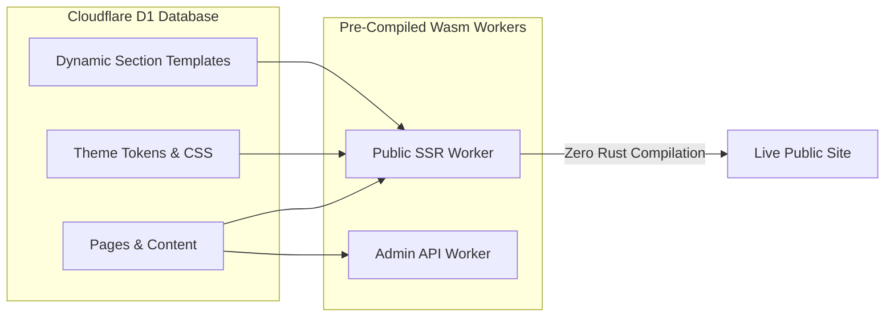
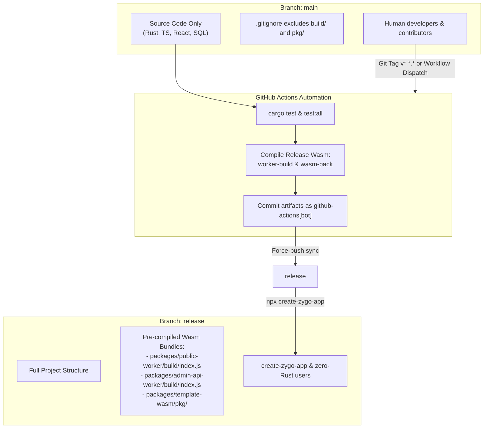

# Pre-Built Wasm Distribution & Dual-Branch Architecture

This guide explains Zygo CMS's pre-built WebAssembly (Wasm) distribution model and dual-branch architecture. It describes how end users can run, customize, build, and deploy Zygo CMS without a Rust toolchain, and how contributors and maintainers build and release the compiled Wasm artifacts.

---

## Overview & Motivation

Zygo CMS's backend services are written in Rust and compiled to WebAssembly running on [Cloudflare Workers](https://workers.cloudflare.com/):
- **`packages/public-worker`**: Public-facing SSR worker powered by [MiniJinja](https://github.com/mitsuhiko/minijinja) with Cloudflare D1 edge caching.
- **`packages/admin-api-worker`**: Authenticated REST API worker handling content, media, revisions, and Cloudflare Access authentication.
- **`packages/template-wasm`**: MiniJinja template rendering engine compiled to WebAssembly for real-time live preview inside the React Admin UI.

### Why Standard Users Do Not Need Rust

In many traditional CMS frameworks, changing templates or styling requires recompiling the server binary. Zygo CMS takes a different approach:
- **Dynamic Templates in D1**: MiniJinja section templates and layouts are stored dynamically in Cloudflare D1 SQLite database records (`section_templates` and `layout_templates` tables).
- **Dynamic Theme Tokens**: Theme tokens, colors, fonts, and typography presets are stored in D1 and rendered at runtime.
- **Dynamic Content**: Pages, blog posts, documentation, and media references are loaded directly from D1 and R2.

Because templates, theme settings, and content are all dynamic and database-backed, standard site owners, designers, and content editors never need to recompile the Rust workers. Zygo CMS distributes pre-compiled WebAssembly bundles so that users only need Node.js and pnpm to run, develop, build, and deploy.



---

## Dual-Branch Architecture

Zygo CMS uses a dual-branch repository strategy to cleanly separate human development source code from distribution-ready compiled binaries:



### 1. `main` Branch (Human Developer Branch)
- Contains source code only (`.rs`, `.ts`, `.tsx`, `.sql`, `.mjs`).
- Build artifacts (`packages/*/build/` and `packages/template-wasm/pkg/`) are strictly gitignored to keep repository history clean and prevent binary merge conflicts.
- Active feature branches, bugfixes, and pull requests target `main`.

### 2. `release` Branch (CI-Managed Distribution Branch)
- Managed exclusively by GitHub Actions automation.
- Automatically updated on semantic version tags (`v*.*.*`) or via manual workflow dispatch.
- Contains the complete project source **plus** pre-compiled WebAssembly release bundles:
  - `packages/public-worker/build/index.js` (and companion `.wasm` asset)
  - `packages/admin-api-worker/build/index.js` (and companion `.wasm` asset)
  - `packages/template-wasm/pkg/` (Wasm bindings for the Admin UI live preview)
- Target branch for `npx create-zygo-app`, giving new users instantaneous setup without compiling Rust.

---

## End User Guide (Zero-Rust Setup)

If you are building a website, designing section templates, configuring themes, or managing content with Zygo CMS, you do not need Rust installed.

### System Requirements
- **Node.js**: v22 or higher
- **pnpm**: v11 or higher
- **Cloudflare Wrangler CLI**: Installed locally or run via `npx wrangler`

### 1. Scaffolding a New Site
Create a new project using the scaffolding CLI:

```bash
npx create-zygo-app my-site
cd my-site
```

`create-zygo-app` automatically clones from the `release` branch, bringing down the pre-compiled WebAssembly binaries along with your project files.

### 2. Local Development
Initialize your local database and start the development environment:

```bash
# 1. Apply local SQLite migrations
pnpm run db:migrate:local

# 2. Start the dev servers
pnpm run dev
```

Cloudflare Wrangler boots the pre-compiled Wasm worker bundles directly in its local workerd runtime:
- **Public Website**: `http://localhost:8788`
- **Admin REST API**: `http://localhost:8787`
- **Admin UI Dashboard**: `http://localhost:5173`

### 3. Building
When you build your application:

```bash
pnpm run build
```

The smart build runner (`scripts/build.mjs`) automatically checks for existing pre-compiled Wasm bundles:
- If pre-compiled Wasm bundles are present in `build/` and `pkg/`, the runner verifies their integrity and proceeds immediately to building the Vite Admin UI.
- No Rust compiler invocation occurs.

### 4. Deploying to Cloudflare
When you are ready to ship to production:

```bash
pnpm run deploy
```

Wrangler packages and uploads the pre-compiled WebAssembly binaries directly to Cloudflare Workers and deploys the Admin UI SPA.

---

## Contributor Guide (Modifying Rust Workers)

If you are developing backend features, altering API routes, modifying database queries, or updating template-wasm logic, you will need a Rust development environment.

### What Requires Rust
You must compile Rust if you modify files in any of the following packages:
- `packages/core/` (shared models, database queries, and validation)
- `packages/public-worker/src/` (SSR routing, caching, and SSR template execution)
- `packages/admin-api-worker/src/` (REST API handlers, auth, R2 upload pipelines)
- `packages/template-wasm/src/` (Rust-based client-side preview rendering)

### Prerequisites for Rust Contributors
Install the Rust toolchain, WebAssembly target, and compilation tools:

```bash
# 1. Install Rust via rustup (if not already installed)
curl --proto '=https' --tlsv1.2 -sSf https://sh.rustup.rs | sh

# 2. Add the 32-bit WebAssembly target
rustup target add wasm32-unknown-unknown

# 3. Install worker-build for Cloudflare Workers
cargo install worker-build

# 4. Install wasm-pack for template-wasm
cargo install wasm-pack
# or: npm install -g wasm-pack
```

### Contributor Build Commands

| Command | Purpose |
| :--- | :--- |
| `pnpm run build:rust` | Compiles `template-wasm` (via `wasm-pack`) and both workers (`worker-build --release`). |
| `pnpm run build:wasm` | Compiles `template-wasm` only into `packages/template-wasm/pkg/`. |
| `node scripts/build.mjs --force-rust` | Forces recompilation of all Rust workers and `template-wasm`, even if pre-built bundles already exist, then builds the UI. |
| `node scripts/build.mjs --skip-rust` | Skips Rust compilation entirely and builds only the Admin UI (fails if pre-built Wasm bundles are missing). |
| `cargo test` | Runs the native Rust unit and integration test suites. |

---

## Maintainer & Release Operator Guide (Cutting a Release)

Maintainers cut official releases to update the `release` branch with newly compiled, optimized WebAssembly binaries.

### How to Cut a Release

#### Method 1: Semantic Version Tag (Recommended)
Pushing a git tag formatted as `v*.*.*` automatically triggers the release workflow:

```bash
# Ensure main is up to date and clean
git checkout main
git pull origin main

# Create and push a semantic version tag
git tag v0.2.0
git push origin v0.2.0
```

#### Method 2: Manual Workflow Dispatch
1. Open the repository on GitHub.
2. Navigate to the **Actions** tab.
3. Select **Build & Publish Release Branch** from the workflows list on the left.
4. Click **Run workflow**, choose the source branch (typically `main`), and confirm.

### What GitHub Actions Does During Release
The CI workflow (`.github/workflows/release.yml`) executes the following steps:
1. **Toolchain Setup**: Installs Rust stable, `wasm32-unknown-unknown`, `worker-build`, and `wasm-pack`.
2. **Quality Gates**: Runs `cargo test` and `pnpm run test:all` to ensure all tests pass.
3. **Compilation**: Runs `pnpm run build:rust` with release optimizations to generate:
   - `packages/public-worker/build/index.js` & `.wasm`
   - `packages/admin-api-worker/build/index.js` & `.wasm`
   - `packages/template-wasm/pkg/`
4. **Git Operations**:
   - Temporarily un-ignores or forces tracking of the compiled `build/` and `pkg/` directories.
   - Checks out the `release` orphan/tracking branch.
   - Commits the updated code and compiled artifacts authored by `github-actions[bot]`.
   - Force-pushes the updated tree to `origin/release`.

### Verifying the `release` Branch Locally
To inspect and verify the published `release` branch:

```bash
git fetch origin release
git checkout origin/release

# Check that pre-compiled worker files exist
ls -la packages/public-worker/build/
ls -la packages/admin-api-worker/build/
ls -la packages/template-wasm/pkg/
```

---

## Troubleshooting & FAQs

### Q: Why do I get "missing pre-built Wasm bundle" during `pnpm run build`?
If you cloned the `main` branch directly (instead of using `npx create-zygo-app` or checking out `release`), the `build/` directories are intentionally not checked into git.
- **Solution A (Install Rust)**: Install Rust, `worker-build`, and `wasm-pack` as described in the Contributor Guide, then run `pnpm run build:rust`.
- **Solution B (Use Release Branch)**: If you do not want to install Rust, use `npx create-zygo-app` to create your project or fetch pre-compiled bundles from the `release` branch.

### Q: How is `.gitignore` handled between `main` and `release`?
On `main`, `.gitignore` contains:
```gitignore
packages/*/build/
packages/template-wasm/pkg/
```
During the automated release workflow on GitHub Actions, the workflow adjusts or overrides `.gitignore` rules specifically for the `release` branch commit so that `packages/public-worker/build/`, `packages/admin-api-worker/build/`, and `packages/template-wasm/pkg/` are committed and tracked in `release` without affecting `main`.

### Q: Does editing templates in the Admin UI require running `pnpm run build`?
No. Section templates are rendered dynamically from Cloudflare D1 by MiniJinja at runtime. Editing, adding, or deleting templates via the Admin UI takes effect immediately without any worker build step.
