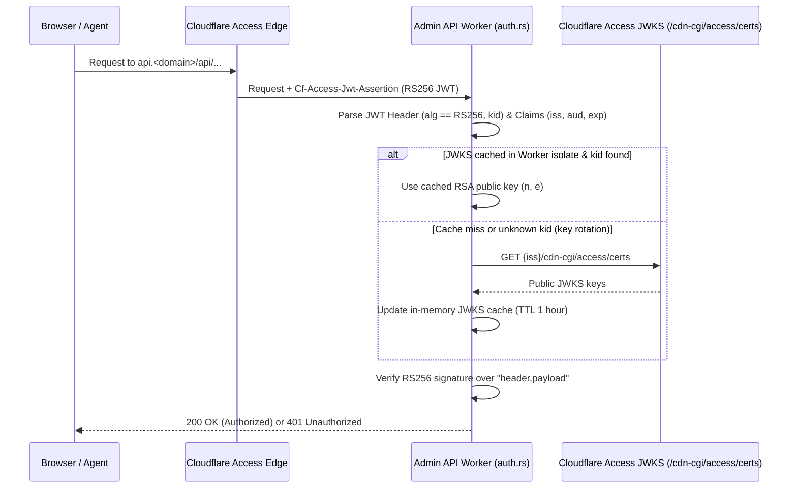

# Zero-Trust Auth Hardening (`workers_dev = false` & RS256 JWT Signature Verification) Spec

## 1. Problem Statement & Motivation

Zygo CMS relies on **Cloudflare Access** to protect `admin.<domain>` and `api.<domain>` at the edge. When a request passes Cloudflare Access, Cloudflare injects the `Cf-Access-Jwt-Assertion` HTTP header containing a signed RS256 JSON Web Token (JWT).

Currently, two defense-in-depth gaps exist:
1. **`.workers.dev` Subdomain Exposure**: Neither [`packages/admin-api-worker/wrangler.toml`](file:///Users/ryan/Code/zygodactyl/zygo-cms/packages/admin-api-worker/wrangler.toml) nor [`packages/admin-ui/wrangler.toml`](file:///Users/ryan/Code/zygodactyl/zygo-cms/packages/admin-ui/wrangler.toml) explicitly sets `workers_dev = false`. If `.workers.dev` subdomains are active on the Cloudflare account, an attacker who discovers `<worker>.<subdomain>.workers.dev` can send requests directly to the worker, bypassing the Custom Domain's Cloudflare Access policy.
2. **Unverified JWT Cryptographic Signature**: [`packages/admin-api-worker/src/auth.rs`](file:///Users/ryan/Code/zygodactyl/zygo-cms/packages/admin-api-worker/src/auth.rs#L77-L116) decodes the base64 JWT payload and checks `exp` and `aud` claims, but **does not verify the RS256 cryptographic signature** against Cloudflare Access's public JSON Web Key Set (JWKS) at `/cdn-cgi/access/certs`. If `.workers.dev` is reachable or `CF_ACCESS_AUD` is unset, an attacker could forge a base64-encoded JWT payload with an arbitrary admin email.

---

## 2. Technical Design & Implementation Plan

### 2.1 Disable `.workers.dev` on Admin Workers (`wrangler.toml` & `setup.mjs`)
1. Add `workers_dev = false` to:
   - [`packages/admin-api-worker/wrangler.toml`](file:///Users/ryan/Code/zygodactyl/zygo-cms/packages/admin-api-worker/wrangler.toml)
   - [`packages/admin-ui/wrangler.toml`](file:///Users/ryan/Code/zygodactyl/zygo-cms/packages/admin-ui/wrangler.toml)
   - [`packages/public-worker/wrangler.toml`](file:///Users/ryan/Code/zygodactyl/zygo-cms/packages/public-worker/wrangler.toml)
2. Ensure [`scripts/setup.mjs`](file:///Users/ryan/Code/zygodactyl/zygo-cms/scripts/setup.mjs) and [`packages/create-zygo-app/index.mjs`](file:///Users/ryan/Code/zygodactyl/zygo-cms/packages/create-zygo-app/index.mjs) preserve `workers_dev = false` when updating routes.
   *(Note: Local development via `wrangler dev` is unaffected by `workers_dev = false`.)*

### 2.2 RS256 Cryptographic Signature Verification (`packages/admin-api-worker/src/auth.rs`)

#### Step-by-Step Verification Flow
1. **Header Validation**:
   - Split `Cf-Access-Jwt-Assertion` into `header_b64.payload_b64.signature_b64`.
   - Decode the JWT header and enforce `alg == "RS256"` and non-empty `kid` (Key ID). Reject `alg: "none"` or symmetric algorithms immediately with `401 Unauthorized`.
2. **Issuer (`iss`) & Certs Endpoint Resolution**:
   - Extract `iss` from the payload (e.g., `https://<team-name>.cloudflareaccess.com`) or read `CF_ACCESS_TEAM_DOMAIN` from `env`.
   - Validate that `iss` strictly matches `https://*.cloudflareaccess.com` to prevent SSRF or rogue JWKS URL injection!
3. **JWKS Fetch & Isolate Caching**:
   - Cache fetched JWK sets (`kid -> (n, e)`) in a thread-safe `Mutex<Option<CachedJwks>>` with a 1-hour TTL.
   - If the token's `kid` is not in the cache (and the cache is older than 60 seconds, to prevent DoS via random `kid` headers), re-fetch `https://<team>.cloudflareaccess.com/cdn-cgi/access/certs`.
4. **RS256 Signature Verification**:
   - Verify the RSA PKCS#1 v1.5 SHA-256 signature (`signature_b64`) over the ASCII bytes of `"{header_b64}.{payload_b64}"` using the JWK's modulus (`n`) and exponent (`e`) (via WebCrypto `SubtleCrypto` or a lightweight Wasm-compatible Rust RSA verifier).
5. **Claims Validation**:
   - Verify `exp` (not expired, with 30s clock-skew tolerance), `nbf` (if present), and `aud` (matching `CF_ACCESS_AUD` when configured).
6. **Automatic `CF_ACCESS_AUD` Provisioning in `setup.mjs`**:
   - When [`scripts/setup.mjs`](file:///Users/ryan/Code/zygodactyl/zygo-cms/scripts/setup.mjs#L574-L575) creates the Cloudflare Access application for `api.<domain>`, capture the returned `aud` tag from the Cloudflare API response and write `CF_ACCESS_AUD` and `CF_ACCESS_TEAM_DOMAIN` into `packages/admin-api-worker/wrangler.toml` `[vars]` automatically.

### 2.3 Unit & Integration Testing
- Add unit tests in `packages/admin-api-worker/src/auth.rs` with a generated test RSA keypair verifying:
  - Valid RS256 signatures pass.
  - Tampered payloads (e.g., modified `email` or `exp` with original signature) fail with `401 Unauthorized`.
  - Wrong `alg` (`HS256` / `none`) or untrusted `iss` domains fail with `401 Unauthorized`.
  - `ENVIRONMENT = "dev"` local development bypass continues to work offline without hitting Cloudflare Access.
