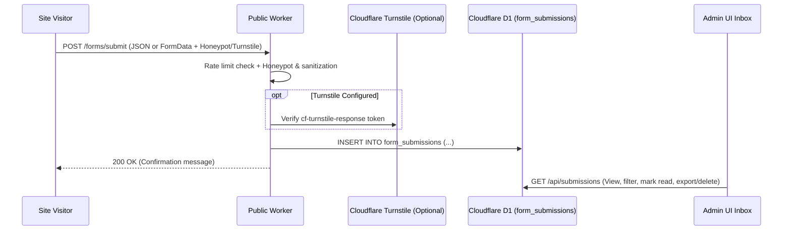

# Native Contact Form Section & D1 Submissions Inbox Spec

## 1. Problem Statement & Motivation

For small businesses, agencies, consultants, and independent creators, **collecting customer inquiries and leads** is one of the primary functions of their website.

Currently, Zygo CMS ships 10 built-in visual page sections (`hero`, `text`, `text-image`, `gallery`, `image-carousel`, `call-to-action`, `feature-grid`, `testimonial`, `faq`, `video-embed`), but has no built-in **Contact Form** section or backend submission storage. Adding a native, spam-protected Contact Form section backed by Cloudflare D1 and an Admin UI Submissions Inbox enables small businesses to launch complete lead-generating websites out of the box with zero third-party SaaS form subscriptions.

---

## 2. Architecture & Design



### 2.1 D1 Database Schema (`form_submissions`)
Add a migration creating the `form_submissions` table:
```sql
CREATE TABLE IF NOT EXISTS form_submissions (
    id INTEGER PRIMARY KEY AUTOINCREMENT,
    form_name TEXT NOT NULL DEFAULT 'contact',
    page_path TEXT,
    sender_name TEXT,
    sender_email TEXT NOT NULL,
    subject TEXT,
    message TEXT NOT NULL,
    metadata_json TEXT DEFAULT '{}',
    status TEXT NOT NULL DEFAULT 'unread', -- 'unread', 'read', 'archived'
    created_at DATETIME DEFAULT CURRENT_TIMESTAMP
);

CREATE INDEX IF NOT EXISTS idx_form_submissions_status ON form_submissions(status);
CREATE INDEX IF NOT EXISTS idx_form_submissions_created_at ON form_submissions(created_at);
```
*(All queries in `zygo-core` must list explicit columns—no `SELECT *`—and structs must derive `#[serde(default)]` and `#[serde(skip_unknown_fields)]`.)*

### 2.2 Built-In `contact-form` Section Template
Seed an 11th built-in section template (`id = 'contact-form'`, `name = 'Contact Form'`):
- **Schema Fields**:
  - `heading` (`text`, required): e.g., `"Get in Touch"`
  - `subheading` (`textarea`, optional): e.g., `"Have a question or project in mind? Send us a message."`
  - `form_name` (`text`, optional): Identifier for filtering in the inbox (default `"Contact"`).
  - `submit_label` (`text`, required): e.g., `"Send Message"`
  - `success_message` (`text`, required): e.g., `"Thank you! Your message has been sent."`
  - `show_subject` (`boolean`, optional): Toggle optional Subject field.
  - `show_phone` (`boolean`, optional): Toggle optional Phone Number field (stored in `metadata_json`).
- **Styling & Accessibility**:
  - Styled using Zygo theme CSS custom properties (`--color-surface`, `--color-border`, `--color-text`, `--color-accent`, `--border-radius`, `--font-body`).
  - Every input has an explicit `<label for="...">`, `required` validation attributes, and an accessible `role="status"` confirmation banner on submission.

### 2.3 Spam Protection & Rate Limiting (`public-worker`)
To protect D1 from spam bots without requiring paid third-party services:
1. **Honeypot Field**: Include a visually hidden, `tabindex="-1" autocomplete="off"` honeypot field (`_gotcha`). If populated, silently return `200 OK` without writing to D1.
2. **IP Rate Limiting**: Enforce an in-memory per-IP rate limit on `POST /forms/submit` (e.g., max 5 submissions per 10 minutes per IP).
3. **Optional Cloudflare Turnstile**: Support an optional `turnstile_site_key` and `turnstile_secret_key` in Settings. When configured, automatically render the free Cloudflare Turnstile widget in the form and verify the token server-side before inserting into D1.

### 2.4 Admin UI Submissions Inbox & Dual MCP Parity
1. **Admin API Endpoints (`admin-api-worker`)**:
   - `GET /api/submissions`: Paginated list of submissions with `?status=` (`unread`, `read`, `archived`), `?form_name=`, and `?q=` search.
   - `PUT /api/submissions/:id`: Update status (`read` / `unread` / `archived`).
   - `DELETE /api/submissions/:id`: Delete a submission.
2. **Admin UI Page (`/submissions` or `/inbox`)**:
   - Table view with unread badge count in the sidebar, status filters, detail drawer/dialog, and CSV export.
3. **WebMCP & `zygo-mcp` Tools**:
   - Register `list_form_submissions`, `update_form_submission_status`, and `delete_form_submission` across both `packages/admin-ui/src/lib/webmcp/` and `packages/zygo-mcp/index.mjs`.
4. **Future Integration Hook**:
   - When the Webhooks or Email Sender roadmap items are implemented, `POST /forms/submit` can automatically trigger an outbound webhook or email notification to the site admin.
