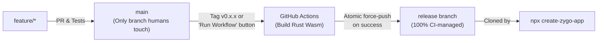

# Pre-Built Wasm Distribution & CI-Managed `release` Branch Spec

## 1. Problem Statement & Motivation

Zygo CMS aims to be **simple to set up and deploy—even for a non-developer**.

Currently, scaffolding and running Zygo CMS via [`packages/create-zygo-app`](file:///Users/ryan/Code/zygodactyl/zygo-cms/packages/create-zygo-app/index.mjs) clones the `main` branch and runs `pnpm run build`, which requires a full local Rust and WebAssembly toolchain:
- `rustup` and `cargo` (plus OS-level C/C++ build tools like Xcode Command Line Tools)
- `wasm32-unknown-unknown` target
- `worker-build` and `wasm-pack`

However, because Zygo CMS now stores all public HTML/CSS templates (`layout_templates` and `section_templates`) and theme tokens dynamically in Cloudflare D1 using **MiniJinja**, end users and site administrators **never need to recompile the Rust workers** to customize, theme, or operate their CMS. Requiring a local Rust compiler creates unnecessary onboarding friction for non-developers while adding zero value for standard deployments.

At the same time, compiling `--release` Rust Wasm artifacts on every pull request or commit to `main` would consume excessive GitHub Actions build minutes and pollute `main` with binary merge conflicts if committed directly.

---

## 2. Chosen Approach: Single Human Branch (`main`) + CI-Managed `release` Branch

We will adopt a **tag/dispatch-triggered, CI-managed `release` branch** workflow:



### Why This Approach Was Selected
1. **Zero Extra Daily CI Build Minutes:** Release Wasm bundles are only compiled and published when explicitly cutting a release (via a `v*` Git tag or manual `workflow_dispatch`), keeping day-to-day PRs fast and inexpensive.
2. **Single Source of Truth for Developers (`main`):** Developers only ever branch from and merge into `main`. Compiled directories (`build/`, `pkg/`) remain `.gitignore`d on `main`, eliminating binary merge conflicts.
3. **Atomic, Guaranteed-Working Distribution (`release`):** Because humans never manually merge into `release` and GitHub Actions only updates `release` *after* all tests and Wasm builds succeed, `npx create-zygo-app` is guaranteed to always pull a verified, pre-compiled snapshot.
4. **Zero-Rust Onboarding for End Users:** Standard users only need Node.js (`npx` / `pnpm`). Local dev (`wrangler dev`) and production deploys (`wrangler deploy`) execute directly against the pre-compiled `build/index.js` Wasm bundles.

---

## 3. Technical Design & Implementation Plan

### 3.1 Pre-Compiled Artifacts Included on `release`
When the release workflow runs, it compiles and force-commits three artifact directories onto the `release` branch:
1. **`packages/public-worker/build/`** — Compiled output of `worker-build --release` for the public SSR worker.
2. **`packages/admin-api-worker/build/`** — Compiled output of `worker-build --release` for the authenticated Admin REST API worker.
3. **`packages/template-wasm/pkg/`** — Compiled output of `wasm-pack` consumed by `packages/admin-ui` for in-browser MiniJinja live previews and validation.

> **Why `admin-ui` is still built locally by the user:**
> Unlike the Rust workers, `packages/admin-ui` injects the user's custom API domain (`VITE_API_BASE_URL=https://api.<domain>`) at build time during `pnpm run setup`. Because `template-wasm/pkg/` is pre-compiled, running `pnpm --filter admin-ui run build` only runs Vite (pure Node.js, ~3 seconds) and requires no Rust tooling.

### 3.2 GitHub Actions Release Workflow (`.github/workflows/release.yml`)
Create a dedicated workflow triggered by:
- Pushing a semantic version tag (`v*.*.*`, e.g., `v0.2.0`)
- Manual trigger (`workflow_dispatch`) in the GitHub Actions UI

**Workflow Steps:**
1. Checkout `main`.
2. Setup Rust (`wasm32-unknown-unknown`), `worker-build`, `wasm-pack`, Node.js, and `pnpm`.
3. Run quality gates (`cargo test --lib`, `pnpm run build:wasm`, `pnpm run build:api`, `pnpm run build:public`, `pnpm test`).
4. Remove `build/` and `pkg/` entries from `.gitignore` (or `git add -f`) for the three pre-built Wasm directories:
   - `packages/public-worker/build`
   - `packages/admin-api-worker/build`
   - `packages/template-wasm/pkg`
5. Commit the build artifacts as a release snapshot and force-push to `origin/release`.
6. *(Optional)* Create a GitHub Release with a downloadable tarball for the version tag.

### 3.3 Build Script Separation (`package.json`)
Currently, root [`package.json`](file:///Users/ryan/Code/zygodactyl/zygo-cms/package.json#L13-L16) defines:
```json
"build": "pnpm run build:api && pnpm run build:public && pnpm run build:ui"
```
To support both non-developers (using pre-built Wasm) and contributors (editing Rust code):
- Add `"build:rust": "pnpm --filter template-wasm run build && pnpm run build:api && pnpm run build:public"`.
- Update `"build"` (or use a small Node helper script `scripts/build.mjs`) to check:
  - If pre-built worker bundles (`packages/public-worker/build/index.js`, `packages/admin-api-worker/build/index.js`, and `packages/template-wasm/pkg`) already exist **and** `cargo`/`worker-build` are not installed (or `--skip-rust` is used), skip Rust compilation and only run `pnpm run build:ui`.
  - If a developer has `cargo` + `worker-build` installed (or runs `pnpm run build:rust`), compile the Rust packages as normal.

### 3.4 `create-zygo-app` Updates (`packages/create-zygo-app/index.mjs`)
1. Change `DEFAULT_BRANCH` in [`packages/create-zygo-app/index.mjs`](file:///Users/ryan/Code/zygodactyl/zygo-cms/packages/create-zygo-app/index.mjs#L12) from `'main'` to `'release'`.
2. Update `COPY_IGNORE_DIRS` in [`packages/create-zygo-app/index.mjs`](file:///Users/ryan/Code/zygodactyl/zygo-cms/packages/create-zygo-app/index.mjs#L44-L54) so that `packages/public-worker/build`, `packages/admin-api-worker/build`, and `packages/template-wasm/pkg` are preserved when scaffolding a new project.
3. Update [`README.md`](file:///Users/ryan/Code/zygodactyl/zygo-cms/README.md) and [`docs/official/quickstart.md`](file:///Users/ryan/Code/zygodactyl/zygo-cms/docs/official/quickstart.md) prerequisites to note that **Rust & Cargo are only required if modifying backend Rust worker code**.

### 3.5 Bonus CI Optimization: Path Filtering on PRs
To further conserve GitHub Actions minutes on [`.github/workflows/deploy.yml`](file:///Users/ryan/Code/zygodactyl/zygo-cms/.github/workflows/deploy.yml), configure path filters on `pull_request` events so that PRs modifying only `packages/admin-ui/**` or `docs/**` skip full worker Wasm compilation when not needed.
