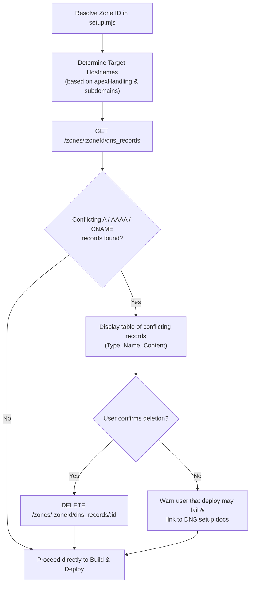

# Setup Wizard DNS Pre-Flight Conflict Check Spec

## 1. Problem Statement & Motivation

Zygo CMS deploys three Cloudflare Workers (`public-worker`, `admin-api-worker`, and `admin-ui`) using **Cloudflare Workers Custom Domains** (`custom_domain = true` in `wrangler.toml`).

When Cloudflare attaches a Worker Custom Domain, it automatically synthesizes internal DNS records and provisions edge TLS certificates. However, **Cloudflare refuses to overwrite pre-existing externally managed `A`, `AAAA`, or `CNAME` DNS records** for those hostnames.

Because domain registrars and Cloudflare onboarding flows frequently create default parked or placeholder DNS records (such as `A @ 192.0.2.1`, `AAAA @ 100::`, or `CNAME www @`), running `pnpm run setup` on a newly registered or migrated domain currently fails at the final `pnpm run deploy` step with:

```text
Error: An externally managed DNS record already exists for this domain
```

For a non-developer, having to open the Cloudflare Dashboard, understand the difference between `A`/`AAAA`/`CNAME` and `MX`/`TXT` records, and manually delete conflicting records (as currently documented in [`docs/domain-and-dns-setup.md`](file:///Users/ryan/Code/zygodactyl/zygo-cms/docs/domain-and-dns-setup.md#L84-L102)) is error-prone and interrupts the automated onboarding flow.

---

## 2. Chosen Approach: Automated Pre-Flight DNS Inspection & Prompted Cleanup in `setup.mjs`

Because [`scripts/setup.mjs`](file:///Users/ryan/Code/zygodactyl/zygo-cms/scripts/setup.mjs#L969) already resolves the user's `zoneId` and authenticates with their Cloudflare API Token before deployment, the setup wizard can proactively inspect the zone's DNS records, detect conflicts for the exact hostnames being deployed, and offer to remove them with explicit user confirmation.



### Why This Approach Was Selected
1. **Eliminates the #1 Deployment Failure Mode:** Catches DNS collisions *before* `wrangler deploy` runs, turning a cryptic terminal failure into a guided 1-click confirmation.
2. **Safe by Design (Zero Risk to Email or Verification Records):**
   - Only inspects `A`, `AAAA`, and `CNAME` record types.
   - Strictly ignores `MX` (email), `TXT` (SPF/DKIM/DMARC/verification), `CAA`, `NS`, and `SRV` records.
   - Ignores existing Cloudflare Worker Custom Domain records (which have `proxiable: false` / internal worker metadata) so re-running `pnpm run setup` on an already-deployed Zygo site does not flag its own active worker routes.
   - Respects the user's chosen `apexHandling` mode: if the user selected `do_nothing` ("Leave Apex untouched, it is used for something else"), the apex domain (`example.com`) is excluded from the conflict check.
3. **Explicit Human-in-the-Loop Confirmation:** Never deletes a DNS record silently. It prints the exact records found (`Type`, `Name`, `Content / Target`) and asks for confirmation via `@clack/prompts` `confirm()`.

---

## 3. Technical Design & Implementation Plan

### 3.1 Target Hostname Resolution
In [`scripts/setup.mjs`](file:///Users/ryan/Code/zygodactyl/zygo-cms/scripts/setup.mjs), compute the list of hostnames that Zygo Workers will claim as Custom Domains:
- Always include:
  - `${config.publicSubdomain}.${config.domain}` (e.g., `www.example.com`)
  - `${config.adminUiSubdomain}.${config.domain}` (e.g., `admin.example.com`)
  - `${config.adminApiSubdomain}.${config.domain}` (e.g., `api.example.com`)
- Conditionally include `${config.domain}` (apex) **unless** `config.apexHandling === 'do_nothing'`.

### 3.2 Querying & Filtering Conflicting Records
Add `findConflictingDnsRecords(zoneId, apiToken, targetHostnames)` in [`scripts/setup.mjs`](file:///Users/ryan/Code/zygodactyl/zygo-cms/scripts/setup.mjs):
1. Call `GET https://api.cloudflare.com/client/v4/zones/${zoneId}/dns_records?per_page=100`.
2. Filter `result` where:
   - ` targetHostnames.includes(record.name.toLowerCase())`
   - `['A', 'AAAA', 'CNAME'].includes(record.type)`
   - Record is not already managed by Cloudflare Workers Custom Domains.

### 3.3 Interactive Prompt & Deletion
If `conflicts.length > 0`:
1. Pause the spinner and print each conflicting record clearly:
   ```text
   ⚠️  Found existing DNS records that conflict with Cloudflare Worker Custom Domains:
     • A      example.com          -> 192.0.2.1
     • CNAME  www.example.com      -> example.com
   (Note: MX and TXT records for email/verification are never touched.)
   ```
2. Prompt via `confirm()`:
   - `message: 'Would you like to delete these conflicting DNS records so Cloudflare Workers can bind to your domains?'`
   - `initialValue: true`
3. If confirmed, iterate through `conflicts` and call:
   - `DELETE https://api.cloudflare.com/client/v4/zones/${zoneId}/dns_records/${record.id}`
4. Log success (`✓ Removed N conflicting DNS record(s)`) or warn gracefully if the API token lacks `Zone > DNS > Edit` permissions.

### 3.4 Unit Test Coverage
Extend the setup script unit tests to verify:
- `findConflictingDnsRecords` accurately matches `A`, `AAAA`, and `CNAME` records on target hostnames while ignoring `MX`, `TXT`, and unrelated subdomains.
- `do_nothing` apex handling excludes the apex domain from conflict detection.
- `deleteDnsRecords` issues `DELETE` requests for each conflicting record ID and handles API errors gracefully.
